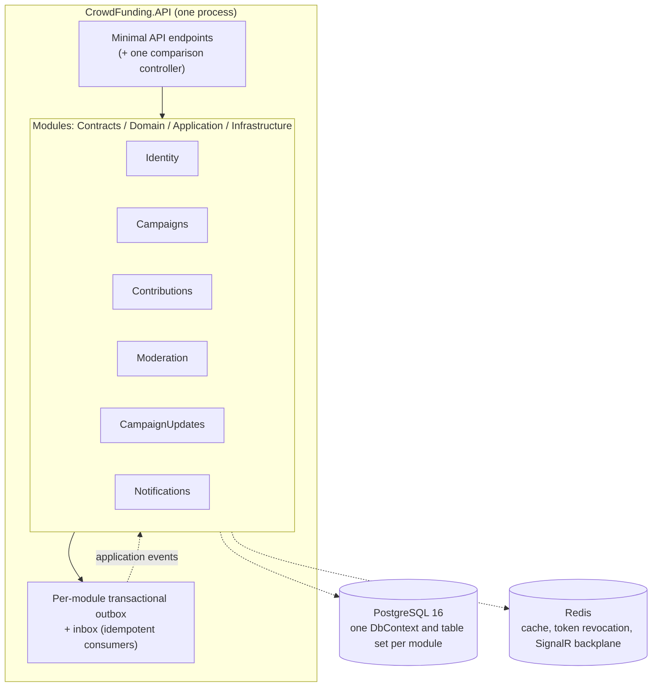

# CrowdFunding Hub: A Clean Architecture Modular Monolith

> **Audience:** senior engineers, tech leads and architects
> **What it is:** a production-grade .NET 10 modular monolith for a crowdfunding platform, built as the reference codebase of a C# Clean Architecture course
> **Core idea:** keep one deployable, but give every module the boundaries (contracts, data ownership, asynchronous integration, offline token validation) it would need to become a service later

---

## 1. Summary

Most microservice migrations fail because the monolith was never built for decomposition: shared tables, cross-module joins, synchronous in-process calls, dual writes, shared secrets. CrowdFunding Hub is a single ASP.NET Core host whose six modules avoid those traps, so the course can study each technique in running, tested code.



Moderation runs as an in-process module on this branch. **Extracting a module into its own service is the upcoming course step**; a working proof-of-concept (standalone Moderation host, JWKS-validated authentication, Strangler Fig compose topology, extraction boundary tests) is preserved on branch `future/microservices-extraction`. The plan for that step is in [`educational/01-architecture-paradigms/monolith-to-microservices-blueprint.md`](educational/01-architecture-paradigms/monolith-to-microservices-blueprint.md) and [`educational/03-engineering-spec-and-roadmap/deconstruction-walkthrough.md`](educational/03-engineering-spec-and-roadmap/deconstruction-walkthrough.md).

---

## 2. The Rules the Codebase Follows

1. **Contracts only across modules.** A module references another module's `Contracts` project (events, queries, a cross-module command), never its Application, Domain or Infrastructure. [`ModuleBoundaryConventionTests`](tests/ArchitectureTests/CrowdFunding.ArchitectureTests/ModuleBoundaryConventionTests.cs) enforces this for every module by convention.
2. **Each module owns its data.** One DbContext, one set of tables and its own migration history per module, no cross-module foreign keys, and a per-module connection string (`ConnectionStrings:{Module}Db`, falling back to `DefaultConnection`) so a module can move to its own database. Tables currently share PostgreSQL's `public` schema; see [`docs/PLATFORM_SHORTCOMINGS.md`](docs/PLATFORM_SHORTCOMINGS.md).
3. **Asynchronous integration through a transactional outbox.** Domain events become application events written in the same transaction as the state change, delivered at least once, and consumed idempotently. See [`docs/outbox-architecture.md`](docs/outbox-architecture.md).
4. **Offline token validation.** Identity signs ES256 JWTs and publishes public keys at `/.well-known/jwks.json`; private keys are encrypted at rest.
5. **Invariants where they cannot be bypassed.** Business rules live in aggregates; money invariants are also enforced by PostgreSQL. See [`docs/append-only-ledger.md`](docs/append-only-ledger.md).
6. **Architecture is tested.** Boundary rules are unit tests that fail the build.

---

## 3. What to Read

| Topic | Where |
| :--- | :--- |
| Architecture, layers, pipelines, libraries | [`docs/ARCHITECTURE_AND_LIBRARIES.md`](docs/ARCHITECTURE_AND_LIBRARIES.md) |
| Outbox, wake-up signal, inbox, tracing across the outbox | [`docs/outbox-architecture.md`](docs/outbox-architecture.md) |
| Append-only funding ledger: database-enforced vs. code-enforced invariants | [`docs/append-only-ledger.md`](docs/append-only-ledger.md) |
| Minimal APIs vs. controllers, side by side | [`docs/minimal-apis-vs-controllers.md`](docs/minimal-apis-vs-controllers.md) |
| Design trade-offs | [`docs/TRADE_OFFS_AND_LIMITATIONS.md`](docs/TRADE_OFFS_AND_LIMITATIONS.md) |
| Known limitations and their fix paths | [`docs/PLATFORM_SHORTCOMINGS.md`](docs/PLATFORM_SHORTCOMINGS.md) |
| Course evaluation of the codebase | [`docs/educational-evaluation.md`](docs/educational-evaluation.md) |
| Course material (paradigms, audits, roadmap, mental models) | [`educational/README.md`](educational/README.md) |
| One use case in three styles (Rosetta Stone sample) | [`src/Samples/RosettaStone/README.md`](src/Samples/RosettaStone/README.md) |
| What changed and what was ported from the sibling backend | [`CHANGELOG.md`](CHANGELOG.md) |
| Conventions for contributors | [`DEV_GUIDELINES.md`](DEV_GUIDELINES.md) |

---

## 4. Technology Stack

| Area | Choice | Why |
| :--- | :--- | :--- |
| Runtime | .NET 10, ASP.NET Core, C# 14 | Minimal APIs, built-in OpenAPI 3.1, rate limiting, `IExceptionHandler`. |
| HTTP API | Minimal APIs with `TypedResults` (one MVC controller kept for comparison) | Thin adapters; the response contract is in the handler signature. |
| Database | PostgreSQL 16, EF Core 10, Npgsql | `FOR UPDATE SKIP LOCKED` outbox claims, advisory locks, `xmin` row versions, triggers and CHECK constraints for ledger invariants. |
| Cache and coordination | Redis | Read-model cache, token revocation list, cache-invalidation pub/sub, SignalR backplane. |
| Validation | FluentValidation in a command pipeline behavior | One place, every dispatch path. |
| Errors | RFC 9457 ProblemDetails | Domain-owned exceptions map to 4xx; nothing internal leaks. |
| Security | ES256 JWT + JWKS, refresh token rotation, AES-256-GCM key encryption | Offline validation, instant revocation, keys safe at rest. |
| Observability | Serilog (compact JSON), OpenTelemetry (OTLP), health checks | Structured logs with trace ids; traces across HTTP, EF Core, Npgsql and the outbox. |
| API documentation | `Microsoft.AspNetCore.OpenApi` + Scalar | Native document generation, XML comments as summaries. |
| Testing | xUnit, Testcontainers (PostgreSQL, Redis, RabbitMQ), reflection-based architecture tests | Real database semantics; boundaries enforced in CI. |
| Packages | Central package management (`Directory.Packages.props`) | One version per package, no suppressed vulnerability warnings. |

---

## 5. Getting Started

### Prerequisites
- [.NET 10 SDK](https://dotnet.microsoft.com/download/dotnet/10.0)
- Docker (local infrastructure and Testcontainers)

### 1. Start the infrastructure
```bash
docker compose up -d
```
Starts PostgreSQL (`localhost:5432`, database `crowdfundingdb`, `postgres/postgres`), Redis (`localhost:6379`) and the .NET Aspire dashboard for OpenTelemetry (UI at `http://localhost:18888`, OTLP on `localhost:4317`).

### 2. Run the API
```bash
dotnet run --project src/API/CrowdFunding.API
```
In `Development` the API applies every module's migrations on startup and exports telemetry to the dashboard. For CI or container init jobs, apply migrations explicitly with `dotnet run --project src/API/CrowdFunding.API -- migrate`. Create the first administrator with `-- seed-admin <email> <password> <displayName>`.

### 3. Explore
- API reference (Scalar): `http://localhost:5076/scalar/v1`
- OpenAPI document: `http://localhost:5076/openapi/v1.json`
- Public signing keys: `http://localhost:5076/.well-known/jwks.json`
- Health: `http://localhost:5076/health/live`, `http://localhost:5076/health/ready`
- Live pledge updates (SignalR): `/hubs/campaigns`

Register with `POST /api/identity/register`, log in with `POST /api/identity/login`, and send `Authorization: Bearer {accessToken}`.

### 4. Run the Rosetta Stone sample (optional)
```bash
dotnet run --project src/Samples/RosettaStone   # http://localhost:5090/scalar/v1
```

### Configuration

| Setting | Purpose |
| :--- | :--- |
| `ConnectionStrings:DefaultConnection`, `ConnectionStrings:{Module}Db` | PostgreSQL; a module-specific string moves that module to its own database. |
| `ConnectionStrings:Redis` | Redis. |
| `Jwt:Issuer`, `Jwt:Audience`, `Jwt:ExpirationMinutes` | Token settings. |
| `SigningKeyEncryption:Key` | **Required.** Base64 32-byte key encrypting the ES256 private keys at rest (`openssl rand -base64 32`). A development-only key is in `appsettings.Development.json`. |
| `PaymentGatewayWebhook:Secret`, `CloudFunctionWebhook:Secret` | HMAC secrets for inbound webhooks. |
| `Cors:AllowedOrigins` | Browser origins allowed to call the API. |
| `ForwardedHeaders:KnownProxies`, `ForwardedHeaders:KnownNetworks` | Reverse proxies trusted for client IP and scheme. |
| `RateLimiting:{Global,Auth,Payment,Webhook}:{PermitLimit,WindowSeconds}` | Rate limits. |
| `Messaging:Provider` | `InProcess` (default) or `RabbitMQ` (publish only; no consumer yet). |
| `OTEL_EXPORTER_OTLP_ENDPOINT` and other `OTEL_*` variables | OpenTelemetry export. |

---

## 6. Tests

```bash
dotnet test CrowdFunding.slnx
```

| Project | Scope | Tests |
| :--- | :--- | :---: |
| `CrowdFunding.UnitTests` | Aggregates, value objects, handlers, pipeline behaviors, exception mapping, signing-key encryption. | 321 |
| `CrowdFunding.ArchitectureTests` | Module boundaries by convention, per-module dependency rules, API host rules. | 26 |
| `CrowdFunding.IntegrationTests` | End-to-end HTTP flows, outbox and inbox, the funding ledger and its migration, edge hardening, OpenAPI, telemetry, against PostgreSQL and Redis in Testcontainers. | 105 |

CI ([`.github/workflows/ci.yml`](.github/workflows/ci.yml)) verifies formatting, builds in Release with warnings as errors, then runs architecture, unit and integration tests.
