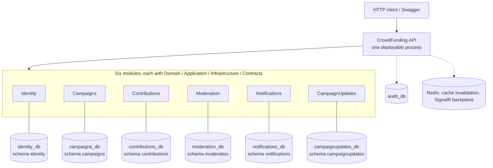
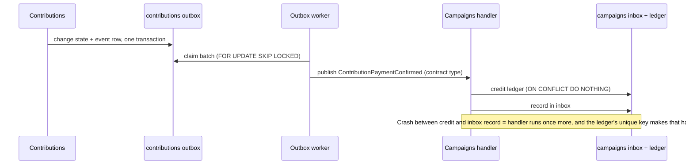
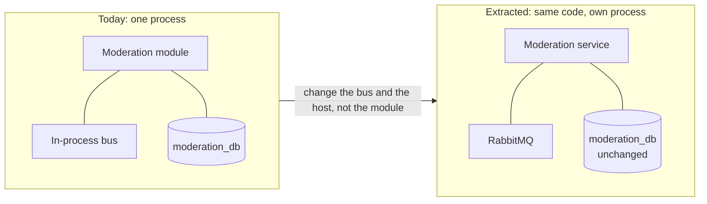
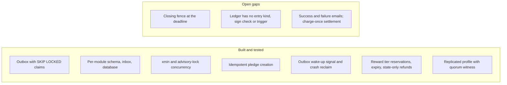
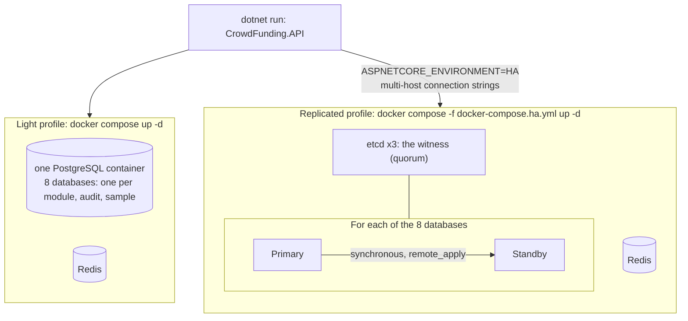
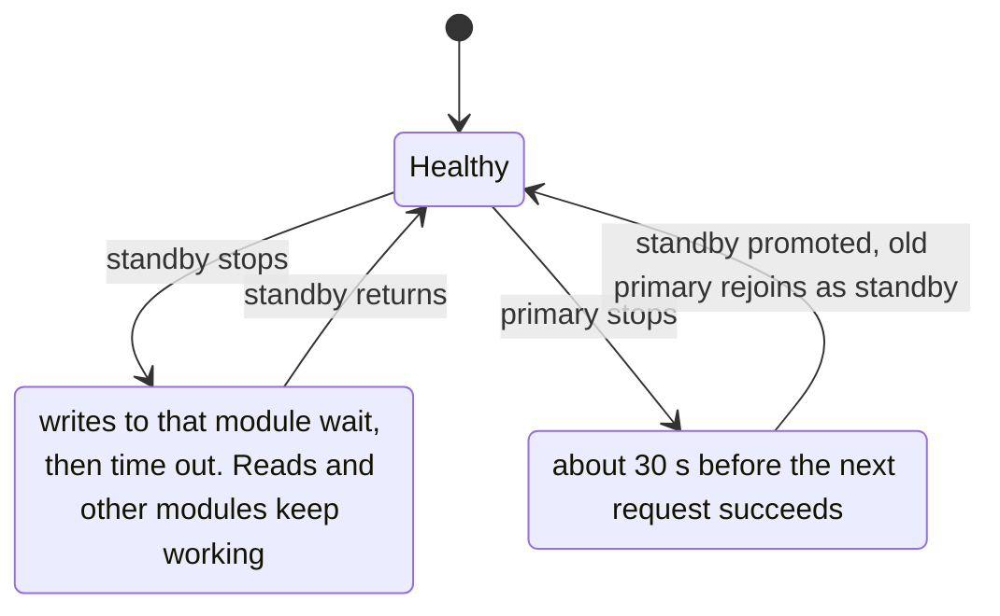

# CrowdFunding Hub: Architectural Reference & Educational Blueprint

> **Curriculum Target:** Principal Engineers, Enterprise Software Architects, Tech Leads  
> **Core Architectural Paradigm:** Modular Monolith Designed for Frictionless Microservices Decomposition  
> **Primary Philosophy:** *The outcome of this project is not to run microservices, but to build a clean, unified Modular Monolith engineered with the strict architectural boundaries, data isolation, and cryptographic decoupling required to turn any module into a microservice at will—with zero rewrites of business logic.*

---

## Run it on your machine (backend only)

Needs the .NET 10 SDK and a Docker-compatible runtime. Docker Desktop works; so does [Colima](https://github.com/abiosoft/colima) (`brew install colima docker docker-compose`, then `colima start`).

```bash
docker compose up -d          # PostgreSQL with one database per module, plus Redis
dotnet run --project src/API/CrowdFunding.API
```

Each module connects to its own database (`identity_db`, `campaigns_db`, ...) and applies its own migrations at startup. If port 5432 or 6379 is taken, set `CF_PG_PORT` / `CF_REDIS_PORT` and override the matching `ConnectionStrings__*` settings.

Integration tests start their own databases with Testcontainers. With Colima, export `DOCKER_HOST=unix://$HOME/.colima/default/docker.sock` and `TESTCONTAINERS_DOCKER_SOCKET_OVERRIDE=/var/run/docker.sock` first.

### Replicated profile (two nodes per module, quorum witness)

```bash
colima start --memory 8                              # Colima only; Docker Desktop: give it 8 GB
docker compose -f docker-compose.ha.yml up -d        # 16 database nodes + 3 etcd witnesses + Redis (~3.5 GB, 2-3 minutes to settle)
ASPNETCORE_ENVIRONMENT=HA dotnet run --project src/API/CrowdFunding.API -- migrate
ASPNETCORE_ENVIRONMENT=HA dotnet run --project src/API/CrowdFunding.API
```

Every module database is a primary plus a synchronous standby (`synchronous_commit = remote_apply`, strict mode), and the etcd group decides who may be primary. If the standby is down, writes to that module wait instead of being accepted unreplicated. See `docs/LOCAL_DISTRIBUTION_AND_HA_PLAN.md` and `docs/TESTS_THAT_TEACH.md` for the drills.


## 1. Executive Summary & Project Goal

Most microservices migrations fail not because distributed systems are inherently flawed, but because **the monolith was never architected for decomposition**. When organizations attempt to break apart a typical legacy monolith, they encounter shared database tables, cross-schema SQL joins, synchronous in-process query coupling, dual-write state corruption, and symmetric secret sprawl.

`CrowdFundingHub` is a production-grade educational benchmark showing how to build a **Modular Monolith** that avoids these traps from day one.

### The system today



### How modules talk without sharing tables



### From module to microservice



The extraction is demonstrated in [`services/CrowdFunding.Moderation.Service`](./services/CrowdFunding.Moderation.Service/README.md).

---

## 2. The 6 Non-Negotiable Rules of Decomposition-Ready Architecture

Every line of code in this repository adheres to 6 core architectural guardrails:

1. **Contract Assembly Isolation:** Modules communicate *exclusively* through lightweight `*.Contracts` assemblies containing DTOs, query definitions, and integration events. Modules never reference another module's `Application`, `Domain`, or `Infrastructure` layers.
2. **PostgreSQL Schema Isolation:** Every one of the six modules owns a PostgreSQL schema (`identity`, `campaigns`, `contributions`, `moderation`, `notifications`, `campaignupdates`) and its own EF Core migrations history table inside it. `ModuleSchemaRulesTests` checks this against a real database. The local stack goes one step further: one database per module.
3. **Zero Cross-Schema Foreign Keys:** Cross-module references are primitive identifiers (`Guid CampaignId`), never database-level foreign key constraints. Data integrity is enforced via application invariants and eventual consistency sagas.
4. **Transactional Outbox for Boundary Traversal:** Local database transactions write business events atomically into the module's own outbox table, eliminating distributed dual-write hazards. Consumers record what they have handled in a per-module inbox table, so a redelivered event is not handled twice (the record is written after the handler, so one crash window remains; see `docs/TESTS_THAT_TEACH.md`).
5. **Decentralized Authentication (Asymmetric ES256 / JWKS):** Identity generates private ECDSA keys and exposes public keys at `/.well-known/jwks.json`. Consuming modules and future microservices validate JWTs offline without calling back to Identity.
6. **Automated Architecture Tests (assembly-reference checks):** Build-time unit tests enforce that the API host and external modules never violate clean architecture boundaries or directly reference internal domains.

---

## 3. Educational Curriculum Directory

A master curriculum suite is published under [`educational/`](./educational/README.md) for software architects:

### [01. Architecture Paradigms](./educational/01-architecture-paradigms/)
- **[`poly-pattern-architecture.md`](./educational/01-architecture-paradigms/poly-pattern-architecture.md)**: Architectural Pragmatism vs. Dogmatism. Why homogeneous architecture is an anti-pattern. Applied to the real modules in [`docs/POLY_PATTERN_TIER_ASSIGNMENT.md`](./docs/POLY_PATTERN_TIER_ASSIGNMENT.md): three tiers, chosen by two questions (does another module need to react reliably? can concurrent writes corrupt the data?).
- **[`monolith-to-microservices-blueprint.md`](./educational/01-architecture-paradigms/monolith-to-microservices-blueprint.md)**: The definitive architectural blueprint for zero-rewrite microservice extraction and the Strangler Fig pattern.
- **[`justifying-the-outbox-and-complex-crud.md`](./educational/01-architecture-paradigms/justifying-the-outbox-and-complex-crud.md)**: Real-world external integrations (SendGrid email, AWS Lambda / Cloud Function AI moderation, Stripe payment intents, limited perk inventory reservation) proving why the Outbox pattern and rich DDD are mathematically mandatory.

### [02. Gap Analysis & Architectural Trade-offs](./educational/02-gap-analysis-and-tradeoffs/)
- **[`over-engineering-audit.md`](./educational/02-gap-analysis-and-tradeoffs/over-engineering-audit.md)**: Where did we go too far? An unsparing audit of accidental complexity: the 14-file pipeline for basic inserts, project explosion, and triple-mapping ceremonies.
- **[`under-engineering-audit.md`](./educational/02-gap-analysis-and-tradeoffs/under-engineering-audit.md)**: Where didn't we go far enough? Hidden microservice decomposition roadblocks: synchronous query coupling (`ICampaignContributionAvailabilityReader`), centralized outbox poller coupling, and connection pool starvation.

### [03. Engineering Specifications & Roadmap](./educational/03-engineering-spec-and-roadmap/)
- **[`transformation-spec.md`](./educational/03-engineering-spec-and-roadmap/transformation-spec.md)**: Sprint-ready engineering specification to evolve the codebase into the benchmark educational reference (Epics 1–5).
- **[`deconstruction-walkthrough.md`](./educational/03-engineering-spec-and-roadmap/deconstruction-walkthrough.md)**: Step-by-step operational runbook demonstrating how to extract `Moderation` into a standalone Docker microservice with **zero lines of domain logic rewritten**.

### [04. Architect's Gold Notes](./educational/04-architect-gold-notes/)
- **[`key-mental-models-for-students.md`](./educational/04-architect-gold-notes/key-mental-models-for-students.md)**: Timeless architectural mental models, the Dual-Write Failure sequence diagram, and the 10 Commandments of Decomposition-Ready Architecture.

---

## 4. What Is Built, What Is Not

The design says more than the code does in a few places. [`design-to-code-mapping-round1.md`](./educational/03-engineering-spec-and-roadmap/design-to-code-mapping-round1.md) lists every step as MATCHES, SIMPLER VARIANT or NOT BUILT, with the test that guards it.



The open gaps are also listed in [`docs/TESTS_THAT_TEACH.md`](./docs/TESTS_THAT_TEACH.md). Historical ticket text lived in a `qa-tickets/` folder that is not part of this repository.

---

## 5. Technology Stack & Design Decisions

| Category | Technology | Architectural Rationale & Problem Solved |
| :--- | :--- | :--- |
| **Framework** | .NET 10 / ASP.NET Core | High-throughput async runtime with C# 14 records and pattern matching. |
| **Database** | PostgreSQL 16 + `Npgsql` | Schema-per-module isolation, `FOR UPDATE SKIP LOCKED` outbox claims, and `xmin` optimistic concurrency tokens. |
| **Replication** | Patroni (Spilo image) + etcd witness | Optional profile: a primary and a synchronous standby per module database, failover decided by a three-member etcd group. Infrastructure only; the application stays .NET. |
| **ORM** | Entity Framework Core 10 | Independent `DbContext` per module with isolated migration history tables. |
| **Mapping** | Mapster | High-performance compiled IL object mapping avoiding AutoMapper runtime reflection tax. |
| **Validation** | FluentValidation | Expressive, strongly typed command validation separated from HTTP controllers. |
| **Security** | Asymmetric ES256 ECDSA | Elliptic-curve JWT signing with RFC 7517 JWKS endpoint for offline signature verification. |
| **Testing** | xUnit, Testcontainers, assembly-reference architecture tests | Ephemeral PostgreSQL containers for real database integration testing, plus build-time architectural dependency enforcement. See [`docs/TESTS_THAT_TEACH.md`](./docs/TESTS_THAT_TEACH.md). |

---

---

## 6. Run It, Test It, Break It

The run instructions are at the top of this file. This section shows what you get and how the pieces connect.





The consistency-first rule (a write is acknowledged only after the standby has applied it) and the drills behind these diagrams are written up in [`docs/LOCAL_DISTRIBUTION_AND_HA_PLAN.md`](./docs/LOCAL_DISTRIBUTION_AND_HA_PLAN.md) and [`docs/TESTS_THAT_TEACH.md`](./docs/TESTS_THAT_TEACH.md).

Useful URLs while the API runs on `http://localhost:5076`: `/swagger` (Development) and `/.well-known/jwks.json`.

---

## 7. Automated Test Suite

```bash
dotnet test CrowdFunding.slnx
```

| Test Project | Purpose & Scope | Count | Needs Docker |
| :--- | :--- | :---: | :---: |
| **`CrowdFunding.UnitTests`** | Domain aggregate invariants, command handlers, value objects. | 284 | no |
| **`CrowdFunding.ArchitectureTests`** | Assembly-reference rules that keep module boundaries intact. | 22 | no |
| **`CrowdFunding.IntegrationTests`** | HTTP flows, concurrency races, outbox, inbox and schema rules against real PostgreSQL (Testcontainers). | 92 | yes |

All of them pass. The tests worth reading first, and the ones that are not, are listed in [`docs/TESTS_THAT_TEACH.md`](./docs/TESTS_THAT_TEACH.md).
