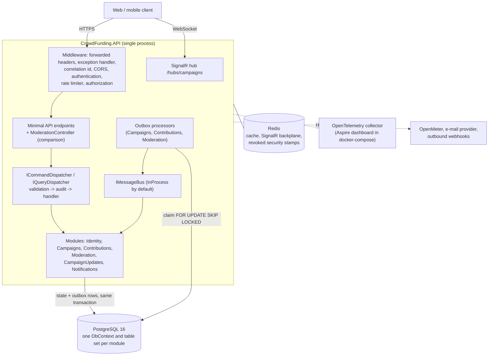
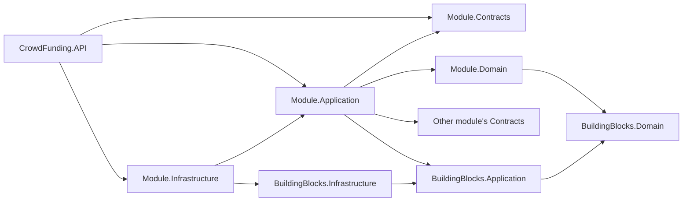
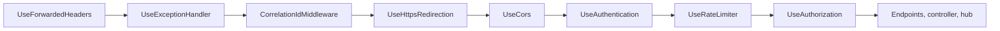
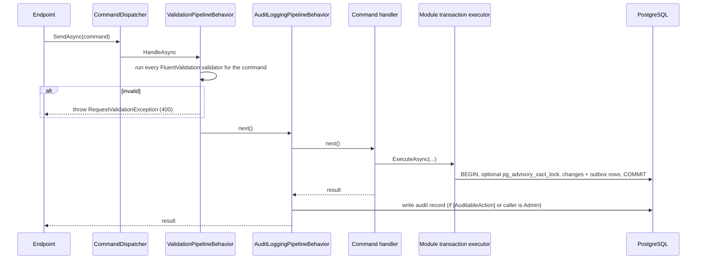
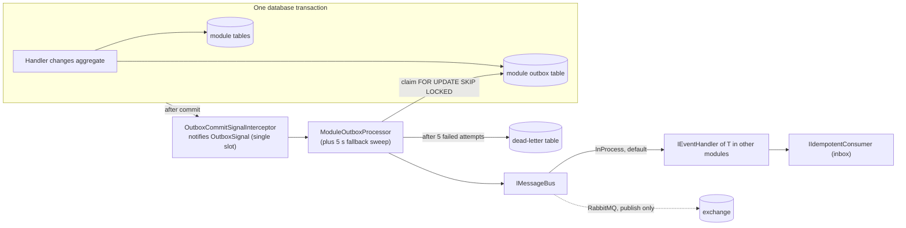

# CrowdFunding Hub: Architecture and Library Reference

This document describes how the codebase is structured today and why each library is in it.
Every statement here is checked against the code on this branch. Where a capability is planned
rather than implemented, the text says so.

- Runtime: .NET 10, C# 14, ASP.NET Core 10
- Database: PostgreSQL 16 (EF Core 10.0.11, Npgsql 10.0.3); Redis for caching, the SignalR
  backplane and token revocation
- Solution file: [`CrowdFunding.slnx`](../CrowdFunding.slnx); package versions:
  [`Directory.Packages.props`](../Directory.Packages.props)
- Related documents: [`README.md`](../README.md), [`DEV_GUIDELINES.md`](../DEV_GUIDELINES.md),
  [`outbox-architecture.md`](outbox-architecture.md), [`append-only-ledger.md`](append-only-ledger.md),
  [`minimal-apis-vs-controllers.md`](minimal-apis-vs-controllers.md),
  [`TRADE_OFFS_AND_LIMITATIONS.md`](TRADE_OFFS_AND_LIMITATIONS.md), [`PLATFORM_SHORTCOMINGS.md`](PLATFORM_SHORTCOMINGS.md)

## Contents

1. [System overview](#1-system-overview)
2. [Solution layout](#2-solution-layout)
3. [Dependency rules and architecture tests](#3-dependency-rules-and-architecture-tests)
4. [HTTP request pipeline](#4-http-request-pipeline)
5. [Command and query pipeline](#5-command-and-query-pipeline)
6. [Errors](#6-errors)
7. [Persistence](#7-persistence)
8. [Messaging: outbox, signal, inbox, bus](#8-messaging-outbox-signal-inbox-bus)
9. [Security](#9-security)
10. [Observability](#10-observability)
11. [API documentation](#11-api-documentation)
12. [The Rosetta Stone sample](#12-the-rosetta-stone-sample)
13. [Moderation and microservice extraction](#13-moderation-and-microservice-extraction)
14. [Library reference](#14-library-reference)
15. [Known limitations](#15-known-limitations)

---

## 1. System overview

CrowdFunding Hub is a modular monolith: one deployable ASP.NET Core host that composes six
business modules. Each module follows Clean Architecture internally (Contracts, Domain,
Application, Infrastructure) and owns its own DbContext and tables. Modules talk to each other
only through their Contracts assemblies: commands and queries for synchronous calls, and
application events delivered through a per-module transactional outbox for asynchronous work.



[`docker-compose.yml`](../docker-compose.yml) runs the local dependencies: PostgreSQL 16, Redis
and the .NET Aspire dashboard (UI on `http://localhost:18888`, OTLP on host port 4317). The API
itself runs with `dotnet run` (development URL `http://localhost:5076`).

---

## 2. Solution layout

```text
src/
  API/CrowdFunding.API/                  Composition root and HTTP host
  BuildingBlocks/
    CrowdFunding.BuildingBlocks.Domain/          BaseEntity, Money, AdvisoryLockKey, domain exceptions
    CrowdFunding.BuildingBlocks.Application/     dispatchers, pipeline behaviors, events, IMessageBus,
                                                 IIdempotentConsumer, application exceptions, audit
    CrowdFunding.BuildingBlocks.Infrastructure/  outbox processor and signal, inbox, message buses,
                                                 exception classifier, audit store, cache
                                                 invalidation, OpenMeter client
  Modules/{Identity,Campaigns,Contributions,Moderation,CampaignUpdates,Notifications}/
    CrowdFunding.Modules.{Module}.Contracts/        public commands, queries, events, DTOs
    CrowdFunding.Modules.{Module}.Domain/           aggregates, entities, value objects, invariants
    CrowdFunding.Modules.{Module}.Application/      handlers, validators, ports
    CrowdFunding.Modules.{Module}.Infrastructure/   DbContext, migrations, repositories, adapters
  Samples/RosettaStone/                  Separate runnable host for the three-tier comparison
tests/
  UnitTests/CrowdFunding.UnitTests/
  ArchitectureTests/CrowdFunding.ArchitectureTests/
  IntegrationTests/CrowdFunding.IntegrationTests/   (Testcontainers: PostgreSQL, Redis, RabbitMQ)
```

The six modules:

| Module | Owns |
| :--- | :--- |
| [Identity](../src/Modules/Identity) | Users, PBKDF2 password hashes, roles and permissions, refresh tokens, security stamps, ES256 signing keys, token issuance |
| [Campaigns](../src/Modules/Campaigns) | Campaign lifecycle (draft, publish, cancel, expire), reward tiers and reservations, the append-only funding ledger |
| [Contributions](../src/Modules/Contributions) | Pledges, payment confirmation and failure, Stripe webhook reconciliation, refunds, a local read model of active campaigns |
| [Moderation](../src/Modules/Moderation) | Campaign reviews, the media-analysis webhook, the approve and reject workflow |
| [CampaignUpdates](../src/Modules/CampaignUpdates) | Outbound webhook subscriptions and signed delivery (`pledge.confirmed`) |
| [Notifications](../src/Modules/Notifications) | Notification preferences, unsubscribe, e-mail notifications driven by events |

Every module has exactly these four projects; `ModuleBoundaryConventionTests` fails if one is
missing.

---

## 3. Dependency rules and architecture tests



Rules:

- A module references another module only through that module's Contracts assembly.
- A Domain assembly references no CrowdFunding assembly other than BuildingBlocks.Domain.
- A Contracts assembly references no module internals (Domain, Application, Infrastructure).
- BuildingBlocks never reference a module.
- The API host is the composition root: it references each module's Infrastructure (to register
  it) and Application and Contracts (to dispatch commands and queries). Endpoints work with
  Contracts and Application types, not domain entities.
- The API host does not reference the Rosetta Stone sample.

The tests in [`tests/ArchitectureTests/CrowdFunding.ArchitectureTests`](../tests/ArchitectureTests/CrowdFunding.ArchitectureTests)
enforce these rules with plain reflection over compiled assemblies
(`Assembly.GetReferencedAssemblies()` and type inspection). No architecture-testing library such
as NetArchTest is used.

| Test class | What it checks |
| :--- | :--- |
| `ModuleBoundaryConventionTests` | Every module has all four layers; cross-module references go only to Contracts; Domain references only BuildingBlocks.Domain; Contracts reference no module internals. A new module is covered without a new test class. |
| `{Module}ModuleDependencyTests` (one per module) | The module's specific allowed and forbidden references |
| `ReplicatedReadModelBoundaryTests` | Contributions does not call Campaigns synchronously to check whether a campaign accepts pledges; it uses its own replicated read model |
| `ApiHostDependencyTests` | The API does not reference the sample; the API exposes Minimal APIs with exactly one controller |

Because the checks read assembly metadata, a forbidden project reference fails the tests as soon
as it is added, before anyone writes code against it.

---

## 4. HTTP request pipeline

The order in [`Program.cs`](../src/API/CrowdFunding.API/Program.cs):



1. **Forwarded headers** run first so everything later sees the real client IP and scheme. Only
   loopback and the proxies in `ForwardedHeaders:KnownProxies` / `KnownNetworks` are trusted
   ([`EdgeSecurityConfiguration.cs`](../src/API/CrowdFunding.API/Security/EdgeSecurityConfiguration.cs)).
2. **Exception handler**: [`GlobalExceptionHandler`](../src/API/CrowdFunding.API/Observability/GlobalExceptionHandler.cs)
   turns exceptions into RFC 9457 problem details (see [section 6](#6-errors)).
3. **Correlation id**: [`CorrelationIdMiddleware`](../src/API/CrowdFunding.API/Observability/CorrelationIdMiddleware.cs)
   uses the current trace id (else an incoming `X-Correlation-Id`, else a new id), pushes it into
   Serilog's `LogContext` and returns it in the `X-Correlation-Id` response header.
4. **CORS**: a default policy with an explicit origin list from `Cors:AllowedOrigins` and
   credentials allowed, so the SignalR client can connect.
5. **Authentication** runs before the rate limiter so rate-limit policies can partition by the
   caller's `sub` claim.
6. **Rate limiter** (see [section 9](#9-security)).
7. **Authorization**: one policy per permission constant (`PermissionConstants.All`), each
   requiring an authenticated user with a matching `permission` claim.
8. **Endpoints**: Minimal APIs in [`Endpoints/`](../src/API/CrowdFunding.API/Endpoints)
   (`IdentityEndpoints`, `CampaignEndpoints`, `RewardTierEndpoints`, `ContributionEndpoints`,
   `WebhookSubscriptionEndpoints`, `NotificationEndpoints`, `InboundWebhookEndpoints`), using
   `TypedResults` and named routes for `CreatedAtRoute`. One MVC controller,
   [`ModerationController`](../src/API/CrowdFunding.API/Controllers/ModerationController.cs)
   (`/api/moderation/reviews`), is kept on purpose so the two styles can be compared; see
   [`minimal-apis-vs-controllers.md`](minimal-apis-vs-controllers.md). Request and response
   mapping is explicit code; there is no mapping library.

Health checks (`/health/live`, `/health/ready`) and the JWKS document (`/.well-known/jwks.json`)
are anonymous and excluded from rate limiting. The SignalR hub is at `/hubs/campaigns` and uses
a Redis backplane when `ConnectionStrings:Redis` is set.

Host commands: `dotnet run -- migrate` applies every module's migrations and exits (for CI and
init jobs); `dotnet run -- seed-admin <email> <password> <displayName>` creates the first
administrator. In Development and Testing, migrations also run at startup.

---

## 5. Command and query pipeline

The dispatchers are small in-house types in
[`BuildingBlocks.Application/Messaging`](../src/BuildingBlocks/CrowdFunding.BuildingBlocks.Application/Messaging),
not MediatR. Handlers are registered by assembly scan at startup, and the dispatcher resolves
the handler from the scoped DI container.

Commands pass through `ICommandPipelineBehavior<TCommand, TResult>` implementations, which wrap
the handler in registration order (first registered is outermost):



- **Validation** ([`ValidationPipelineBehavior`](../src/BuildingBlocks/CrowdFunding.BuildingBlocks.Application/Validation/ValidationPipelineBehavior.cs))
  is outermost, so an invalid command is rejected before auditing or the handler. Endpoints do
  not validate by hand. Queries go through `IQueryDispatcher` and are not validated by the
  pipeline.
- **Audit** ([`AuditLoggingPipelineBehavior`](../src/BuildingBlocks/CrowdFunding.BuildingBlocks.Application/Audit/AuditLoggingPipelineBehavior.cs))
  writes an audit record after the handler succeeds, for commands marked `[AuditableAction]` or
  executed by an Admin. A failed audit write fails the request. Audit records live in their own
  `AuditDbContext`.
- **Transactions** are owned by per-module transaction executors in each module's
  Infrastructure (for example [`CampaignTransactionExecutor`](../src/Modules/Campaigns/CrowdFunding.Modules.Campaigns.Infrastructure/Transactions/CampaignTransactionExecutor.cs)).
  They open the transaction, optionally take an advisory lock, and turn the aggregate's domain
  events into outbox rows before commit.

---

## 6. Errors

- Domain code throws subclasses of `DomainException` from
  [`BuildingBlocks.Domain/Exceptions`](../src/BuildingBlocks/CrowdFunding.BuildingBlocks.Domain/Exceptions):
  `BusinessRuleViolationException` (400) and `DomainConflictException` (409). It does not use
  `InvalidOperationException` or `ArgumentException` for business outcomes.
- Application code throws `NotFoundException` (404), `ResourceConflictException` (409),
  `ConcurrencyConflictException` (409), `UnauthenticatedException` (401),
  `ForbiddenAccessException` (403) and `RequestValidationException` (400 with an `errors` map).
- [`ExceptionClassifier`](../src/BuildingBlocks/CrowdFunding.BuildingBlocks.Infrastructure/ErrorHandling/ExceptionClassifier.cs)
  maps these to status codes. Npgsql connection-pool exhaustion and PostgreSQL errors 53300 and
  57P03 become 503 with `Retry-After: 2`. Anything else is a generic 500; framework, EF Core and
  Npgsql messages are never returned to the client.
- `GlobalExceptionHandler` writes `application/problem+json` with a `traceId`. Malformed JSON
  and unbindable parameters also become a 400 problem response, because
  `RouteHandlerOptions.ThrowOnBadRequest` is enabled in every environment.

---

## 7. Persistence

**One DbContext per module.** Identity, Campaigns, Contributions, Moderation, CampaignUpdates
and Notifications each have their own DbContext, migrations and repositories; audit has
`AuditDbContext`. There are no foreign keys between modules and no cross-context joins.

**Tables live in the `public` schema.** Module tables are distinguished by ownership and naming
(`campaigns`, `campaign_ledger_entries`, `campaigns_outbox_messages`, `contributions`,
`contributions_processed_events`, `users`, `refresh_tokens`, `campaign_reviews`, and so on). Only
each module's EF migrations history table is in a per-module schema (`identity`, `campaigns`,
`contributions`, `moderation`, `campaignupdates`, `notifications`; audit uses `system`). This is
not strict schema-per-module isolation; moving the tables into per-module schemas is a
remaining limitation.

**Per-module connection strings.** Each module resolves `ConnectionStrings:{Module}Db` and falls
back to `ConnectionStrings:DefaultConnection`
([`ConfigurationExtensions`](../src/BuildingBlocks/CrowdFunding.BuildingBlocks.Infrastructure/Configuration/ConfigurationExtensions.cs)),
so a module can be pointed at its own database without code changes once its tables and data
are moved there.

**Concurrency primitives:**

| Primitive | Where | Purpose |
| :--- | :--- | :--- |
| `xmin` row version | `Campaign`, `Contribution`, `RewardTier`, `RewardTierReservation`, `RefreshToken` | Optimistic concurrency: EF Core adds `AND xmin = @x` to updates; a mismatch becomes `ConcurrencyConflictException` (409) |
| `pg_advisory_xact_lock` | `CampaignTransactionExecutor`, keyed by [`AdvisoryLockKey.FromGuid`](../src/BuildingBlocks/CrowdFunding.BuildingBlocks.Domain/Common/AdvisoryLockKey.cs) (a 64-bit fold of the GUID) | Serializes writers on one campaign (pledge credit vs cancel, ledger SUM) and on one reward tier (slot reservation). Released at commit or rollback |
| `FOR UPDATE SKIP LOCKED` | [`OutboxClaimQuery`](../src/BuildingBlocks/CrowdFunding.BuildingBlocks.Infrastructure/Persistence/OutboxClaimQuery.cs) | Lets several outbox workers claim disjoint batches |
| `INSERT ... ON CONFLICT DO NOTHING` | Ledger appends, inbox claims | Idempotency under redelivery |

**Append-only campaign ledger.** `campaign_ledger_entries` records every change to a campaign's
funding: `Pledge` (positive), `Refund` (negative) and `OpeningBalance`. A trigger rejects
`UPDATE` and `DELETE`; a unique key on `(ContributionId, Kind)` with `ON CONFLICT DO NOTHING`
makes a redelivered pledge a no-op; a CHECK constraint ties sign to kind.
`Campaign.RecordPledge` (published campaigns only, positive amount, same currency) and
`RecordRefund` produce entries, and
[`CampaignLedger`](../src/Modules/Campaigns/CrowdFunding.Modules.Campaigns.Infrastructure/Persistence/Repositories/CampaignLedger.cs)
recomputes `campaigns.raised_amount` as the SUM of entries; a second trigger rejects any
`raised_amount` that differs from that SUM. A cancelled or completed campaign credits nothing
(`Credited = false`), and refunds append compensating entries, so the raised amount of a
cancelled or failed campaign drops as refunds land. See [`append-only-ledger.md`](append-only-ledger.md).

---

## 8. Messaging: outbox, signal, inbox, bus

See [`outbox-architecture.md`](outbox-architecture.md) for the full treatment.



**Transactional outbox.** Campaigns, Contributions and Moderation each have an outbox table and a
[`ModuleOutboxProcessor<TDbContext>`](../src/BuildingBlocks/CrowdFunding.BuildingBlocks.Infrastructure/Outbox/ModuleOutboxProcessor.cs)
hosted service. The transaction executor writes outbox rows in the same transaction as the state
change. The processor claims batches with `FOR UPDATE SKIP LOCKED`, reclaims `Processing` rows
whose lease (`LockedUntilUtc`) expired (counting that as an attempt), deletes rows on success,
reschedules a failed row after a fixed 10-second delay (`RetryDelay`), and moves a row to the dead-letter table after five attempts.
A failed pass is logged and does not stop the service. `IOutboxDispatcher.DrainAsync` exists for
tests and diagnostics.

**Wake-up signal.** [`OutboxCommitSignalInterceptor`](../src/BuildingBlocks/CrowdFunding.BuildingBlocks.Infrastructure/Outbox/OutboxCommitSignalInterceptor.cs)
notifies [`OutboxSignal<TDbContext>`](../src/BuildingBlocks/CrowdFunding.BuildingBlocks.Infrastructure/Outbox/OutboxSignal.cs)
(a single-slot channel that drops extra writes) after a transaction that wrote outbox rows
commits, so events are dispatched right away. The 5-second poll is only a fallback sweep. The
signal is in-process: other replicas pick up the rows on their next sweep.

**Inbox.** [`IIdempotentConsumer`](../src/BuildingBlocks/CrowdFunding.BuildingBlocks.Application/Inbox/IIdempotentConsumer.cs)`.ExecuteOnceAsync(eventId, consumerName, effect)`
claims `(eventId, consumerName)` with `INSERT ... ON CONFLICT DO NOTHING` inside the effect's
transaction, so the effect and the claim commit or roll back together. Tables:
`contributions_processed_events` and `campaign_updates_processed_events`. It is used by Stripe
webhook reconciliation (keyed by the Stripe event id) and by the `pledge.confirmed` webhook
fan-out. `BaseApplicationEvent.EventId` is stable and serialized; it equals the outbox row id and
the CloudEvents `id`.

**Message bus.** `IMessageBus` has two implementations, selected by `Messaging:Provider`:

- `InProcessMessageBus` (default, `InProcess`): calls the registered `IEventHandler<T>`
  implementations in the same process. This is the working mode.
- `RabbitMqMessageBus` (`RabbitMQ`): publishes a CloudEvents envelope to RabbitMQ. It is
  publish-only; there is no RabbitMQ consumer in the codebase, so cross-process event delivery
  is not implemented.

Delivery to external systems (outbound webhooks from CampaignUpdates) is at-least-once, and
receivers must deduplicate. Each delivery is signed with HMAC-SHA256 in the
`X-CrowdFunding-Signature` header (`t={unix},v1={hex}` over `"{t}.{body}"`).

Contributions keeps a replicated read model of active campaigns (`active_campaigns_cache`),
updated from Campaigns events, so accepting a pledge does not call the Campaigns module.

---

## 9. Security

**Tokens.** Access tokens are JWTs signed with ES256 (ECDSA P-256). Verification uses only the
public keys, which are also published at `/.well-known/jwks.json`
([`JwksEndpoint`](../src/API/CrowdFunding.API/Security/JwksEndpoint.cs)); a verifier holding the
JWKS cannot forge tokens. Validation checks issuer, audience, signature and lifetime with zero
clock skew. `MapInboundClaims = false`: claims keep their issued names, and the user's identity
comes from the `sub` claim only (`CustomClaimTypes.Subject`, `Email`, `Role`, `Permission`,
`SecurityStamp`, `DisplayName`).

**Signing keys at rest.** Private keys are stored in `identity_signing_keys`, encrypted with
AES-256-GCM by [`SigningKeyProtector`](../src/Modules/Identity/CrowdFunding.Modules.Identity.Infrastructure/Services/SigningKeyProtector.cs).
The key comes from `SigningKeyEncryption:Key` (environment variable `SigningKeyEncryption__Key`,
base64, 32 bytes); startup fails without it. The key id is bound as associated data, and legacy
plaintext rows are re-encrypted on warm-up.

**Refresh tokens.** 256-bit random tokens stored as SHA-256 hashes. Every refresh revokes the
presented token and issues a new one (rotation). Presenting an already-revoked token is treated
as theft: every session of the account is revoked and the security stamp is rotated.

**Revocation.** Each access token carries the user's security stamp. On every authenticated
request, `OnTokenValidated` checks a Redis-backed revocation store
([`RedisSecurityStampRevocationStore`](../src/Modules/Identity/CrowdFunding.Modules.Identity.Infrastructure/Services/RedisSecurityStampRevocationStore.cs)),
so logout and refresh-token reuse invalidate access tokens that have not yet expired.

**Rate limiting** ([`RateLimitingConfiguration`](../src/API/CrowdFunding.API/RateLimiting/RateLimitingConfiguration.cs)):
fixed windows, configurable under `RateLimiting:{Global|Auth|Payment|Webhook}`.

| Policy | Default | Partition |
| :--- | :--- | :--- |
| Global limiter | 300 per 60 s | `sub` if authenticated, else client IP |
| `auth-strict` | 10 per 60 s | client IP |
| `payment-strict` | 20 per 60 s | `sub`, else client IP |
| `webhook-strict` | 200 per 60 s | client IP |

A rejected request gets 429 as RFC 9457 problem details with a `traceId` and `Retry-After`.
Limits are held in memory, so they apply per instance.

**Inbound webhooks.** Stripe payment webhooks and the moderation media-analysis callback are
verified by signature (`StripeWebhookSignatureVerifier`, `CloudFunctionSignatureVerifier`)
before any command runs.

**CORS.** Explicit origin list from `Cors:AllowedOrigins`; no wildcard.

---

## 10. Observability

- **Logs**: Serilog with compact JSON (CLEF) output, enriched from the log context (including
  the correlation id), machine name and environment name
  ([`LoggingConfiguration`](../src/API/CrowdFunding.API/Observability/LoggingConfiguration.cs)).
  Logs are not exported through OpenTelemetry.
- **Traces**: OpenTelemetry instrumentation for ASP.NET Core, HttpClient, EF Core, Npgsql and
  the `CrowdFunding.Outbox` activity source.
- **Metrics**: ASP.NET Core, HttpClient, Npgsql and `System.Runtime`.
- **Export**: the OTLP exporter is enabled only when `OTEL_EXPORTER_OTLP_ENDPOINT` is set
  (`appsettings.Development.json` sets `http://localhost:4317`, the Aspire dashboard from
  docker-compose). See [`OpenTelemetryConfiguration`](../src/API/CrowdFunding.API/Observability/OpenTelemetryConfiguration.cs).
- **Health checks**: `/health/live` (the process is up; no dependencies checked) and
  `/health/ready` (one check per module DbContext plus the audit DbContext).

---

## 11. API documentation

In Development and Testing the host serves the OpenAPI document generated by the built-in
`Microsoft.AspNetCore.OpenApi` package at `/openapi/v1.json` and the Scalar UI at `/scalar/v1`
([`OpenApiConfiguration`](../src/API/CrowdFunding.API/Documentation/OpenApiConfiguration.cs)).
Neither is mapped in other environments. Swashbuckle is not used.

---

## 12. The Rosetta Stone sample

[`src/Samples/RosettaStone`](../src/Samples/RosettaStone/README.md) implements one use case,
"create a campaign", three ways so they can be compared side by side:

| Tier | Endpoint | Shape |
| :--- | :--- | :--- |
| 1. Minimal API CRUD | `POST /rosetta/v1/campaigns/tier1-minimal-api` | One file, manual validation, direct `DbSet.Add` |
| 2. Pragmatic CQRS | `POST /rosetta/v1/campaigns/tier2-pragmatic-cqrs` | Command, handler and endpoint using the shared dispatcher abstractions and FluentValidation; no aggregate or outbox |
| 3. Rich domain model + outbox | `POST /api/campaigns` (the production endpoint) | Aggregate, domain events, outbox, validation and audit pipeline |

The sample is its own host (`dotnet run --project src/Samples/RosettaStone`, Scalar UI at
`http://localhost:5090/scalar/v1`) with its own DbContext and `rosetta` schema. The production
API does not reference it (`ApiHostDependencyTests`). All three tiers return the same RFC 9457
validation-problem shape, which an integration test verifies.

---

## 13. Moderation and microservice extraction

On this branch Moderation is an in-process module of the monolith, like the other five. It has
its own DbContext, outbox and Contracts, and other modules reach it only through
`CrowdFunding.Modules.Moderation.Contracts` and events, which keeps a later extraction possible.

Extracting a module into its own service is the upcoming step of the course; it is not
implemented on this branch. A working proof of concept (a standalone Moderation host,
JWKS-validated authentication, a Strangler Fig deployment topology and extraction boundary tests)
is preserved on the branch `future/microservices-extraction`. On this branch, two gaps would
have to close for a real extraction: the RabbitMQ bus has no consumer, and module tables share
the `public` schema.

---

## 14. Library reference

Versions are taken from [`Directory.Packages.props`](../Directory.Packages.props) (central
package management; projects reference packages without versions).

### Web host and API

| Package | Version | Used in | Why |
| :--- | :--- | :--- | :--- |
| ASP.NET Core (shared framework) | 10.0 | API, sample | Host, Minimal APIs, DI, rate limiting, CORS, forwarded headers, SignalR, health checks, problem details. All built in, so these concerns need no third-party packages. |
| Microsoft.AspNetCore.Authentication.JwtBearer | 10.0.11 | API | Bearer token validation with a custom signing-key resolver and the `OnTokenValidated` revocation check |
| Microsoft.AspNetCore.OpenApi | 10.0.11 | API, sample | Built-in OpenAPI document generation (replaced Swashbuckle) |
| Scalar.AspNetCore | 2.17.2 | API, sample | Interactive API reference UI over the OpenAPI document |
| Microsoft.AspNetCore.SignalR.StackExchangeRedis | 10.0.11 | API | Redis backplane so SignalR broadcasts reach clients connected to any instance |
| MessagePack | 3.1.8 | API | Referenced directly so the SignalR Redis backplane's transitive MessagePack dependency resolves to this version |

### Data access and caching

| Package | Version | Used in | Why |
| :--- | :--- | :--- | :--- |
| Microsoft.EntityFrameworkCore (+ .Relational, .Design) | 10.0.11 | Module Infrastructure, BuildingBlocks.Infrastructure | One DbContext per module, migrations, change tracking. Raw SQL is used where PostgreSQL features matter (`SKIP LOCKED` claims, `ON CONFLICT`, advisory locks, the ledger SUM). |
| Npgsql.EntityFrameworkCore.PostgreSQL | 10.0.3 | Module Infrastructure, sample | PostgreSQL provider: `xmin` row versions, per-module migration history schemas |
| Npgsql | 10.0.3 | API | ADO.NET driver, referenced directly to pin its version; its exceptions drive the 503 classification |
| StackExchange.Redis | 3.1.31 | BuildingBlocks.Infrastructure | Redis pub/sub for distributed cache invalidation (for example signing keys and cached campaign reads) |
| Microsoft.Extensions.Caching.StackExchangeRedis | 10.0.11 | Identity and Campaigns Infrastructure | `IDistributedCache` for revoked security stamps and cached campaign reads |

### Messaging, security, validation, HTTP

| Package | Version | Used in | Why |
| :--- | :--- | :--- | :--- |
| FluentValidation | 12.1.1 | Module Application, BuildingBlocks.Application, sample | Declarative validators, run by `ValidationPipelineBehavior` before every command handler |
| RabbitMQ.Client | 7.1.2 | BuildingBlocks.Infrastructure, integration tests | `RabbitMqMessageBus` (publish-only) |
| System.IdentityModel.Tokens.Jwt | 8.22.0 | Identity Infrastructure | ES256 token creation |
| Microsoft.Extensions.Http.Resilience | 10.9.0 | BuildingBlocks.Infrastructure, Notifications Infrastructure | Standard resilience handler (retries, timeouts, circuit breaker) for the OpenMeter and e-mail HTTP clients |
| Microsoft.Extensions.DependencyInjection (+ .Abstractions), Microsoft.Extensions.Configuration | 10.0.11 | Application and Infrastructure projects, unit tests | Module registration extensions outside the web SDK |

### Observability

| Package | Version | Why |
| :--- | :--- | :--- |
| Serilog.AspNetCore | 10.0.0 | Structured logging host integration |
| Serilog.Formatting.Compact | 3.0.0 | Compact JSON (CLEF) output |
| Serilog.Enrichers.Environment | 3.0.1 | Machine and environment names on every event |
| OpenTelemetry.Extensions.Hosting | 1.18.0 | Tracing and metrics setup |
| OpenTelemetry.Instrumentation.AspNetCore, OpenTelemetry.Instrumentation.Http | 1.18.0 | Incoming request and outgoing HttpClient spans and metrics |
| OpenTelemetry.Instrumentation.EntityFrameworkCore | 1.18.0-beta.1 | EF Core spans (the package is still published as a beta) |
| Npgsql.OpenTelemetry | 10.0.3 | Npgsql command spans |
| OpenTelemetry.Exporter.OpenTelemetryProtocol | 1.18.0 | OTLP export, enabled only when an endpoint is configured |

### Testing

| Package | Version | Why |
| :--- | :--- | :--- |
| xunit, xunit.runner.visualstudio | 2.9.3, 3.1.4 | Test framework for all three test projects |
| Microsoft.NET.Test.Sdk | 17.14.1 | `dotnet test` integration |
| coverlet.collector | 6.0.4 | Cross-platform coverage (`--collect:"XPlat Code Coverage"`) |
| Microsoft.AspNetCore.Mvc.Testing | 10.0.11 | `WebApplicationFactory<Program>` for in-memory API hosts |
| Testcontainers.PostgreSql, Testcontainers.Redis, Testcontainers.RabbitMq | 4.14.0 | Real PostgreSQL, Redis and RabbitMQ in containers, because `xmin`, advisory locks, `SKIP LOCKED`, triggers and `ON CONFLICT` cannot be tested on an in-memory provider |
| Microsoft.AspNetCore.SignalR.Client | 10.0.11 | Hub tests |
| Microsoft.Extensions.Caching.Memory | 10.0.11 | In-memory cache in tests |

Not used: MediatR (in-house dispatchers), AutoMapper and Mapster (explicit mapping), Swashbuckle
(built-in OpenAPI), NetArchTest (reflection-based architecture tests).

In-house components instead of libraries: the command and query dispatchers, the outbox
processor and signal, the inbox, the CloudEvents envelope, and the OpenMeter client
([`OpenMeterClient`](../src/BuildingBlocks/CrowdFunding.BuildingBlocks.Infrastructure/Metering/OpenMeterClient.cs)),
which sends usage events as CloudEvents over HTTP.

---

## 15. Known limitations

These are current, known gaps; [`PLATFORM_SHORTCOMINGS.md`](PLATFORM_SHORTCOMINGS.md) and
[`TRADE_OFFS_AND_LIMITATIONS.md`](TRADE_OFFS_AND_LIMITATIONS.md) discuss them in depth.

1. Module tables share the `public` schema; only migration history is per schema.
2. The RabbitMQ bus publishes only; cross-process event delivery (and so extraction) is not
   implemented on this branch.
3. The outbox wake-up signal is in-process; other replicas rely on the 5-second sweep. A CDC
   relay (Debezium) was considered and not implemented.
4. Rate limits and the outbox signal are per instance; there is no distributed rate limiter.
5. Queries are not validated by the pipeline, only commands.
6. The signing-key encryption key cannot be rotated yet (single key; the `ENC:v1` prefix leaves
   room for versions).
7. Anonymous one-click unsubscribe trusts a bare user id; it needs a signed, expiring token.
8. E-mail and metering side effects rely on provider idempotency keys, not the inbox, so a crash
   between send and commit can repeat them.
9. Outbound webhooks are at-least-once; receivers must deduplicate.
10. A refund that arrives before its pledge was credited is a no-op (acceptable because refunds
    only follow cancellation or failure), and a busy campaign's writes are serialized by its
    advisory lock.
11. OpenTelemetry is used for traces and metrics only; logs stay on Serilog.
