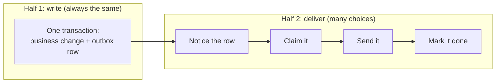
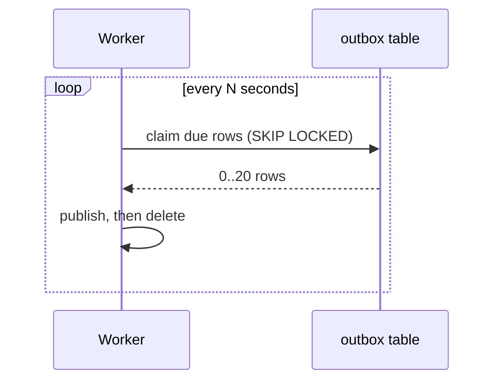
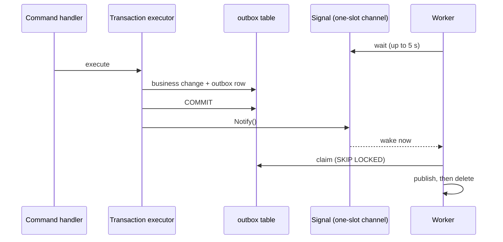
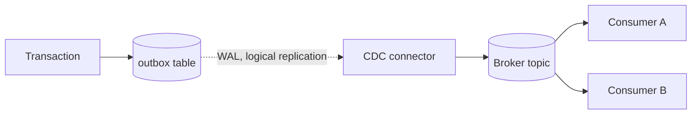
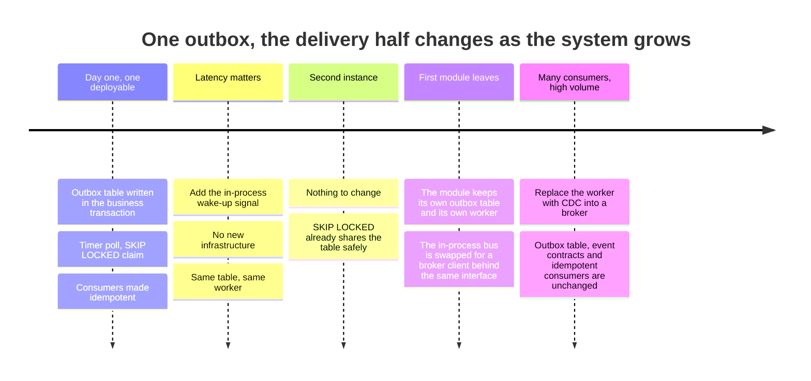
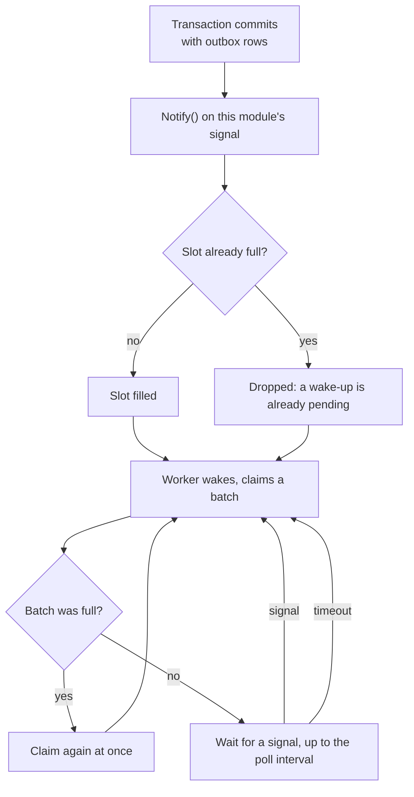

# Getting events out of the outbox: approaches, trade-offs and when to choose each

The outbox pattern solves one problem: a module must change its own data and tell the rest of the system about it, and those two things must succeed or fail together. The answer is to write the event into a table in the same transaction as the change. That part is settled.

This document is about the question that comes next, the one most tutorials skip: **how does a row in that table become a message that something reacts to?** There are several honest answers. Each costs something different, and the right one depends on when in the life of the system you are asking.

## 1. The two halves of the pattern

Half 1 never changes, whatever you choose below. Half 2 is where the approaches differ, and they differ mostly in how the row is **noticed**.

## 2. The approaches

### A. Timer polling

A background worker wakes every few seconds and asks the table for due rows. In PostgreSQL the claim uses `FOR UPDATE SKIP LOCKED`, so two workers never take the same row.

- **Good:** nothing to install; trivially correct; works with any number of instances; survives crashes because the table is the source of truth.
- **Bad:** an event waits, on average, half the interval and at worst the whole interval. A query runs every tick even when nothing happened.
- **Choose it when:** you are starting out and a few seconds of delay is invisible to users.

### B. Polling plus an in-process wake-up signal (what this project does now)

Same worker, same table, same claim query. The only change: after the transaction that wrote the row **commits**, the writer pokes the worker. The worker sleeps on that poke instead of on a clock, and keeps the timer only as a safety net.

- **Good:** delivery in milliseconds, with the same simplicity and the same correctness as A. No new infrastructure. A measured difference in this repository: the slowest of five deliveries took 5.04 seconds with the timer alone and under one second with the signal.
- **Bad:** the signal only reaches workers in the same process, so it is an optimisation and never the source of truth (see section 5 for why that is fine).
- **Choose it when:** you run one deployable (a monolith) or one process per module (microservices), and you want latency without operating a broker.

### C. PostgreSQL LISTEN / NOTIFY

The database itself wakes listeners. A trigger or the writer runs `NOTIFY outbox`, and workers in any process that did `LISTEN outbox` are woken.

- **Good:** works across processes and across instances; no broker.
- **Bad:** notifications are not durable (a listener that is down misses them), payloads are small, each listener holds a dedicated connection, and it does not pass through a transaction-mode connection pooler such as PgBouncer. You still need the poll as a safety net.
- **Choose it when:** several processes write to the same outbox and you want all their workers woken, and you control the connections.

### D. Log-based change data capture (Debezium and friends)

A connector reads PostgreSQL's write-ahead log through a logical replication slot and turns every inserted outbox row into a message on a broker topic. No process ever queries the outbox table.

- **Good:** no polling load at all; delivery is as fast as replication; ordering follows the log; natural fit when events must reach a broker anyway; scales to many tables without extra query load.
- **Bad:** a lot of moving parts (a connector, a Connect cluster, a broker, schemas for the table, a replication slot that retains WAL if the connector stops and can fill the disk); the team must operate and monitor them; local development needs the whole stack; consumers must still be idempotent because delivery is at-least-once.
- **Choose it when:** you already run a broker, several services consume the events, volumes are high, or polling load on the database has become a measurable cost.

### E. Publish straight to the broker inside the request

The handler changes the database and then publishes to the broker, with no outbox.

- **Good:** the shortest code and the lowest latency.
- **Bad:** a **dual write**. If the process dies between the two steps, or the broker is down, the database and the rest of the system disagree and nothing ever repairs it. Reordering the two steps only changes which side loses.
- **Choose it when:** you can afford to lose or duplicate an event (a cache invalidation, a metric). Not for money, not for state other modules depend on.

### F. In-memory dispatch after commit, no outbox

The same idea as E with an in-process event bus: raise the event after `SaveChanges`.

- **Good:** trivial, fast.
- **Bad:** a crash after the commit and before the dispatch loses the event forever. Still a dual write, just with no network involved.
- **Choose it when:** the reaction is best-effort by nature.

## 3. Side by side

| | A. Timer poll | B. Poll + signal | C. LISTEN/NOTIFY | D. CDC | E/F. Direct, no outbox |
|---|---|---|---|---|---|
| Typical delay | up to the interval | milliseconds | milliseconds | milliseconds to seconds | milliseconds |
| Survives a crash after commit | yes | yes | yes (poll fallback) | yes | **no** |
| Extra infrastructure | none | none | none | connector, Connect, broker | broker (E) |
| Database load while idle | one query per tick | one query per tick (rare, safety net) | one connection per listener | none from polling | none |
| Several app instances | yes (SKIP LOCKED) | yes | yes | yes | n/a |
| Ordering | by schedule time | by schedule time | by schedule time | log order | none |
| Duplicate delivery possible | yes | yes | yes | yes | yes |
| Operational cost | lowest | lowest | low | **highest** | low |
| Fits a monolith | yes | **best** | yes | overkill | risky |
| Fits microservices | yes | yes | yes | **best at scale** | risky |

Every row that says "yes" to duplicates is a reminder: **whatever you choose, the consumer must be idempotent.** That is what the per-module inbox is for.

## 4. Choosing by time: decide with the future in view, pay only for the present

The skill this course teaches is not "pick the best technology". It is picking the cheapest option that **does not close the door** on the next one. The line to look for is: what stays fixed, and what is allowed to change later.

What makes each step cheap is what was decided earlier:

| Decision taken early | Why it is cheap now | What it saves later |
|---|---|---|
| Events are plain contract types in each module's `Contracts` assembly | One small assembly per module | A consumer in another process can read the same type without sharing internals |
| The worker publishes through an `IMessageBus` interface | A tiny in-process implementation | Swapping to RabbitMQ changes configuration, not the worker |
| One outbox table and one worker per module, in the module's own schema | Slightly more tables | A module extracted into a service takes its outbox with it |
| The outbox row carries an id and the consumer records handled ids (the inbox) | One small table per consumer | At-least-once delivery from any transport is safe |
| The signal is behind an interface and is only an optimisation | One channel per module | Replacing it with LISTEN/NOTIFY or CDC changes nothing for callers |
| Delivery is **not** coupled to a broker | No broker to run today | The broker arrives when a second consumer process exists, not before |

And the decisions we deliberately did **not** take yet, because their cost is paid now and their benefit is later:

| Not taken yet | Why not now | The signal that says it is time |
|---|---|---|
| A Kafka-compatible broker | A monolith needs no network hop between modules | A second process must consume a module's events |
| CDC | Polling plus a signal is fast enough and free | Polling load shows up in the database, or event volume makes claim batches the bottleneck |
| An orchestrator for multi-step flows | The refund saga is a short chain of events | A flow with compensation across more than three steps and several owners |
| An API gateway | One host | More than one deployable behind the same public address |

## 5. How the signal works, and what happens when it goes wrong

Four small decisions make it safe:

1. **A one-slot channel that drops extra signals.** Ten commits while the worker is busy become one pending wake-up, not ten. The signal never grows.
2. **A signal sent before the worker starts waiting stays in the slot.** The next wait returns at once. There is no window in which a wake-up can be missed.
3. **Notify only after the commit returns.** Waking earlier lets the worker look, find nothing (the row is not visible yet) and go back to sleep.
4. **The timer stays.** Failed messages are rescheduled a few seconds into the future, rows may be written by another instance or a script, and a process can restart with signals in flight. The poll interval picks all of that up. The signal is the fast path; the table is the truth.

Other instances: a commit on instance A wakes A's own worker, which claims any due row in that module's table, including ones written by instance B. So at least one worker is always woken. Only writers outside the application (a manual `INSERT`, another system) rely on the timer.

Failure modes, all of them harmless:

| What goes wrong | What happens | Cost |
|---|---|---|
| Process restarts with signals pending | Signals are gone; rows are still in the table | Up to one poll interval of extra delay |
| Signal sent, worker busy | One wake-up stays pending | The next batch starts immediately |
| Worker crashes mid-batch | Claimed rows stay in `Processing` until their 30-second lease runs out; any worker then reclaims them and counts an attempt, and after five unfinished claims the message is dead-lettered | Up to the lease length of extra delay for those rows |
| Two batches in one process | A per-worker gate allows one at a time; across processes `SKIP LOCKED` keeps them apart | None |

## 6. Where the other approaches slot in

- **Moving to a broker later (D):** keep the outbox table and its write path exactly as they are. Replace the worker with a connector reading the log, and make each consumer record handled message ids. Nothing in the business code changes. This is the payoff for keeping Half 1 and Half 2 separate.
- **Several processes writing one outbox (C):** add `LISTEN` on a dedicated connection to wake workers across processes. Keep the poll.
- **A module becomes a service:** its code, its outbox table and its worker move together; the in-process bus becomes a broker client behind `IMessageBus`.

## 7. Exercises

1. Remove the `Notify()` call from one transaction executor and run `OutboxWakeUpLatencyE2ETests`. What is the slowest delivery now, and why does it match a number in the configuration?
2. Raise the poll interval to a minute. Which tests still pass, and what does that tell you about the signal and the safety net?
3. Kill the process between the commit and the next poll. Where is the event, and who delivers it after the restart?
4. Write down for your own system: how long can an event wait today, who would notice, and which row of the comparison table would you move to if that number had to drop tenfold? What would you have to install?
