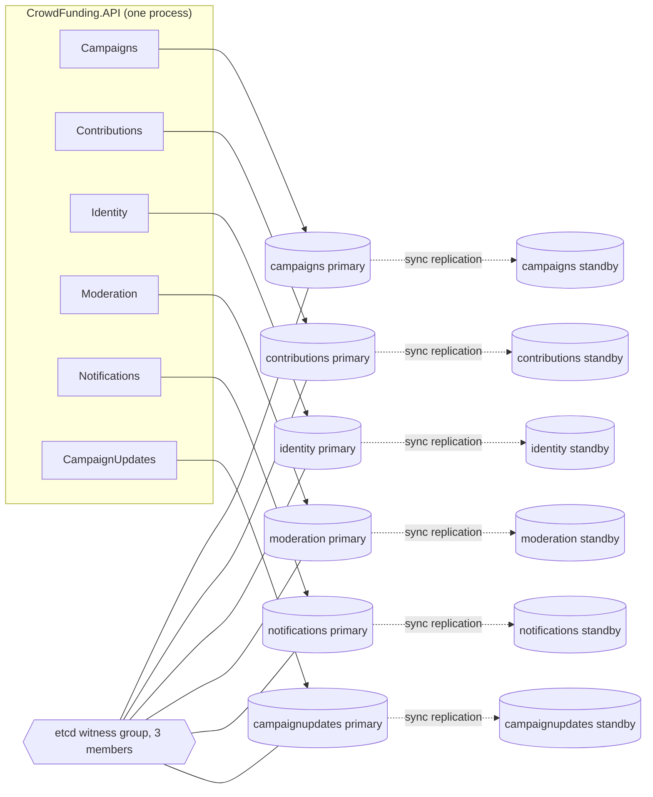
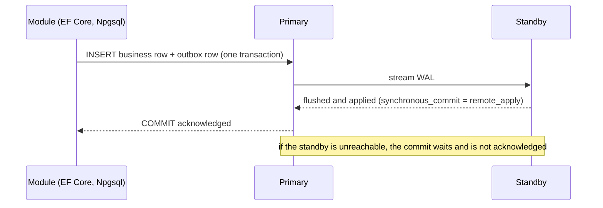
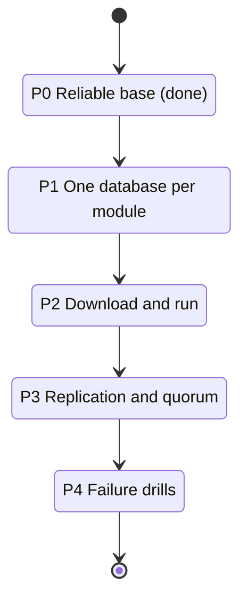

# Plan: a download-and-run clean monolith with a replicated database per module

Status: proposal. Nothing in this document is implemented yet unless it says so.

## The goal

At the end of the clean-monolith work, a learner downloads the project and runs it on their own
machine, then breaks and repairs it to see the architecture work. Two requirements from the course
owner:

1. One download, one command, working system and tests on a laptop.
2. No single database for all modules. Each module has its own database, kept on two nodes with
   replication and quorum, with consistency chosen over availability when the two conflict (PC/EC
   in PACELC terms).

## What is true today (checked in the code)

| Fact | Evidence |
|---|---|
| Every module reads its own connection string and falls back to the shared one | `GetRequiredModuleConnectionString("CampaignsDb")` and the same for Contributions, Identity, Moderation, Notifications, CampaignUpdates, Audit |
| Today they all point at one database | `appsettings.json` has only `DefaultConnection`; `docker-compose.yml` starts one PostgreSQL and one Redis |
| A test already runs one module in a separate database | `MultiDatabaseConnectionDecouplingTests` |
| Modules already live in their own schemas, with no foreign key crossing a schema | `ModuleSchemaRulesTests` |
| Each module has its own outbox and inbox, so no transaction spans two modules | `ModuleOutboxProcessor`, `EfInbox` |

So the code is already shaped for one database per module. The work is infrastructure, migration
and failure handling, not a rewrite.

## The quorum problem with two nodes

A quorum is a majority of voters. With two database nodes the majority is both of them:

- If a write needs both nodes, losing either node stops all writes. That is consistent but not highly
  available, and it never promotes the survivor.
- If the survivor is allowed to carry on, two nodes cut off from each other can both carry on and
  diverge (split brain). That breaks the consistency-first rule.
- Automatic failover needs a third voter, even if it stores no data.

Options for each module's database:

| Option | Nodes per module | Behaviour when one node fails | Cost on a laptop |
|---|---|---|---|
| A. Two data nodes plus a shared witness | 2 PostgreSQL, plus one 3-member etcd group shared by every module | Witness and survivor form a majority, the survivor is promoted, no split brain | 12 PostgreSQL containers (or 14 with Audit and the sample) and 3 etcd |
| B. Three data nodes | 3 PostgreSQL, quorum commit `ANY 1` of 2 standbys | One node can fail with no downtime | 18 or more PostgreSQL containers |
| C. Two data nodes, no witness | 2 PostgreSQL | Writes stop on any failure; no automatic failover; manual promotion | 12 containers, simplest, weakest |
| D. Default "lite" profile | 1 PostgreSQL per module, no replication | No fault tolerance | 6 containers |

Recommendation: ship D as the default (so the first run is light), and A as the "HA" profile. A keeps
the two data nodes the course owner asked for and adds only the voter that quorum needs. The etcd
witness is infrastructure, not application code, so it does not conflict with the preference for
the .NET ecosystem; everything the application does stays .NET (Npgsql, EF Core, health checks,
tests).

## How a write behaves (consistency first)

PostgreSQL setting: `synchronous_standby_names` naming the standby and `synchronous_commit =
remote_apply`. The cost is write latency and a stalled write when the standby is down. That is the
chosen trade (consistency over latency and availability).

## Work plan

| Phase | What | Done when |
|---|---|---|
| P0 | Fix the outbox due-time clock defect that made end-to-end tests flaky (done, commit `e84a8dc` on `fix/outbox-due-clock`) | Full suite green three runs in a row |
| P1 | Six PostgreSQL containers, one per module, each module on its own connection string; migrations run per database; Audit gets its own; health checks per database | `docker compose up` then the API starts and the full suite passes with each module on its own database |
| P2 | One command to start everything and one to run the tests; a README for someone who has never seen the project; sample requests; a seed so a first run shows data | A clean machine with Docker and the .NET SDK reaches a working system in the steps written in the README (verified on a fresh clone) |
| P3 | HA compose profile: a standby per primary, replication, the etcd witness, Npgsql multi-host connection strings with `Target Session Attributes=primary`; a replication-lag and role health check | Writes appear on the standby; stopping the primary promotes the standby |
| P4 | Failure drills as tests or scripts: stop a standby (writes stall, none lost), stop a primary (failover, no acknowledged write lost), partition the witness | Each drill has an expected result written down and checked |

## Things this changes in the code

- Migrations: `MigrationRunner` already migrates each context; it must work when each context has its
  own server and wait for a primary.
- Cross-module data: anything that joins across schemas would break. The schema checks show there
  are no cross-schema foreign keys; a search for SQL that names another module's tables is still
  needed and is not done.
- Connection resilience: a failover drops connections. Handlers must tolerate a retried transaction;
  EF Core's execution strategy (`EnableRetryOnFailure`) needs checking against the existing
  hand-written transaction executors, which may not be retry-safe.
- Outbox and inbox: both are per-database already. After a failover an event may be delivered twice,
  which the inbox handles; the window described in the inbox notes still applies.
- Audit: the `system` schema audit table must move to its own database or stay with one module; this
  needs a decision.

## Decisions for the course owner

1. Is option A (two data nodes plus a shared 3-member witness) acceptable as the HA profile, with the
   one-node-per-module "lite" profile as the default first run? Or do you want three data nodes
   (option B)?
2. May writes stall when the standby is down (consistency over availability), as assumed here?
3. Is Docker Desktop the supported local runtime, and what is the minimum machine (RAM) the learner
   is assumed to have? The HA profile starts roughly 15 database containers.
4. Should the Audit table get its own replicated database like a module?
