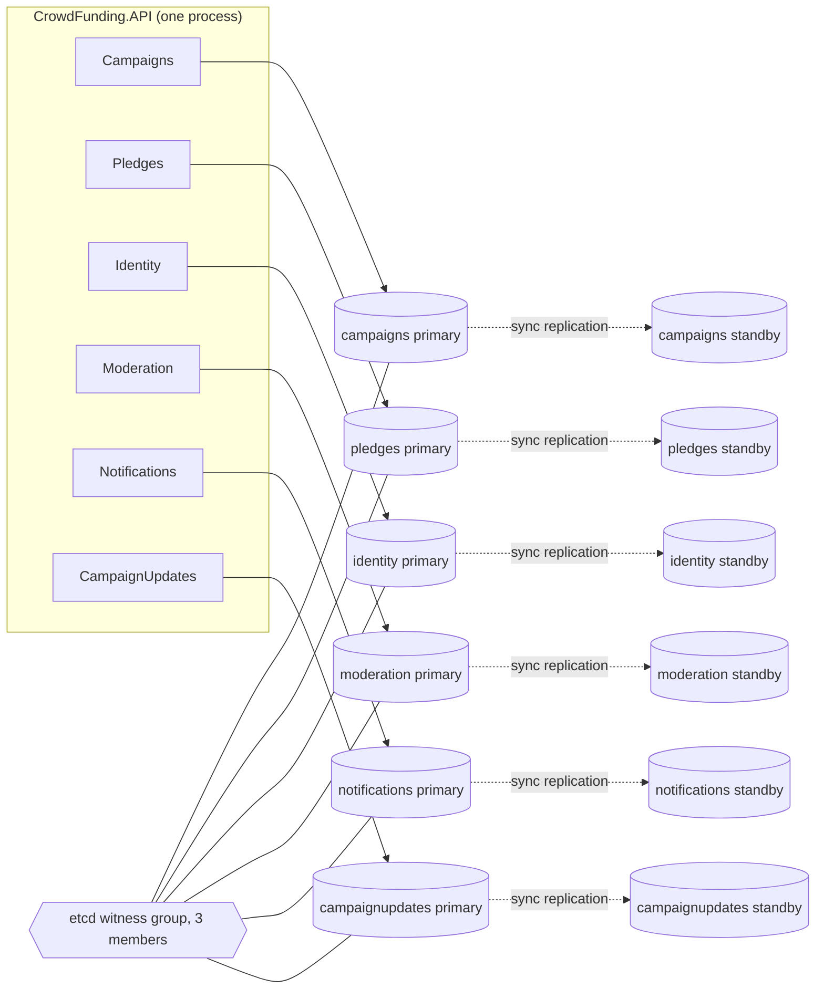
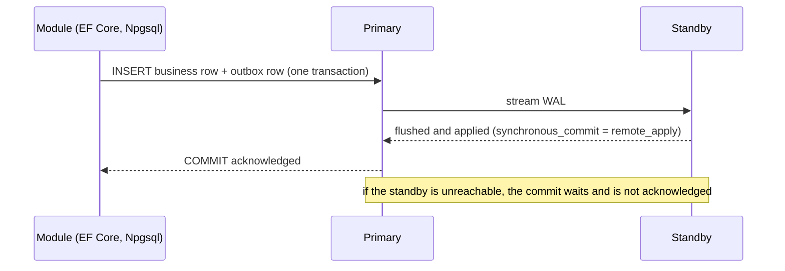
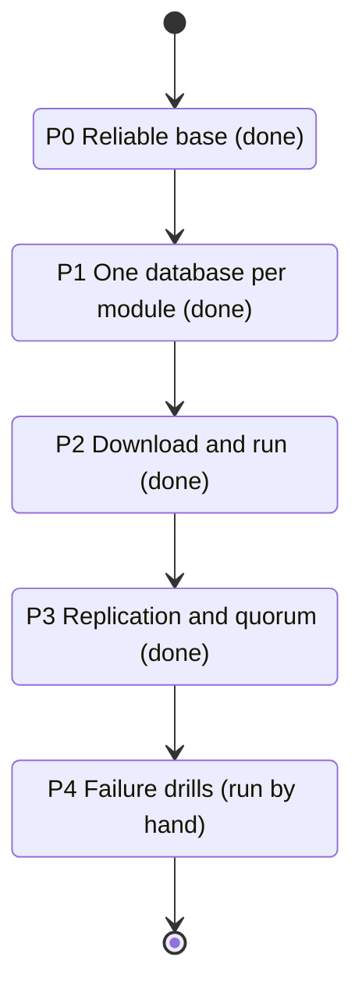

# Plan: a download-and-run clean monolith with a replicated database per module

Status: implemented (phases P0 to P3). The failure drills of P4 were run by hand and their results are in [`TESTS_THAT_TEACH.md`](TESTS_THAT_TEACH.md). This page keeps the reasoning behind the choices.

## The goal

At the end of the clean-monolith work, a learner downloads the project and runs it on their own
machine, then breaks and repairs it to see the architecture work. Two requirements from the course
owner:

1. One download, one command, working system and tests on a laptop.
2. No single database for all modules. Each module has its own database, kept on two nodes with
   replication and quorum, with consistency chosen over availability when the two conflict (PC/EC
   in PACELC terms).

## What is true (checked in the code)

| Fact | Evidence |
|---|---|
| Every module reads its own connection string and falls back to the shared one | `GetRequiredModuleConnectionString("CampaignsDb")` and the same for Pledges, Identity, Moderation, Notifications, CampaignUpdates, Audit |
| Locally each module has its own database | `appsettings.Development.json` has a connection string per module (eight databases: the six modules, Audit and the Rosetta Stone sample); `docker-compose.yml` starts one PostgreSQL container that creates them (`deploy/postgres/init-module-databases.sh`) and one Redis. `DefaultConnection` in `appsettings.json` is only the fallback |
| A test runs one module (Campaigns) in a separate database | `MultiDatabaseConnectionDecouplingTests` |
| Modules already live in their own schemas, with no foreign key crossing a schema | `ModuleSchemaRulesTests` |
| Each module that publishes events (Campaigns, Pledges, Moderation) has its own outbox and worker, and every module except Identity has an inbox, so no transaction spans two modules | `ModuleOutboxProcessor`, `EfInbox` |

So the code is shaped for one database per module. The work was infrastructure, migration
and failure handling, not a rewrite.

## The quorum problem with two nodes

A quorum is a majority of voters. With two database nodes the majority is both of them:

- If a write needs both nodes, losing either node stops all writes. That is consistent but not highly
  available, and it never promotes the survivor.
- If the survivor is allowed to carry on, two nodes cut off from each other can both carry on and
  diverge (split brain). That breaks the consistency-first rule.
- Automatic failover needs a third voter, even if it stores no data.

Options for each module's database:

| Option | Nodes per module | Behaviour when one node fails | Cost on a laptop |
|---|---|---|---|
| A. Two data nodes plus a shared witness | 2 PostgreSQL, plus one 3-member etcd group shared by every module | Witness and survivor form a majority, the survivor is promoted, no split brain | 16 PostgreSQL containers (eight databases, each on two nodes: six modules, Audit and the sample) and 3 etcd |
| B. Three data nodes | 3 PostgreSQL, quorum commit `ANY 1` of 2 standbys | One node can fail with no downtime | 24 PostgreSQL containers |
| C. Two data nodes, no witness | 2 PostgreSQL | Writes stop on any failure; no automatic failover; manual promotion | 16 containers, simplest, weakest |
| D. Default "lite" profile | 1 PostgreSQL container holding one database per module (eight in all), no replication | No fault tolerance | 1 container |

Choice made: D is the default (so the first run is light), and A is the "HA" profile (`docker-compose.ha.yml`). A keeps
the two data nodes the course owner asked for and adds only the voter that quorum needs. The etcd
witness is infrastructure, not application code, so it does not conflict with the preference for
the .NET ecosystem; everything the application does stays .NET (Npgsql, EF Core, health checks,
tests).

## How a write behaves (consistency first)

PostgreSQL setting: `synchronous_standby_names` naming the standby and `synchronous_commit =
remote_apply`. The cost is write latency and a stalled write when the standby is down. That is the
chosen trade (consistency over latency and availability).

## Work plan

| Phase | What | Done when |
|---|---|---|
| P0 | Fix the outbox due-time clock defect that made end-to-end tests flaky (done) | Full suite green three runs in a row |
| P1 | One database per module on one PostgreSQL container, each module on its own connection string; migrations run per database; Audit gets its own | `docker compose up` then the API starts and the full suite passes with each module on its own database |
| P2 | One command to start everything and one to run the tests; a README for someone who has never seen the project; sample requests; a seed so a first run shows data | A clean machine with Docker and the .NET SDK reaches a working system in the steps written in the README (verified on a fresh clone) |
| P3 | HA compose profile: a standby per primary, replication, the etcd witness, Npgsql multi-host connection strings with `Target Session Attributes=primary` (`appsettings.HA.json`). A replication-lag health check is not built | Writes appear on the standby; stopping the primary promotes the standby |
| P4 | Failure drills as tests or scripts: stop a standby (writes stall, none lost), stop a primary (failover, no acknowledged write lost), partition the witness | Each drill has an expected result written down and checked |

## Things this changes in the code

- Migrations: `MigrationRunner` already migrates each context; it must work when each context has its
  own server and wait for a primary.
- Cross-module data: anything that joins across schemas would break. The schema checks show there
  are no cross-schema foreign keys; a search for SQL that names another module's tables is still
  needed and is not done.
- Connection resilience: a failover drops connections. Handlers must tolerate a retried transaction;
  EF Core's execution strategy (`EnableRetryOnFailure`) needs checking against the existing
  hand-written transaction executors, which may not be retry-safe.
- Outbox and inbox: both are per-database already. After a failover an event may be delivered twice,
  which the inbox handles; the window described in the inbox notes still applies.
- Audit: the audit table lives in its own database (`audit_db`), replicated like a module.

## Decisions taken

1. Option A (two data nodes plus a shared 3-member witness) is the HA profile, and the lite profile (one container, one database per module) is the default first run.
2. Writes stall when the standby is down (consistency over availability), as the drills show.
3. Docker Desktop or Colima is the supported local runtime. The HA profile starts 16 database nodes and 3 etcd members and needs roughly 6 GB of memory for the container VM (see the README).
4. The Audit database is replicated like a module (`audit-a` and `audit-b` in `docker-compose.ha.yml`).
