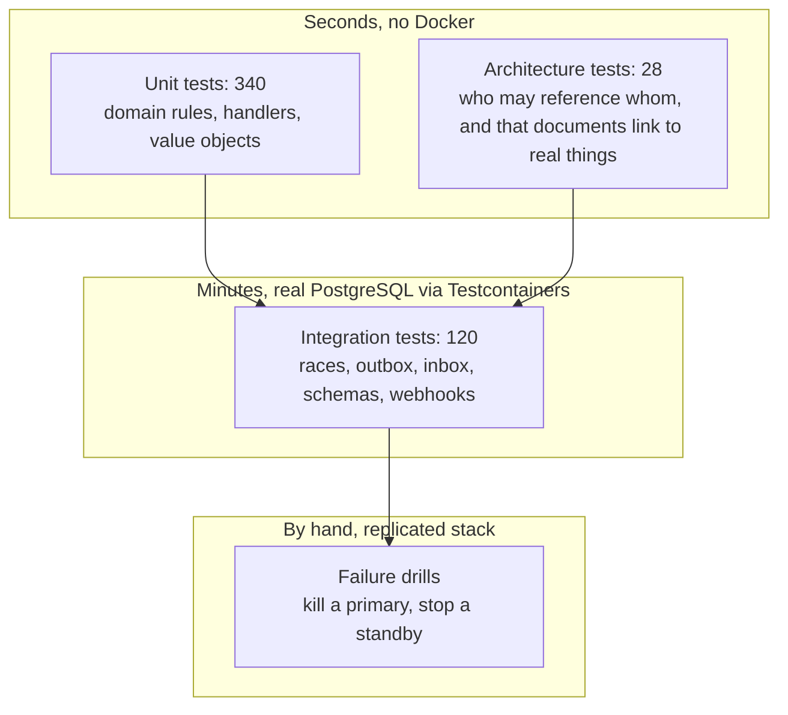
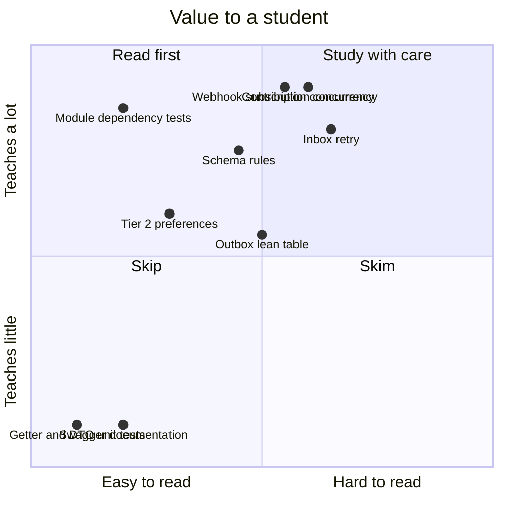

# Tests that teach

Most of the 450 tests in this repository protect the code. A handful do something more useful for a learner: each one **proves a design rule** that would otherwise be a claim in a lesson. This page lists them, says what each one teaches, and says honestly which tests are not worth a student's time.

## The three layers

| Layer | Run it | Needs Docker | Teaches |
|---|---|---|---|
| Unit | `dotnet test tests/UnitTests/CrowdFunding.UnitTests` | no | Domain rules live in aggregates and are testable without infrastructure. |
| Architecture | `dotnet test tests/ArchitectureTests/CrowdFunding.ArchitectureTests` | no | Boundaries are enforced by the build, not by reviewers' memory. |
| Integration | `dotnet test tests/IntegrationTests/CrowdFunding.IntegrationTests` | yes | What only a real database can show: concurrency, transactions, schemas. |
| Drills | see `docs/LOCAL_DISTRIBUTION_AND_HA_PLAN.md` | yes | What happens to consistency when a node dies. |

## The tests worth studying

| Test | What it proves | Why a student should read it |
|---|---|---|
| `*ModuleDependencyTests` (architecture) | A module's Application and Domain never reference another module's internals; Tier 2 handlers depend only on their own `DbContext` and clock. | Shortest path to understanding module boundaries. A broken rule fails the build with the offending type named. |
| `ContributionConcurrencyTests`, `CampaignContributionConcurrencyTests`, `RewardTierConcurrencyE2ETests` | Many simultaneous contributions never oversell a reward tier or lose a pledge total. | Shows **why** the xmin token, advisory lock and unique key exist. Remove the guard and the test fails; that is the lesson. |
| `WebhookSubscriptionConcurrencyTests` | A stale background save cannot re-activate a subscription that an owner deleted. | Found a real lost-update bug while converting a feature to Tier 2, so it teaches the tier rule "can concurrent writes corrupt it?" with evidence. |
| `InboxRetryTests` | A handler that fails is retried; one that succeeded is not run twice for the same message. | Makes at-least-once delivery and idempotent consumers concrete. It also documents the crash window that remains. |
| `ModuleSchemaRulesTests` | Each module's tables live in its own schema, each module has its own migration history, and no foreign key crosses a schema. | Turns "schema isolation" from a diagram into a check that runs against a real database. |
| `OutboxLeanTableE2ETests`, `ContributionAndOutboxE2ETests` | A business change and its event commit together or not at all; dispatch is claimed with `SKIP LOCKED`. | The transactional outbox end to end. |
| `RefundSagaE2ETests`, `PaymentGatewayWebhookReconciliationE2ETests` | A multi-module flow completes by events, and duplicate webhooks are harmless. | Eventual consistency between modules without a distributed transaction. |
| `PledgeIdempotencyE2ETests`, `PledgeIdempotencyTests` | A retried pledge returns the first one; twelve simultaneous requests with one key create exactly one pledge; the same key with a different request is a conflict. | The guarantee is a unique index, not application code. Delete the index or the lookup and the tests fail, which is the lesson. |
| `OutboxWakeUpLatencyE2ETests`, `OutboxSignalTests` | An event reaches its consumer in under a second with no manual drain; without the wake-up the slowest delivery is the five-second timer. | Measures a design choice instead of asserting it. Remove the `Notify()` call and the test fails with the number. |
| `GuardedLoopTests` | A background pass that fails is logged and retried, and a real outbox worker whose database keeps failing stays alive. | An exception that escapes `ExecuteAsync` stops the whole host; the test makes that failure concrete. |
| `OutboxReclaimE2ETests` | A row whose lease ran out is reclaimed and delivered, a live lease is left alone, a message that keeps killing its worker is dead-lettered. | The crash-recovery half of the outbox, seeded with the exact state a dead worker leaves behind. |
| `RabbitMqConsumerHostTests` | Events reach their handlers over a real broker with the outbox row id as the message id; unknown events are ignored; a failing handler is retried then dead-lettered. | Shows the consuming half of a broker transport and what a dead-letter queue is for. |
| `ModerationReadAccessTests` | Reading a review needs the moderation permission in whichever host serves the module. | Why a rule that matters belongs in the handler, not only on the endpoint. |
| `RetentionE2ETests`, `RetentionBackgroundServiceTests` | Idempotency keys older than a week are cleared and recent ones stay; old inbox rows are deleted; one failing cleanup task does not stop the others. | Data with a useful life needs an owner and a schedule, or the table grows for ever. |
| `OneLivePledgeTests`, `PledgeIdempotencyE2ETests` (the two-tabs tests) | A second pledge with a new key is refused, twelve simultaneous pledges with twelve keys create exactly one, and a backer can pledge again once the first failed. | An idempotency key stops a retry; only a business rule enforced by the database stops a second attempt. |
| `LateContributionTests`, `LateConfirmationRefundE2ETests` | A payment confirmed after the campaign ended is refused under the campaign lock and refunded, not retried into the dead-letter table. | The closing fence across two databases is a lock plus a compensation. |
| `NotificationPreferencesTier2Tests` | A Tier 2 feature works with no aggregate or repository. | The poly-pattern in practice: small features stay small. |
| `ReplicatedReadModelResilienceTests` | A module keeps serving from its replicated read model when the source module is down. | Why replicated read models exist. |

## The outbox clock bug as a case study

The integration suite once failed 26 of 92 tests at random. A first guess, a race between the background timer and the test, was wrong, and serialising the work changed nothing. The real cause: the claim query compared a row's application-set `ScheduledAtUtc` with the database's `now()`, and a container clock a few milliseconds behind made a just-queued row look "not yet due". Lesson for students: **a flaky test is a bug report; chase the cause instead of adding retries**, and never compare timestamps produced by two different clocks.

## Failure drills (run on the replicated profile)

These were run against the real stack, not simulated.

| Drill | Result observed |
|---|---|
| Stop a module's primary while the API runs | A replica was promoted; the first request after the stop took about 30 s (the connection waited for a new primary), then the API recovered with no restart and the data written earlier was intact. |
| Stop the standby, then write | The write waited and was never acknowledged, then timed out on the client. Other modules kept serving. This is the consistency-first choice. |
| Bring the standby back | Writes resumed at once; a write that had stalled committed after the standby returned. |

The last point is worth a lesson on its own: a client timeout does not cancel a commit that is waiting for its standby, so a timed-out request may still become durable later. Idempotency keys exist for this reason, and `MakeContribution` now accepts one (see `PledgeIdempotencyE2ETests`).

## Tests that are not worth a student's time

- `SwaggerDocumentationTests` and similar: they guard documentation output, not design.
- Unit tests of plain getters, DTO mapping and trivial value objects: useful as regression nets, but they teach nothing about architecture.
- `RosettaStoneParityTests`: valuable only once you study the Rosetta sample.

## Gaps

- No test yet fails when a Tier 1 or Tier 2 feature reads another module's tables with raw SQL.
- The inbox crash window (handler succeeds, process dies before the record is written) has no test, only a note.
- The failure drills are run by hand; they are not automated.
