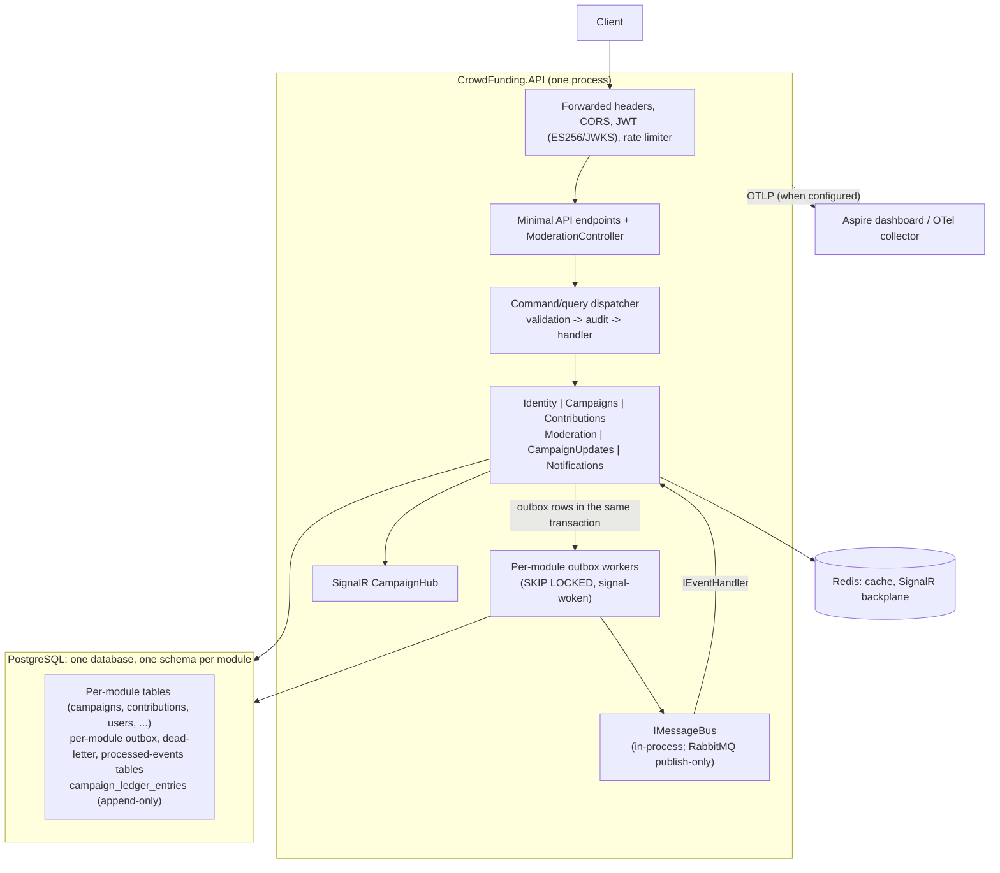

# Architectural Trade-offs and Limitations

This document records the main design decisions in CrowdFunding Hub, what each one costs, and when you would choose differently. It describes the code on this branch. Where a decision replaced an earlier design, the section says what moved and why.

Related documents: [outbox-architecture.md](outbox-architecture.md), [append-only-ledger.md](append-only-ledger.md), [minimal-apis-vs-controllers.md](minimal-apis-vs-controllers.md), [PLATFORM_SHORTCOMINGS.md](PLATFORM_SHORTCOMINGS.md).

## Contents

1. [Topology](#1-topology)
2. [Trade-offs](#2-trade-offs)
   - [2.1 Modular monolith vs. microservices](#21-modular-monolith-vs-microservices)
   - [2.2 One database, one DbContext per module](#22-one-database-one-dbcontext-per-module)
   - [2.3 Polling outbox with a wake-up signal vs. CDC](#23-polling-outbox-with-a-wake-up-signal-vs-cdc)
   - [2.4 At-least-once delivery with an inbox](#24-at-least-once-delivery-with-an-inbox)
   - [2.5 In-process bus with publish-only RabbitMQ](#25-in-process-bus-with-publish-only-rabbitmq)
   - [2.6 Replicated read models vs. synchronous cross-module reads](#26-replicated-read-models-vs-synchronous-cross-module-reads)
   - [2.7 Append-only ledger and the per-campaign advisory lock](#27-append-only-ledger-and-the-per-campaign-advisory-lock)
   - [2.8 Minimal APIs with one comparison controller](#28-minimal-apis-with-one-comparison-controller)
   - [2.9 Domain-owned exceptions and the exception classifier](#29-domain-owned-exceptions-and-the-exception-classifier)
   - [2.10 Validation pipeline](#210-validation-pipeline)
   - [2.11 SignalR with an optional Redis backplane](#211-signalr-with-an-optional-redis-backplane)
   - [2.12 Per-instance rate limiting](#212-per-instance-rate-limiting)
   - [2.13 Signing keys encrypted at rest](#213-signing-keys-encrypted-at-rest)
   - [2.14 Smaller library choices](#214-smaller-library-choices)
3. [Operating limits and failure modes](#3-operating-limits-and-failure-modes)
4. [Remaining limitations](#4-remaining-limitations)
5. [Evolution path](#5-evolution-path)
6. [Summary matrix](#6-summary-matrix)

---

## 1. Topology

CrowdFunding Hub is a modular monolith on .NET 10, PostgreSQL 16 and Redis. One ASP.NET Core host runs six modules: Identity, Campaigns, Contributions, Moderation, CampaignUpdates and Notifications. Each module has four projects (Contracts, Domain, Application, Infrastructure); other modules may reference only its Contracts.

The design favours one deployable, one database and strong consistency where money is involved, while keeping module boundaries tight enough that a module can be extracted later.

---

## 2. Trade-offs

### 2.1 Modular monolith vs. microservices

**Decision.** All six modules run in one process. Boundaries are enforced at build time: the architecture tests read compiled assembly references (reflection, not NetArchTest) and fail if a module references another module's internals, if a Domain project references anything but `BuildingBlocks.Domain`, or if a module lacks one of its four layers ([`ModuleBoundaryConventionTests`](../tests/ArchitectureTests/CrowdFunding.ArchitectureTests/ModuleBoundaryConventionTests.cs)). Modules talk through Contracts: application events through the outbox, and a few Contracts queries.

| Dimension | Modular monolith (this repo) | Microservices |
| :--- | :--- | :--- |
| Deployment | One image, one pipeline | One per service, plus gateway and service discovery |
| Failure isolation | None: an OOM or thread-pool starvation affects every module | A crash stays in one service |
| Scaling | Whole process scales together | Per service |
| Cross-module calls | In-process method calls | Network calls, serialization, timeouts, retries |
| Consistency | Each module commits its own transaction; events are eventually consistent anyway | Same, plus network partitions between services |
| Local development | `docker compose up` (Postgres, Redis, Aspire) and run one project | Many processes or a larger compose file |

**Cost.** No resource isolation. A heavy moderation query competes for CPU and connections with checkout traffic.

**Choose otherwise** when teams need independent release cadence, when one module needs very different scaling or runtime characteristics, or when a failure in one area must not take down another.

**Next course step.** Moderation is an in-process module on this branch. Extracting it into its own service is the upcoming course step. A working proof of concept (standalone Moderation host, JWKS-validated auth, a Strangler Fig compose topology and extraction boundary tests) is preserved on branch `future/microservices-extraction`. It is not part of this branch. Cross-process delivery also needs a broker consumer, which does not exist yet (see [2.5](#25-in-process-bus-with-publish-only-rabbitmq)).

### 2.2 One database, one DbContext per module

**Decision.** All modules use one PostgreSQL database. Each module has its own DbContext and its own tables, with no foreign keys across modules. Each module owns one schema (`campaigns`, `contributions`, `identity`, `moderation`, `notifications`, `campaignupdates`; audit uses `system`) holding all its tables, its outbox, inbox and migration history; nothing lives in `public` ([data-ownership.md](data-ownership.md)). Each module reads `ConnectionStrings:{Module}Db` and falls back to `DefaultConnection`, so one module can be pointed at its own database by configuration.

| Dimension | One database, shared schema (before 2026-09-28) | Schema per module (this repo) | Database per module |
| :--- | :--- | :--- | :--- |
| Operations | One instance to back up, patch and fail over | Same | N instances |
| Boundary enforcement | Convention plus architecture tests; raw SQL could still join across modules | Ownership visible in the database and checked by `ModuleSchemaOwnershipTests`; per-module roles (not yet provisioned) can block cross-module access | Physically impossible to join |
| Noisy neighbour | Shared I/O, WAL and connections | Same | Isolated |
| Point-in-time restore | All modules together | All modules together | Per module |
| Extraction effort | Move tables by name; migrations already separate | `pg_dump -n <schema>` (this repo) | None |

**Cost.** The database is a shared failure domain and I/O budget. Every module connects with the same role, so PostgreSQL does not yet refuse a cross-schema query.

**Choose otherwise.** Per-module database roles are the cheap next step for enforcement (section 5 of [data-ownership.md](data-ownership.md)). Separate databases make sense when a module is extracted or its load starts hurting the others.

### 2.3 Polling outbox with a wake-up signal vs. CDC

**Decision.** Each event-producing module (Campaigns, Contributions, Moderation) writes events as outbox rows in the business transaction. A per-module `ModuleOutboxProcessor<TDbContext>` claims rows with `FOR UPDATE SKIP LOCKED`, publishes them, deletes them on success, retries after a fixed 10-second delay, and moves them to a dead-letter table after 5 attempts. Claimed rows carry a 30-second lease; an expired lease is reclaimed and counted as an attempt. An EF Core interceptor wakes the module's worker as soon as a transaction that wrote outbox rows commits; the 5-second poll is only a fallback sweep. A full batch is followed immediately by another claim. Full description: [outbox-architecture.md](outbox-architecture.md).

**We moved from** a single `OutboxProcessorBackgroundService` in the API host that knew all three DbContexts, polled every 5 seconds, and marked rows `Processed` and kept them. The per-module workers remove the host's knowledge of module tables, the signal removes the fixed latency floor for in-process commits, and delete-on-success keeps the table small.

| Dimension | SKIP LOCKED outbox (this repo) | CDC (Debezium + Kafka/Redpanda) |
| :--- | :--- | :--- |
| Infrastructure | PostgreSQL only | Broker, Kafka Connect, schema registry |
| Latency | Immediate after commit in the writing process; up to 5 s from other replicas | Sub-second |
| Writes per event | INSERT, claim UPDATE, DELETE | INSERT |
| Idle cost | One claim query per module per 5 s | None |
| Replay | Not supported; rows are deleted | By consumer offset |
| Operational risk | Low | A stalled connector makes PostgreSQL retain WAL |

**Cost.** Every event costs three writes and leaves dead tuples for autovacuum. The wake-up signal is in-process, so a second replica's commits reach this replica's worker only through the 5-second sweep (SKIP LOCKED keeps the replicas from double-claiming). There is no replay.

**Choose otherwise** when sustained volume reaches thousands of events per second, several independent systems must consume and replay the same stream, or outbox write amplification measurably slows the primary workload.

### 2.4 At-least-once delivery with an inbox

**Decision.** The outbox delivers at least once: lease expiry, a crash between publish and delete, or one failing handler in a multi-handler event all cause redelivery. Every consumer is idempotent instead of the system trying to guarantee exactly-once delivery:

- [`IIdempotentConsumer.ExecuteOnceAsync(eventId, consumerName, effect)`](../src/BuildingBlocks/CrowdFunding.BuildingBlocks.Application/Inbox/IIdempotentConsumer.cs) claims `(eventId, consumerName)` with `INSERT ... ON CONFLICT DO NOTHING` in the same transaction as the effect's writes. Used by payment-webhook reconciliation (keyed by the Stripe event id) and the pledge-confirmed webhook fan-out in CampaignUpdates.
- The campaign ledger's unique `(ContributionId, Kind)` key makes a repeated credit or refund a no-op.
- Replicated read models are upserts.

Event identity is stable end to end: `BaseApplicationEvent.EventId` is serialized with the event, becomes the outbox row id and the CloudEvents id, and is the inbox key.

| Dimension | At-least-once + idempotent consumers (this repo) | Broker-side exactly-once / distributed transactions |
| :--- | :--- | :--- |
| Infrastructure | A processed-events table per consuming module | Transactional broker features or 2PC |
| Where correctness lives | Each consumer | The transport, but only up to the consumer's own side effects |
| Failure behaviour | Duplicates arrive and are skipped | Coordinator and broker availability become critical |

**Cost.** Every new consumer must pick an idempotency mechanism; forgetting one is a latent bug. Processed-events tables grow and have no retention job yet. Side effects outside the database (e-mail, metering) rely on the provider's idempotency key, so a crash between the external call and the commit can repeat them. Outbound webhooks to subscribers are at-least-once; receivers must deduplicate.

### 2.5 In-process bus with publish-only RabbitMQ

**Decision.** `IMessageBus` has two implementations selected by `Messaging:Provider`. `InProcessMessageBus` (default) runs every `IEventHandler<T>` in the same process. `RabbitMqMessageBus` publishes a CloudEvents envelope to a durable topic exchange, routed by event type. There is no RabbitMQ consumer in this codebase.

**Cost.** Cross-process delivery is not implemented: with the RabbitMQ provider selected, in-process handlers do not run, so the in-process bus is the only working mode. In-process handlers of one event run sequentially and share one outbox row, so a failure in one reruns the others.

**Choose otherwise.** A consumer (with the inbox on the receiving side) is required before any module runs in its own process. That work belongs with the extraction step in [2.1](#21-modular-monolith-vs-microservices).

### 2.6 Replicated read models vs. synchronous cross-module reads

**Decision.** Contributions does not call Campaigns to check a campaign before accepting a pledge. It keeps its own active-campaign cache, updated from `CampaignCreated`, `CampaignPublished`, `CampaignCancelled`, `CampaignSucceeded` and `CampaignFailed` events (`ReplicatedCampaignEventHandlers`). CampaignUpdates keeps a similar campaign-owner cache. `ReplicatedReadModelBoundaryTests` pins this.

**We moved from** a synchronous in-process reader (`ICampaignContributionAvailabilityReader`) that let Contributions query Campaigns' data directly. It gave strong consistency but coupled Contributions to Campaigns' availability and made Contributions impossible to extract without adding an RPC.

| Dimension | Replicated read model (this repo) | Synchronous cross-module read |
| :--- | :--- | :--- |
| Consistency | Eventual; lags by outbox delivery | Always current |
| Coupling | Only to published events | To the other module's API and uptime |
| Extraction | No change needed | Becomes a network call |
| Storage | Small duplicated snapshot | None |

**Cost: the cancellation race.** A pledge can be created or confirmed against a replica that has not yet seen a cancellation. The system handles this in layers rather than preventing it: the replica check rejects most cases; the authoritative credit in Campaigns reloads the campaign under the per-campaign advisory lock and credits nothing if it is no longer accepting contributions (`Credited = false`); and `CampaignTerminationRefundHandler` refunds succeeded contributions of a cancelled or failed campaign, which appends compensating ledger entries. The price is compensation logic instead of a synchronous check.

**Choose otherwise** when a stale read is unacceptable and the two modules will always be deployed together.

**Not yet applied everywhere.** Publishing a campaign still reads Moderation's review status synchronously through `ICampaignReviewStatusReader` (see [PLATFORM_SHORTCOMINGS.md, item 14](PLATFORM_SHORTCOMINGS.md#14-publishing-a-campaign-reads-moderation-synchronously)); it should follow the same replicated-read-model pattern before Moderation is extracted.

### 2.7 Append-only ledger and the per-campaign advisory lock

**Decision.** A campaign's raised amount is derived from `campaign_ledger_entries`, an append-only table: a trigger rejects UPDATE and DELETE, a unique `(ContributionId, Kind)` key rejects duplicates, a CHECK constraint enforces the sign per kind, and a trigger rejects any `campaigns.raised_amount` that differs from `SUM(entries)`. `Campaign.RecordPledge` and `RecordRefund` produce entries; `CampaignLedger` inserts them with `ON CONFLICT DO NOTHING` and recomputes the snapshot. Refunds append negative entries, so the total of a cancelled or failed campaign drops as refunds land. Details and the before/after: [append-only-ledger.md](append-only-ledger.md).

A transaction-scoped `pg_advisory_xact_lock` keyed by campaign id ([`AdvisoryLockKey.FromGuid`](../src/BuildingBlocks/CrowdFunding.BuildingBlocks.Domain/Common/AdvisoryLockKey.cs)) serializes credits, refunds and cancellation of the same campaign. It decides the order of cancel vs. pledge and makes each `SUM` see all committed entries.

**We moved from** a mutable `RaisedAmount` updated with `+=` in C#, a separate dedupe table, and an optimistic-concurrency (`xmin`) retry loop. Every invariant lived in application code, refunds never reduced the total, and nothing could reconstruct a wrong total. The retry loop is gone; the lock stays.

| Dimension | Advisory lock (this repo) | Redis Redlock | No lock, optimistic retry |
| :--- | :--- | :--- | :--- |
| Release on crash | Automatic with the transaction | After TTL | Not applicable |
| Correctness under GC pauses | Enforced by PostgreSQL | Needs fencing tokens | Retry on conflict |
| Scope | One database | Anything | One row |
| Waiting cost | Holds a database connection while waiting | No database connection | Wasted work and retries under contention |

**Cost.** Writes to one campaign are serialized; a very hot campaign queues on its lock, and each waiter holds a pooled connection. Each credit is an INSERT plus an UPDATE with a `SUM`. Business rules now also live in triggers, which must be reviewed like code (they are covered by `CampaignLedgerTests`). A refund that arrives before its pledge credit is a no-op; this is acceptable because refunds only follow cancellation or failure, when credits are already refused.

**Choose otherwise** for sustained very high write rates on single campaigns: batch credits, keep the running total in the trigger instead of a `SUM`, or shard the snapshot.

### 2.8 Minimal APIs with one comparison controller

**Decision.** Every endpoint is a Minimal API in [`src/API/CrowdFunding.API/Endpoints/`](../src/API/CrowdFunding.API/Endpoints/README.md), using route groups, `TypedResults` and named routes for `CreatedAtRoute`. One MVC controller, [`ModerationController`](../src/API/CrowdFunding.API/Controllers/ModerationController.cs), is kept on purpose so the two styles can be compared; [`ApiHostDependencyTests`](../tests/ArchitectureTests/CrowdFunding.ArchitectureTests/ApiHostDependencyTests.cs) pins the controller count at one. Full comparison: [minimal-apis-vs-controllers.md](minimal-apis-vs-controllers.md).

**Cost.** No MVC filters or model binders; teams used to controllers must learn route groups and endpoint metadata. The one controller means two styles in the codebase, deliberately.

**Choose otherwise** when a large existing MVC codebase, MVC-only features or team conventions make controllers the cheaper option.

### 2.9 Domain-owned exceptions and the exception classifier

**Decision.** The domain throws its own exceptions from `BuildingBlocks.Domain`: `BusinessRuleViolationException` (400) and `DomainConflictException` (409), both derived from `DomainException`. The application layer adds `NotFoundException` (404), `ResourceConflictException` and `ConcurrencyConflictException` (409), `UnauthenticatedException` (401), `ForbiddenAccessException` (403) and `RequestValidationException` (400 with field errors). [`ExceptionClassifier`](../src/BuildingBlocks/CrowdFunding.BuildingBlocks.Infrastructure/ErrorHandling/ExceptionClassifier.cs) maps them; Npgsql pool exhaustion and PostgreSQL `53300`/`57P03` map to 503 with `Retry-After: 2`; everything else is a generic 500 that never exposes framework, EF Core or Npgsql messages. [`GlobalExceptionHandler`](../src/API/CrowdFunding.API/Observability/GlobalExceptionHandler.cs) writes RFC 9457 problem details with a `traceId`. Malformed JSON surfaces as `BadHttpRequestException` and becomes a 400.

**We moved from** domain code throwing `InvalidOperationException` and `ArgumentException` for business outcomes, which made a business rejection indistinguishable from a bug.

| Dimension | Exceptions + classifier (this repo) | Result types |
| :--- | :--- | :--- |
| Handler code | Straight-line; throw on rejection | Every call site checks and propagates |
| Visibility in signatures | Not visible | Explicit in the return type |
| Cost on the failure path | Exception allocation and stack unwinding | Cheap |
| HTTP mapping | One classifier | A mapping per result type or a shared convention |

**Cost.** The failure path is more expensive, and which exceptions a method throws is documented, not typed. Acceptable because rejections are rare compared with successful requests.

**Choose otherwise** when rejection is a hot path (validation-heavy bulk APIs) or the team prefers errors in signatures.

### 2.10 Validation pipeline

**Decision.** [`ValidationPipelineBehavior`](../src/BuildingBlocks/CrowdFunding.BuildingBlocks.Application/Validation/ValidationPipelineBehavior.cs) runs every FluentValidation validator for a command before its handler and throws `RequestValidationException` with all errors. It is the outermost behaviour, so invalid commands are neither audited nor handled. Endpoints do no validation of their own.

**Cost.** Queries are not validated by the pipeline; their handlers must guard their own inputs (paging bounds, for example). Validators only check shape; business rules stay in the domain, so a request can pass validation and still be rejected with a 400 or 409 from the domain.

### 2.11 SignalR with an optional Redis backplane

**Decision.** `CampaignHub` pushes funding progress to clients. When `ConnectionStrings:Redis` is set, SignalR uses the Redis backplane (`AddStackExchangeRedis`, channel prefix `crowdfunding_signalr`) so broadcasts reach clients on every instance. Without Redis it falls back to in-memory, which is correct for one instance only. Push failures are logged and never fail the command.

**Cost.** Redis becomes a dependency for multi-instance real-time updates. Pushes are best effort: a client that is disconnected when a pledge lands misses it and must re-read the campaign.

### 2.12 Per-instance rate limiting

**Decision.** ASP.NET Core's rate limiter with fixed windows: a global limiter (default 300 per 60 s, partitioned by the `sub` claim, else by client IP) and named policies `auth-strict` (per IP), `payment-strict` (per user, else IP) and `webhook-strict` (per IP), configurable under `RateLimiting:*` ([`RateLimitingConfiguration`](../src/API/CrowdFunding.API/RateLimiting/RateLimitingConfiguration.cs)). Authentication runs before the limiter so the user partition works, and forwarded headers are trusted only from configured proxies so the IP partition cannot be spoofed. Rejections are 429 problem details with `Retry-After`.

**Cost.** Counters are in memory per instance. With N replicas behind a load balancer the effective limit is up to N times the configured one.

**Choose otherwise** when you run several replicas and the limits protect something expensive: use a Redis-backed limiter or enforce limits at the gateway.

### 2.13 Signing keys encrypted at rest

**Decision.** Identity issues ES256 JWTs and publishes public keys at `/.well-known/jwks.json`. Private signing keys are stored in the database encrypted with AES-256-GCM ([`SigningKeyProtector`](../src/Modules/Identity/CrowdFunding.Modules.Identity.Infrastructure/Services/SigningKeyProtector.cs)). The key-encryption key comes from `SigningKeyEncryption:Key` (base64, 32 bytes); startup fails without it. The key id is bound as associated data, so a ciphertext cannot be moved to another key's row. Legacy plaintext rows are re-encrypted on warm-up.

| Dimension | App-held KEK (this repo) | KMS / HSM |
| :--- | :--- | :--- |
| Dependencies | Configuration only | Cloud KMS or HSM |
| Protects against | Database dump or backup leak | Same, plus leaked application configuration |
| Rotation | Not implemented (the `ENC:v1` prefix leaves room) | Managed |

**Cost.** Anyone with both the database and the application configuration can decrypt the keys. KEK rotation is not implemented.

**Choose otherwise** in production with compliance requirements: wrap the keys with a KMS, or sign inside an HSM so the private key never leaves it.

### 2.14 Smaller library choices

- **Explicit mapping instead of Mapster.** Mapping code is written by hand next to where it is used. More lines, but every mapping is visible, refactor-safe and checked by the compiler.
- **Built-in OpenAPI instead of Swashbuckle.** `Microsoft.AspNetCore.OpenApi` generates `/openapi/v1.json` and Scalar serves the UI at `/scalar/v1`, in Development and Testing only. One fewer third-party dependency, and it reads `TypedResults` metadata directly.
- **Custom dispatcher instead of MediatR.** Commands and queries go through the project's own dispatcher and pipeline behaviours; no licence or version churn, at the cost of maintaining a small amount of plumbing.
- **Serilog for logs, OpenTelemetry for traces and metrics.** Traces (ASP.NET Core, HttpClient, EF Core, Npgsql, `CrowdFunding.Outbox`) and metrics are exported over OTLP when `OTEL_EXPORTER_OTLP_ENDPOINT` is set. Logs stay in Serilog compact JSON and are not exported through OpenTelemetry, so correlating logs with traces relies on the trace id in each log entry.

---

## 3. Operating limits and failure modes

The numbers below are defaults from the code, not load-test results. Measure before relying on them.

| Area | Current behaviour | What limits it | Symptom when exceeded |
| :--- | :--- | :--- | :--- |
| Writes to one campaign | Serialized by the advisory lock | Lock hold time (one short transaction per credit) and the connection pool, since waiters hold connections | Rising latency on pledges to that campaign, then pool exhaustion (503 with `Retry-After`) |
| Outbox throughput | 20 rows per claim; full batches are claimed back to back | Handler speed and database write rate | Growing number of due outbox rows |
| Outbox latency | Immediate after commit on the writing instance; up to 5 s from other instances and for retries | In-process signal | Delayed read-model updates and real-time pushes |
| Outbox table size | Only pending and in-flight rows | Autovacuum keeping up with deletes | Bloat on a very busy table |
| Rate limits | Per instance | In-memory counters | Effective limit multiplied by replica count |
| SignalR | Multi-instance only with Redis | Backplane configuration | Clients on other instances miss pushes |
| Database connections | One pool per connection string, shared by module DbContexts that use the same string | `MaxPoolSize` and PostgreSQL `max_connections` | 503 from the classifier |

### Failure modes

| Failure | What happens |
| :--- | :--- |
| Worker crashes mid-batch | Rows stay `Processing` until the 30 s lease expires, then any worker reclaims them and counts an attempt. Consumers deduplicate the redelivery. |
| Event cannot be resolved or deserialized | Row goes straight to the dead-letter table with the reason; the rest of the batch continues. |
| Handler keeps failing | Retried every 10 s; after 5 attempts copied to the dead-letter table and deleted from the outbox. |
| Database unavailable during an outbox pass | Pass logged as failed; the worker retries after the fallback interval; the host keeps running. |
| Connection drops while holding the advisory lock | Transaction rolls back; the transaction-scoped lock is released with it. |
| Database overloaded (pool exhausted, `53300`, `57P03`) | Requests get 503 with `Retry-After: 2` instead of a 500. |
| Pledge confirmed after cancellation | Campaigns credits nothing (`Credited = false`); the Contributions refund path handles the payment. |

---

## 4. Remaining limitations

1. Schemas are per module, but database roles are not: every module can still read every schema. See [2.2](#22-one-database-one-dbcontext-per-module).
2. No broker consumer: RabbitMQ publishing works, cross-process delivery and module extraction are not implemented on this branch. See [2.5](#25-in-process-bus-with-publish-only-rabbitmq).
3. The outbox wake-up signal is in-process; other replicas rely on the 5-second sweep. CDC was considered and not implemented.
4. Rate limiting and the outbox signal are per instance; there is no distributed rate limiter.
5. The anonymous one-click unsubscribe trusts a bare user id; it needs a signed, expiring token.
6. Signing-key KEK rotation is not implemented.
7. E-mail and metering side effects rely on provider idempotency keys, not the inbox; exactly-once is not guaranteed across a crash between the call and the commit.
8. Ledger: a refund that arrives before its pledge credit is a no-op; a hot campaign is serialized by its advisory lock.
9. Queries are not validated by the pipeline, only commands.
10. The OpenTelemetry logs pipeline is not used; logs stay in Serilog.
11. Outbound webhooks are at-least-once; receivers must deduplicate.
12. Processed-events and dead-letter tables have no retention job.

---

## 5. Evolution path

Move when a measurement says so, not on a schedule.

1. **Harden the monolith.** Per-module database roles (schemas are done); retention jobs for processed-events and dead-letter tables; alerts on due-outbox-row count, dead-letter inserts and connection-pool usage; a distributed rate limiter or gateway limits once there are several replicas; KEK rotation or KMS wrapping.
2. **Extract a module (the next course step).** Add a broker consumer with the inbox on the receiving side, give Moderation its own host and database via `ConnectionStrings:ModerationDb`, and route traffic with the Strangler Fig pattern. The proof of concept is on branch `future/microservices-extraction`.
3. **Stream events.** Replace the polling workers with CDC when event volume or the number of independent consumers justifies a broker. Outbox rows, `EventId` identity and inbox stay the same.
4. **Relieve hot campaigns.** If one campaign's lock becomes the bottleneck, batch credits or shard the snapshot while keeping the append-only ledger as the source of truth.

---

## 6. Summary matrix

| Area | Chosen | Main alternative | Why | Accepted cost |
| :--- | :--- | :--- | :--- | :--- |
| System boundary | Modular monolith | Microservices | One deployable; boundaries enforced by architecture tests | No failure or resource isolation |
| Persistence | One database, per-module DbContexts and schemas | Database per module | Simple operations; a module's data leaves with `pg_dump --schema` | One role for all modules; shared I/O |
| Event dispatch | SKIP LOCKED outbox, commit signal, 5 s sweep | CDC | PostgreSQL only; immediate in-process dispatch | Three writes per event; cross-replica latency up to 5 s |
| Delivery semantics | At least once + inbox and idempotent consumers | Exactly-once transport | Correctness where the side effect happens | Every consumer needs an idempotency key |
| Transport | In-process bus; RabbitMQ publish-only | Full broker with consumers | Works with no broker | No cross-process delivery yet |
| Cross-module reads | Replicated read models | Synchronous reads | Loose coupling, extractable | Eventual consistency, compensation logic |
| Money | Append-only ledger, DB-enforced invariants, advisory lock | Mutable counter; Redlock | Invariants hold for every writer | Serialized writes per campaign; logic in triggers |
| HTTP surface | Minimal APIs + one controller | Controllers | Thin adapters; typed results | Two styles, deliberately |
| Errors | Domain exceptions + classifier | Result types | Straight-line handlers; one mapping point | Expensive failure path; untyped errors |
| Validation | Command pipeline behaviour | Validation in endpoints | One place, runs before audit | Queries unvalidated |
| Real-time | SignalR, Redis backplane when configured | In-memory only | Scales across instances | Redis dependency; best-effort pushes |
| Rate limiting | Per-instance fixed windows | Distributed limiter | No extra infrastructure | Limit multiplied by replica count |
| Signing keys | AES-256-GCM with app-held KEK | KMS or HSM | No external dependency | No KEK rotation; config plus DB leak exposes keys |
