# Architectural Trade-offs, System Limitations, and Evolution Roadmap

This document serves as the authoritative architectural record for **CrowdFunding Hub**. It provides an exhaustive, balanced evaluation of the core architectural patterns adopted across the platform, contrasts them with alternative engineering approaches, explicitly catalogs the operational boundaries and performance ceilings of the current implementation, and provides a concrete roadmap for future distributed evolution.

---

## Table of Contents

1. [Executive Summary & Architectural Topology](#1-executive-summary--architectural-topology)
2. [Core Architectural Trade-offs](#2-core-architectural-trade-offs)
   - [2.1 Modular Monolith vs. Distributed Microservices](#21-modular-monolith-vs-distributed-microservices)
   - [2.2 Single Database with Schema Isolation vs. Database-Per-Service](#22-single-database-with-schema-isolation-vs-database-per-service)
   - [2.3 Polling Outbox (`FOR UPDATE SKIP LOCKED`) vs. Change Data Capture (CDC via Debezium / Kafka)](#23-polling-outbox-for-update-skip-locked-vs-change-data-capture-cdc-via-debezium--kafka)
   - [2.4 PostgreSQL Transactional Advisory Locks vs. Distributed Redis Redlock](#24-postgresql-transactional-advisory-locks-vs-distributed-redis-redlock)
   - [2.5 Synchronous Read Services vs. Eventual Consistency & Replicated Read Models](#25-synchronous-read-services-vs-eventual-consistency--replicated-read-models)
   - [2.6 In-Memory SignalR vs. Distributed Redis Backplane](#26-in-memory-signalr-vs-distributed-redis-backplane)
3. [Current Codebase Limitations & Operating Boundaries](#3-current-codebase-limitations--operating-boundaries)
   - [3.1 Explicit Catalog of System Ceilings & Degradation Modes](#31-explicit-catalog-of-system-ceilings--degradation-modes)
   - [3.2 Operating Metrics & Boundary Thresholds Matrix](#32-operating-metrics--boundary-thresholds-matrix)
   - [3.3 Failure Mode and Effects Analysis (FMEA)](#33-failure-mode-and-effects-analysis-fmea)
4. [System Evolution Roadmap](#4-system-evolution-roadmap)
   - [4.1 Quantitative & Qualitative Architectural Triggers](#41-quantitative--qualitative-architectural-triggers)
   - [4.2 Phase 1: In-Place Monolith Hardening (0 – 250 TPS)](#42-phase-1-in-place-monolith-hardening-0--250-tps)
   - [4.3 Phase 2: Event-Driven Modernization with CDC & Stream Processing (250 – 1,000 TPS)](#43-phase-2-event-driven-modernization-with-cdc--stream-processing-250--1000-tps)
   - [4.4 Phase 3: Autonomous Service Decomposition (> 1,000 TPS / Multi-Team Organization)](#44-phase-3-autonomous-service-decomposition--1000-tps--multi-team-organization)
5. [Summary Decision Matrix & Operational Checklist](#5-summary-decision-matrix--operational-checklist)

---

## 1. Executive Summary & Architectural Topology

CrowdFunding Hub is engineered as an **in-process Modular Monolith** in [.NET 10](../README.md) backed by **PostgreSQL 16** and **Redis 7**. The architecture prioritizes **operational simplicity, financial correctness, strict domain boundaries, and strong consistency** over premature distributed systems infrastructure.

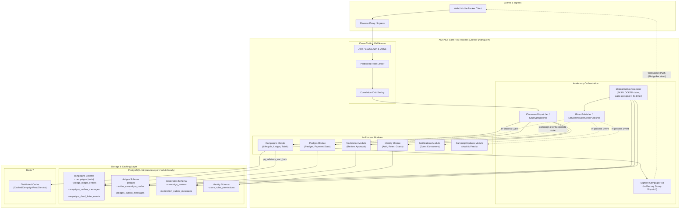

The system strikes a deliberate balance: it avoids the operational taxes of Kubernetes service meshes, Kafka clusters, and distributed transaction coordinators, while enforcing structural decoupling via independent project assemblies, dedicated EF Core `DbContext` instances, schema isolation, and transactional outboxes.

However, every architectural decision incurs a cost. The sections below analyze these trade-offs rigorously.

---

## 2. Core Architectural Trade-offs

### 2.1 Modular Monolith vs. Distributed Microservices

The CrowdFunding Hub architecture implements a **Modular Monolith** pattern: code is split into bounded modules (`Identity`, `Campaigns`, `Pledges`, `Moderation`, `Notifications`, `CampaignUpdates`), each maintaining internal domain models, application handlers, and infrastructure configurations, but running within a single unified host process.

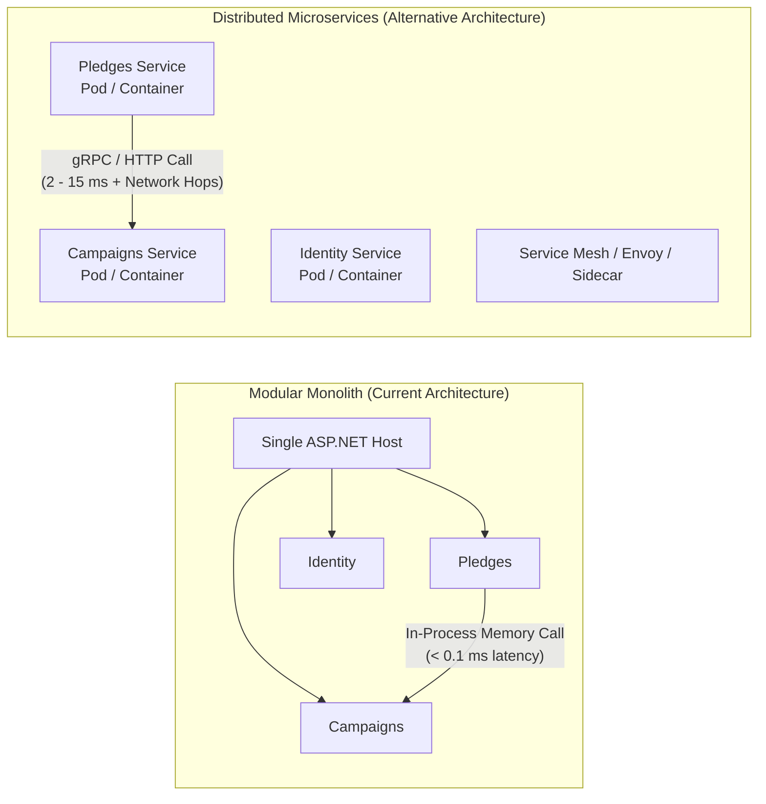

#### Comparison Matrix

| Architectural Dimension | Modular Monolith (CrowdFunding Hub) | Distributed Microservices |
| :--- | :--- | :--- |
| **Deployment Complexity** | **Very Low**: Single container image, single CI/CD pipeline, atomic zero-downtime rolling updates. | **High**: Multiple independently deployed artifacts, service meshes, canary releases, orchestration overhead. |
| **Operational Blast Radius** | **High**: An unhandled OOM, CPU saturation, or fatal crash in one module takes down the entire API host. | **Low**: A failure in `CampaignUpdates` does not crash `Pledges` or `Identity`. |
| **Scaling Flexibility** | **Coarse-Grained**: The entire monolithic process must be scaled out, even if only `Campaigns` queries are hot. | **Fine-Grained**: Hot services (e.g. pledge writes) can be scaled to 50 pods while moderation stays at 2 pods. |
| **Cross-Module Communication** | **Zero Latency**: Direct in-memory C# method calls via contracts and interfaces (`~50 nanoseconds`). | **Network Overhead**: Serialization (JSON/Protobuf), socket management, TLS handshakes, network latency (`2 - 20 ms`). |
| **Transaction Integrity** | **ACID Capable**: Modules can participate in coordinated database transactions if critical; outbox ensures consistency. | **Eventual Consistency / Sagas**: Requires 2-Phase Commit (anti-pattern) or complex choreographed Sagas with compensations. |
| **Polyglot & Team Autonomy** | **Constrained**: Single language (.NET 10 / C#), shared runtime, synchronized dependencies across projects. | **Unconstrained**: Teams can pick Go, Rust, Python, or Node.js per service and deploy on decoupled schedules. |
| **Cognitive & Operational Cost**| **Low**: Developers clone one repository, run `docker compose up`, and hit F5 to debug the entire flow end-to-end. | **High**: Distributed tracing, distributed logging, contract testing (Pact), local Docker-compose orchestration hurdles. |

#### Architectural Evaluation

> [!NOTE]
> **Why Modular Monolith was Chosen:**  
> For an early-to-mid-stage platform, developer velocity, atomic transactional guarantees, and operational simplicity dominate. A microservice architecture introduces distributed failure modes (network partitions, cascading timeouts, partial failures) long before the team size or traffic demands it. By enforcing strict NetArchTest boundaries and referencing only Contract projects, CrowdFunding Hub retains the code modularity of microservices without incurring the distributed systems tax.

> [!WARNING]
> **Trade-off Incurred:**  
> **No resource isolation.** A resource-intensive query in `Moderation` (e.g., generating an administrative audit report) can saturate host CPU cores or database worker threads, degrading the latency of backer checkout requests in `Pledges`.

---

### 2.2 Single Database with Schema Isolation vs. Database-Per-Service

CrowdFunding Hub gives every module its own PostgreSQL schema and dedicated EF Core context. There are six modules (Identity, Campaigns, Pledges, Moderation, Notifications, CampaignUpdates), plus the Audit and RosettaStone contexts, for example:
- [`CampaignsDbContext`](../src/Modules/Campaigns/CrowdFunding.Modules.Campaigns.Infrastructure/Persistence/DbContexts/CampaignsDbContext.cs)
- [`PledgesDbContext`](../src/Modules/Pledges/CrowdFunding.Modules.Pledges.Infrastructure/Persistence/DbContexts/PledgesDbContext.cs)
- [`IdentityDbContext`](../src/Modules/Identity/CrowdFunding.Modules.Identity.Infrastructure/Persistence/DbContexts/IdentityDbContext.cs)
- [`ModerationDbContext`](../src/Modules/Moderation/CrowdFunding.Modules.Moderation.Infrastructure/Persistence/DbContexts/ModerationDbContext.cs)

Each module registers an isolated EF migration history table via `npgsql.MigrationsHistoryTable("__EFMigrationsHistory", "<schema>")`. Where those schemas live is a configuration choice. A single shared database is only the `DefaultConnection` fallback; the local run (`docker-compose.yml`, `appsettings.Development.json`) uses **one database per module** (`identity_db`, `campaigns_db`, and so on), and `docker-compose.ha.yml` gives each of those a two-node Patroni cluster with a shared three-member etcd witness.

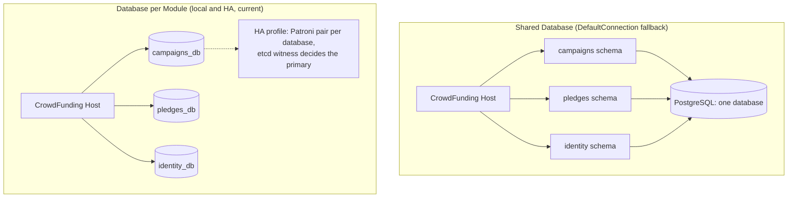

#### Comparison Matrix

| Dimension | Single Database + Schema Isolation (fallback) | Database-Per-Module / Service (local and HA) |
| :--- | :--- | :--- |
| **Operational Overhead** | **Trivial**: Single PostgreSQL instance to provision, backup, monitor, patch, replicate, and failover. | **High**: Multiplied maintenance; $N$ primary databases, $N$ replica sets, $N$ connection pools, independent backup schedules. |
| **Resource Contention ("Noisy Neighbor")**| **High**: Heavy write volume on pledges consumes disk IOPS, WAL write bandwidth, and buffer pool shared with Identity. | **Zero**: Physical isolation guarantees that an IOPS surge in Pledges has zero physical impact on Identity or Campaigns. |
| **Connection Pooling** | **Shared Pool Pressure**: Each application instance allocates connection pool slots across every module DbContext from a shared DB ceiling. | **Independent Pools**: Each service has its own dedicated connection pool tuned specifically to its own concurrency profile. |
| **Data Boundary Enforcement**| **Application-Enforced**: Schemas prevent accidental cross-entity relationships, but nothing physically prevents raw SQL cross-schema joins. | **Strict Physical Isolation**: Foreign keys and cross-service queries are physically impossible at the network and driver levels. |
| **Cross-Module Reporting** | **Simple**: Analytical queries or ETL pipelines can perform efficient read-only cross-schema queries if authorized. | **Complex**: Requires cross-database federated queries, data lake ingestion (e.g. via Debezium), or expensive API composition. |
| **Point-in-Time Recovery** | **Coarse-Grained**: Restoring the database rolls back *all* modules together to the target timestamp. | **Independent**: Can restore `Pledges` to 10:00 AM without reverting unrelated campaigns or identity registrations. |

#### Architectural Evaluation

> [!IMPORTANT]
> **The Schema-Isolation Compromise:**  
> By creating distinct schemas and mapping dedicated DbContexts with schema-isolated migration tables (`__EFMigrationsHistory`), the codebase establishes clean architectural boundaries. If a decision is later made to extract `Pledges` into an autonomous service, its entire database schema can be dumped via `pg_dump -n pledges` and restored into a dedicated database instance with zero schema refactoring.
>
> **The Vulnerability:**  
> In the shared-database configuration the single instance remains a **single point of failure (SPOF)** and a shared I/O bottleneck. A runaway transaction holding an exclusive lock on `campaigns` does not directly lock `pledges`, but WAL disk contention or CPU saturation on the Postgres host will degrade all modules uniformly.

---

### 2.3 Polling Outbox (`FOR UPDATE SKIP LOCKED`) vs. Change Data Capture (CDC via Debezium / Kafka)

To guarantee reliable at-least-once messaging without dual-write race conditions, write handlers persist domain events as [`OutboxMessage`](../src/BuildingBlocks/CrowdFunding.BuildingBlocks.Infrastructure/Persistence/OutboxMessage.cs) rows within the business transaction.

The codebase implements **Option A: PostgreSQL-native Polling Outbox using `FOR UPDATE SKIP LOCKED`** via [`OutboxClaimQuery`](../src/BuildingBlocks/CrowdFunding.BuildingBlocks.Infrastructure/Persistence/OutboxClaimQuery.cs) executed by [`ModuleOutboxProcessor<TDbContext>`](../src/BuildingBlocks/CrowdFunding.BuildingBlocks.Infrastructure/Outbox/ModuleOutboxProcessor.cs), a generic worker with one subclass per module (for example `CampaignsOutboxBackgroundService`).

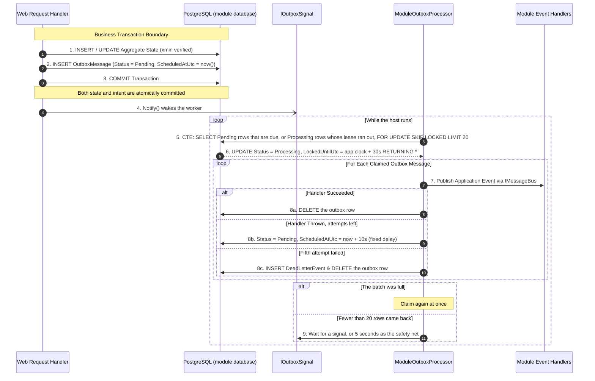

"Due" is judged on the application clock (`"ScheduledAtUtc" <= {3}`, bound to `DateTime.UtcNow`) because a database clock lagging the application's left just-queued rows unclaimable (26 of 92 integration tests failed at random). The lease (`LockedUntilUtc`) is written from the application clock as well, so a lease is never judged against a different clock from the one that wrote it.

#### The CDC Alternative (Debezium + Kafka / Redpanda)

In a CDC architecture, the outbox table is **append-only**. The background service does not poll the database. Instead, PostgreSQL's logical decoding engine (`pgoutput` plugin with `wal_level=logical`) streams committed transaction log segments directly to a Debezium connector, which forwards them to a Kafka or Redpanda topic.

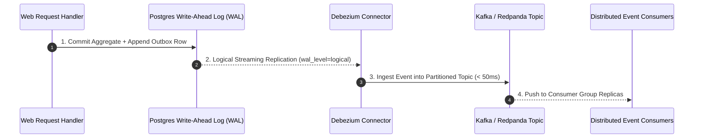

#### Comparison Matrix

| Architectural Dimension | Polling Outbox with `SKIP LOCKED` | CDC via Debezium + Kafka |
| :--- | :--- | :--- |
| **External Infrastructure** | **Zero**: Pure PostgreSQL. No extra daemons, brokers, or operational pipelines. | **Heavy**: Requires Kafka/Redpanda cluster, ZooKeeper/KRaft, Debezium Connect, Kafka Schema Registry. |
| **Dispatch Latency** | **Low to moderate**: The committing process wakes the worker through `IOutboxSignal`, so delivery usually starts within milliseconds. The 5-second timer is only the safety net for rows another instance wrote, a lost signal, or a failed message waiting out its fixed 10-second retry delay. | **Near-Zero**: Sub-100 millisecond latency. Events stream off the WAL as soon as the transaction commits. |
| **PostgreSQL MVCC Write Bloat**| **Severe under load**: Each outbox event requires 1 INSERT, 1 claim UPDATE (`Pending` $\to$ `Processing`) and 1 DELETE on success. Every UPDATE and DELETE leaves a dead tuple behind. | **None**: The outbox table is strictly append-only. No UPDATE statements; rows are purged in bulk or partitioned. |
| **Database Polling Overhead** | **Bounded**: A worker queries when a commit wakes it or its 5-second timer fires, whether or not new events exist. | **Zero Polling**: Database pushes changes via replication stream; zero query load or connection churn. |
| **Multi-Worker Coordination** | **Built-in (`SKIP LOCKED`)**: Concurrent workers claim non-overlapping batches atomically without distributed locks. | **Partition Consumer Groups**: Handled natively by Kafka consumer group rebalancing across worker pods. |
| **Event Replayability** | **None from the outbox**: A delivered row is deleted, so replaying means re-publishing from another source. Only dead-lettered events are kept (in the dead-letter table). | **Native**: Consumers can rewind Kafka topic offsets to reprocess historical events arbitrarily. |
| **Failure Blast Radius** | **Local**: If the worker crashes, the rows it had claimed stay in `Processing` until the 30-second lease runs out, then any worker reclaims them (see 3.3, Scenario A). | **Infrastructure Dependency**: If Kafka or Debezium crashes, WAL logs accumulate on Postgres disk, risking disk full outages. |

#### Mathematical Model of MVCC Write Amplification

In PostgreSQL, an `UPDATE` does not overwrite data in place; it writes an entirely new row version (tuple) and marks the old tuple dead.
For an event load of $\lambda$ events/second:
$$\text{Tuples Written per Second} = \lambda_{\text{insert}} + \lambda_{\text{claim\_update}} = 2\lambda$$
$$\text{Dead Tuples Generated per Second} = \lambda_{\text{claim\_update}} + \lambda_{\text{delete}} = 2\lambda$$

A successful delivery ends with a DELETE, which writes no new tuple but kills the claimed one, so rows do not pile up in the table; the dead tuples are what autovacuum has to clean.

At a modest volume of $100\text{ events/sec}$, the database generates:
$$200\text{ dead tuples/sec} \times 86,400\text{ sec/day} = 17,280,000\text{ dead tuples/day}$$

Without aggressive `autovacuum` tuning (specifically lowering `autovacuum_vacuum_scale_factor` to `0.05` and increasing `autovacuum_cost_limit`), the partial index `ix_*_pending` and the heap pages suffer severe bloat, degrading claim query response times and consuming significant disk I/O.

#### 2.3.1 The per-module inbox (consumer side)

Every module except Identity (Campaigns, Pledges, Moderation, Notifications, CampaignUpdates) keeps a `<module>_inbox_messages` table keyed `(MessageId, Consumer)`, where `Consumer` is the handler's full type name ([`EfInbox`](../src/BuildingBlocks/CrowdFunding.BuildingBlocks.Infrastructure/Persistence/EfInbox.cs), used by [`ServiceProviderEventPublisher`](../src/BuildingBlocks/CrowdFunding.BuildingBlocks.Infrastructure/Events/ServiceProviderEventPublisher.cs)). The handler runs first; only after it succeeds is the pair recorded with `INSERT ... ON CONFLICT DO NOTHING`. A crash between the handler and the record therefore re-runs the handler once, so handlers must still tolerate a repeat. Both transports carry the outbox row id as the message id (in process through `InboxMessageContext`, over RabbitMQ as the CloudEvents envelope id read by `RabbitMqConsumerHost`), so the inbox applies to both. A retention task deletes inbox rows older than `Retention:InboxDays` (14 days by default), and another clears pledge idempotency keys older than `Retention:IdempotencyKeyDays` (7 days), both hourly. See the retry test in [`TESTS_THAT_TEACH.md`](TESTS_THAT_TEACH.md).

---

### 2.4 PostgreSQL Transactional Advisory Locks vs. Distributed Redis Redlock

CrowdFunding Hub uses PostgreSQL transaction-scoped advisory locks via [`pg_advisory_xact_lock`](../src/Modules/Campaigns/CrowdFunding.Modules.Campaigns.Infrastructure/Transactions/CampaignTransactionExecutor.cs#L55) to serialize concurrent modifications to the same campaign aggregate (e.g. `AddPledgeToCampaignCommandHandler` and `CancelCampaignCommandHandler`). Keys are computed deterministically via 64-bit entropy XOR in [`AdvisoryLockKey.FromGuid`](../src/BuildingBlocks/CrowdFunding.BuildingBlocks.Domain/Common/AdvisoryLockKey.cs#L14).

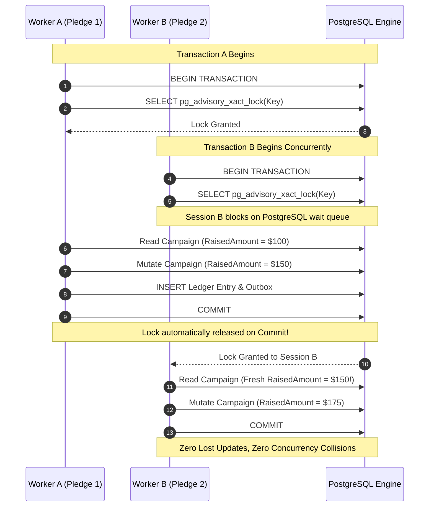

#### The Distributed Alternative: Redis Redlock

In a Redis Redlock pattern, the application acquires an algorithmic distributed lock across multiple independent Redis nodes before beginning the database transaction, maintaining a heartbeat to extend the lock lease until work completes.

#### Comparison Matrix

| Dimension | PostgreSQL `pg_advisory_xact_lock` | Distributed Redis Redlock |
| :--- | :--- | :--- |
| **Lock Lifecycle & Rollback** | **ACID-Native**: Lock is bound directly to the database transaction. If the host crashes, network drops, or query times out, the lock is **automatically released instantly**. | **Time-To-Live (TTL) Leased**: Lock requires a TTL. If the process crashes, the lock remains orphaned until TTL expires. |
| **Split-Brain & GC Pauses** | **Zero Risk**: PostgreSQL enforces lock mutual exclusion at the storage engine level; pauses cannot cause stale lock leakage. | **Vulnerable**: Martin Kleppmann's critique: a long GC pause can allow the TTL to expire while the worker still believes it owns the lock. |
| **Connection Consumption** | **High**: The waiting session occupies an active PostgreSQL server connection and client pool connection for the entire duration of the wait. | **Zero DB Connections**: Contending threads wait on Redis or in-memory queues; database connections are only opened after the lock is acquired. |
| **Throughput Ceiling** | **Capped by DB Connection Pool**: If 100 concurrent requests contend for the same aggregate, all 100 pool connections are locked, starving other queries. | **Extremely High**: Redis handles 100,000+ operations/second in-memory with sub-millisecond acquisition latency. |
| **Operational Overhead** | **Zero**: Uses existing relational database engine. | **Moderate to High**: Requires 3 to 5 independent Redis master nodes for true consensus-based Redlock safety. |
| **Scope of Application** | **Single DB Instance Only**: Cannot coordinate transactions across disparate databases or external HTTP APIs. | **Universal**: Can coordinate work across microservices, external payment gateways, or third-party webhooks. |

#### Architectural Evaluation

> [!TIP]
> **Why Advisory Locks are Optimal Today:**  
> Financial ledger updates must guarantee absolute serializability. Because `pg_advisory_xact_lock` is transaction-scoped, it has zero chance of leaving orphaned locks if an ASP.NET Core pod is abruptly terminated by Kubernetes (OOMKilled/SIGKILL).
>
> **The Bottleneck:**  
> If a high-profile crowdfunding campaign goes viral, receiving 500 pledges/second, all 500 requests will queue inside PostgreSQL for the same 64-bit advisory key. This will instantly exhaust the Npgsql connection pool (default: 100 connections), causing catastrophic connection starvation across unrelated modules (`Identity`, `Moderation`).

---

### 2.5 Synchronous Read Services vs. Eventual Consistency & Replicated Read Models

When a backer attempts to pledge funds via `POST /api/campaigns/{campaignId}/pledges`, the `Pledges` module must verify that the campaign exists, is currently `Published`, has not passed its deadline, and accepts the specified currency.

The architecture solves this with a **replicated read model** (Event-Carried State Transfer):
1. `Campaigns` publishes `CampaignCreated`, `CampaignPublished`, `CampaignCancelled`, `CampaignSucceeded` and `CampaignFailed` application events through its outbox.
2. [`ReplicatedCampaignEventHandlers`](../src/Modules/Pledges/CrowdFunding.Modules.Pledges.Application/Features/ActiveCampaigns/Events/ReplicatedCampaignEventHandlers.cs) in `Pledges` consume them and keep a local table, `pledges.active_campaigns_cache` (campaign id, owner, title, currency, an `IsActive` flag and the deadline), in the `Pledges` database through [`IActiveCampaignCacheRepository`](../src/Modules/Pledges/CrowdFunding.Modules.Pledges.Application/Abstractions/Persistence/IActiveCampaignCacheRepository.cs).
3. [`MakePledgeCommandHandler`](../src/Modules/Pledges/CrowdFunding.Modules.Pledges.Application/Features/Pledges/Commands/MakePledge/MakePledgeCommandHandler.cs) reads only that local table. It never calls into `Campaigns`.

An earlier design had `Pledges` call a synchronous in-process reader, `ICampaignPledgeAvailabilityReader`, that queried `CampaignsDbContext` directly. That interface and its implementation were removed; the rest of this section compares the two designs.

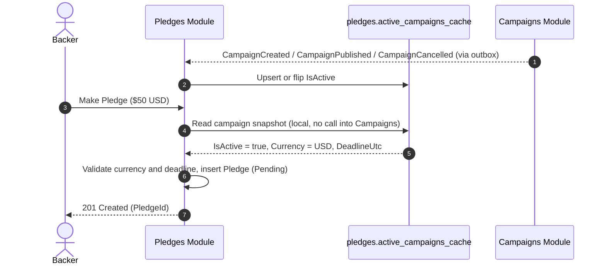

#### The Synchronous Alternative: an In-Process Reader (the earlier design)

In the monolith `Pledges` could ask `Campaigns` directly, through a contract interface that read `campaigns.campaigns` in the same memory space. That is simple and strongly consistent, but it ties the two modules together at runtime.

#### Comparison Matrix

| Dimension | Synchronous In-Process Reader (earlier design) | Replicated Read Model (Current) |
| :--- | :--- | :--- |
| **Consistency Guarantee** | **Strict Strong Consistency**: Always reads the absolute latest committed state in PostgreSQL. Zero window for stale reads. | **Eventual Consistency**: The replica lags by the event delivery time (milliseconds with the outbox wake-up signal, up to the 5-second safety-net timer). |
| **Temporal Coupling** | **High**: A slow query or lock contention in the `Campaigns` schema directly blocks the `Pledges` command handler. | **Zero**: `Pledges` queries its own local table; failures or slowdowns in `Campaigns` have no effect on pledges. |
| **In-Process Code Coupling** | **Moderate**: `Pledges` depends on a `Campaigns` query contract. Cannot extract `Pledges` without introducing network RPC. | **Low**: `Pledges` only consumes `Campaigns` application events. |
| **Storage Overhead** | **Zero Duplication**: Data is stored once in `campaigns.campaigns`. | **Storage Duplication**: A few attributes per campaign are copied into `pledges.active_campaigns_cache`. |
| **Compensation Complexity** | **Zero**: Invalid pledges are rejected immediately at the API gate. | **Higher**: A pledge can be accepted against a campaign that was cancelled moments earlier and must then be refunded. |

#### The "Cancelled Campaign Race" Scenario

Eventual consistency has a price, and this is the window in which it shows:
1. **T0 (00:00)**: Campaign creator cancels Campaign X due to suspected fraud. Aggregate updates `Status = Cancelled`. Outbox row is inserted and the worker is woken.
2. **T1 (00:00, a moment later)**: Backer submits a $1,000 pledge for Campaign X before the `CampaignCancelled` event has reached `Pledges`.
3. **T2**: `Pledges` checks its replicated read model. The local replica still shows `IsActive = true`, so the pledge is accepted.
4. **T3**: The event arrives and `Pledges` flips the replica to inactive. Further pledges and payment confirmations are rejected.
5. **Result**: The pledge that slipped in is not lost track of. `CampaignTerminationRefundHandler` refunds every pledge of the campaign that has already succeeded, and `ConfirmPledgePaymentCommandHandler` refuses to confirm a payment once the replica says the campaign is no longer published. The window is milliseconds with the wake-up signal, not the several seconds a fixed polling timer would leave. Refunds go through a fake payment provider today (see Known Gaps).

> [!NOTE]
> **Conclusion:** The replicated read model costs a short stale window and a refund path for the pledge that lands inside it. In return, `Pledges` no longer depends on `Campaigns` at runtime, which is what makes extracting it into its own service possible.

---

### 2.6 In-Memory SignalR vs. Distributed Redis Backplane

> [!NOTE]
> **Resolved (TICKET-048):** `Program.cs` now wires `AddStackExchangeRedis()` onto the SignalR
> server builder whenever `ConnectionStrings:Redis` is configured, falling back to in-memory-only
> operation otherwise (still correct for a single instance, just not horizontally scalable). The
> "Current State" description and Deployment Blocker callout below describe the *prior* state and
> are kept for the architectural rationale; they no longer describe the shipped configuration.

The API layer hosts [`CampaignHub`](../src/API/CrowdFunding.API/RealTime/CampaignHub.cs) to stream real-time funding progress (`PledgeReceived`) to connected browser clients via WebSocket connections.

Previously, in [`Program.cs`](../src/API/CrowdFunding.API/Program.cs#L64), SignalR was configured using only the standard in-memory message bus:
```csharp
builder.Services.AddSignalR();
builder.Services.AddScoped<ICampaignRealtimeNotifier, SignalRCampaignRealtimeNotifier>();
```

```mermaid
graph TB
    subgraph "Current Single-Instance Model (In-Memory)"
        Client1["Client 1 (Connected to Pod A)"]
        Client2["Client 2 (Connected to Pod A)"]
        PodA["API Pod A<br/>SignalR In-Memory Hub"]
        Client1 -.-> PodA
        Client2 -.-> PodA
        PodA -- "Broadcasts to all clients" --> Client1
        PodA -- "Broadcasts to all clients" --> Client2
    end

    subgraph "The Multi-Instance Failure Trap (Without Redis Backplane)"
        ClientA["Client A (Connected to Pod 1)"]
        ClientB["Client B (Connected to Pod 2)"]
        Pod1["API Pod 1"]
        Pod2["API Pod 2"]
        ClientA -.-> Pod1
        ClientB -.-> Pod2
        PledgeEvt["Pledge Processed on Pod 1"] --> Pod1
        Pod1 -- "Local Broadcast Only!" --> ClientA
        Pod1 -.-x|"Client B NEVER receives update!"| ClientB
    end

    subgraph "Distributed Model (With Redis Backplane)"
        ClientX["Client X (Pod 1)"]
        ClientY["Client Y (Pod 2)"]
        P1["API Pod 1"]
        P2["API Pod 2"]
        RedisBus[("Redis Pub/Sub Backplane")]
        ClientX -.-> P1
        ClientY -.-> P2
        P1 -- "Publish PledgeEvent" --> RedisBus
        RedisBus -- "Fanout" --> P1
        RedisBus -- "Fanout" --> P2
        P1 --> ClientX
        P2 --> ClientY
    end
```

#### Comparison Matrix

| Dimension | In-Memory SignalR (Current State) | Distributed Redis Backplane (`AddStackExchangeRedis`) |
| :--- | :--- | :--- |
| **Infrastructure Dependency** | **None**: Runs entirely inside the ASP.NET Core process memory space. | **Requires Redis**: Relies on Redis Pub/Sub channels for cross-node synchronization. |
| **Horizontal Scalability** | ❌ **Completely Broken**: Deploying $\ge 2$ API replicas results in silent message drops for clients connected to other pods. | ✅ **Fully Scalable**: Works seamlessly across arbitrary horizontal container replicas behind a load balancer. |
| **Broadcast Latency** | **Sub-millisecond**: In-memory pointer dispatch directly to open WebSocket connection buffers. | **Minimal**: Incurs a 1-2 ms network round-trip through Redis Pub/Sub before local fanout. |
| **Memory Footprint** | Low: Tracks connection state locally in heap memory. | Low to Moderate: Requires local Redis connection multiplexer and channel subscription buffers. |
| **Operational Overhead** | Zero configuration. | Requires Redis connection management, health checks, and connection recovery handling. |

#### Architectural Evaluation

> [!NOTE]
> **Resolved:** the codebase already provisioned Redis for response caching ([`CachedCampaignReadService`](../src/Modules/Campaigns/CrowdFunding.Modules.Campaigns.Infrastructure/Caching/CachedCampaignReadService.cs)); `AddStackExchangeRedis()` is now wired into SignalR against that same connection string (TICKET-048), so deploying across multiple instances behind a load balancer no longer silently drops real-time broadcasts.

---

## 3. Current Codebase Limitations & Operating Boundaries

### 3.1 Explicit Catalog of System Ceilings & Degradation Modes

Through architectural analysis of the codebase, the following concrete limitations have been identified:

```mermaid
graph TD
    subgraph "Bottleneck 1: Advisory Lock Serializer"
        L1["500 Pledges / Sec on Single Campaign"] --> L2["Advisory Lock Queue (pg_advisory_xact_lock)"]
        L2 --> L3["Max 65 Transactions/Sec per Campaign"]
        L3 --> L4["100-Connection Pool Saturation"]
        L4 --> L5["503 Service Unavailable across entire API"]
    end

    subgraph "Bottleneck 2: Outbox Processing Throughput"
        O1["Burst of 2,000 Pledges"] --> O2["Outbox Table Backlog"]
        O2 --> O3["Batch of 20 claimed; a full batch is followed by the next claim at once"]
        O3 --> O4["Drain rate is set by handler speed, one message at a time per module"]
        O4 --> O5["Delay lasts only while arrivals outpace handlers"]
    end
```

#### 1. Single-Aggregate Write Serialization Ceiling
- **Root Cause**: `CampaignTransactionExecutor` enforces an exclusive `pg_advisory_xact_lock` derived from the `CampaignId`.
- **Operating Ceiling**: In PostgreSQL, an ACID transaction executing `pg_advisory_xact_lock`, validating state, updating `RaisedAmount`, inserting an append-only ledger entry, inserting an outbox row, and committing takes approximately `12 to 18 ms` of round-trip execution time under SSD backing.
- **Maximum Single-Campaign Throughput**:
  $$\text{Throughput}_{\text{max}} = \frac{1000\text{ ms}}{15\text{ ms/tx}} \approx \mathbf{65\text{ writes/second per campaign}}$$
- **Degradation Behavior**: Any concurrency exceeding 65 requests/second targeting the *same* campaign aggregate will queue inside the database driver. Once the queue exceeds the connection pool limit (`MaxPoolSize=100`), incoming HTTP requests fail immediately with Npgsql connection timeout exceptions.

#### 2. Outbox Dispatch Latency & Handler-Bound Draining
- **Root Cause**: In [`ModuleOutboxProcessor.cs`](../src/BuildingBlocks/CrowdFunding.BuildingBlocks.Infrastructure/Outbox/ModuleOutboxProcessor.cs), a worker claims up to `BatchSize = 20` rows, publishes them one after another, and, when the batch was full, claims again at once. When fewer than 20 rows come back it waits for the commit signal, or for the 5-second timer as a safety net. A batch gate lets only one batch per module run at a time inside a process.
- **Operating Ceiling**: There is no fixed events-per-second cap from the timer. The ceiling is how long the handlers take: for example, handlers that need 50 ms each drain about 20 events per second per module in one process. More instances claim disjoint batches (`SKIP LOCKED`) and raise the ceiling.
- **Degradation Behavior**: If a flash-funding event creates more events than the handlers can finish, the outbox accumulates a backlog until arrivals slow down. While it exists:
  - The campaign's `RaisedAmount` on public pages is out of date.
  - SignalR real-time pledges to backers lag by the length of the backlog.
  - OpenMeter usage and monetization metering events are delayed.
- **Failed messages**: A message whose handler throws goes back to `Pending` with a fixed 10-second delay and is dead-lettered after five attempts, so one bad message delays only itself.

#### 3. Database Connection Pool Exhaustion
- **Root Cause**: Each HTTP request handling a pledge activates multiple scoped dependencies. In an in-process modular monolith, a single web request may open connections to `CampaignsDbContext` and `PledgesDbContext` within the same asynchronous scope.
- **Operating Ceiling**: With default Npgsql pool settings (`MaxPoolSize=100`) and a typical cloud database configured for 200 `max_connections`, a sustained concurrency of 80+ write requests combined with active background outbox polling will saturate available connection slots.
- **Degradation Behavior**: Requests block waiting for a free connection from the pool. If no connection becomes free within `Timeout=15s`, requests throw `NpgsqlException: The connection pool has been exhausted`.

#### 4. PostgreSQL MVCC Table Bloat
- **Root Cause**: The outbox implementation inserts a `Pending` row, updates it to `Processing` when a worker claims it, and deletes it when delivery succeeds (a failed message goes back to `Pending`; an exhausted one moves to the dead-letter table).
- **Operating Ceiling**: Under a sustained load of 50 events/second, the table generates 100 dead tuples per second (8.6 million dead tuples daily).
- **Degradation Behavior**: Unless PostgreSQL `autovacuum` is aggressively tuned specifically for these tables, table heap pages and the partial index `ix_*_pending` expand significantly. Sequential table scans during vacuuming compete with user queries for disk I/O bandwidth.

#### 5. SignalR Horizontal Scaling Barrier
- **Root Cause**: Without a Redis backplane each instance only knows its own WebSocket clients. `Program.cs` adds `AddStackExchangeRedis()` to SignalR whenever `ConnectionStrings:Redis` is configured; without that setting the hub is in-memory only.
- **Operating Ceiling**: With Redis configured, several instances work. Without it, strictly **1 container instance**.
- **Degradation Behavior**: Running 2 or more replicas without the backplane causes silent notification loss; backers connected to Instance B never receive updates generated by transactions processed on Instance A.

---

### 3.2 Operating Metrics & Boundary Thresholds Matrix

The following operational matrix defines the tested safe ranges, warning thresholds, and absolute breaking limits for CrowdFunding Hub:

| Metric / Dimension | Safe Operating Range | Degradation Warning Threshold | Hard System Ceiling | Primary Limiting Factor | Consequence of Breach |
| :--- | :--- | :--- | :--- | :--- | :--- |
| **Global Write Throughput** | 0 – 100 TPS | 100 – 250 TPS | **~350 TPS** | PostgreSQL Write-Ahead Log (WAL) sync & disk I/O | Database latency spikes; connection timeouts. |
| **Single-Campaign Write Concurrency** | 0 – 30 TPS | 30 – 55 TPS | **~65 TPS** | `pg_advisory_xact_lock` sequential execution queue | HTTP 500 / connection pool starvation. |
| **Outbox Event Ingestion Rate** | Backlog empties between pledges | Backlog persists over several batches | Arrival rate above handler speed (single node) | How fast handlers finish; batches of 20 run back to back | Event dispatch lag grows; stale UI totals. |
| **Concurrent WebSocket Connections** | 0 – 2,500 | 2,500 – 10,000 | **~15,000** (single node) | Linux file descriptors & ASP.NET Core memory buffers | Dropped WebSocket handshakes; host OOM. |
| **Active Web Worker Replicas** | Any, with the Redis backplane configured | 1 Node without it | **1 Node** (for SignalR, when `ConnectionStrings:Redis` is not set) | SignalR Redis backplane not configured | Real-time events dropped across nodes. |
| **Outbox Queue Depth** | 0 – 50 rows | 50 – 500 rows | **> 2,000 rows** | Handler speed & database I/O | Latency between pledge and credit keeps growing. |
| **Database Connection Pool Usage** | 0 – 40% | 40 – 75% | **100% (100 conns)** | Npgsql client-side connection pool ceiling | `TimeoutException`: connection pool exhausted. |

---

### 3.3 Failure Mode and Effects Analysis (FMEA)

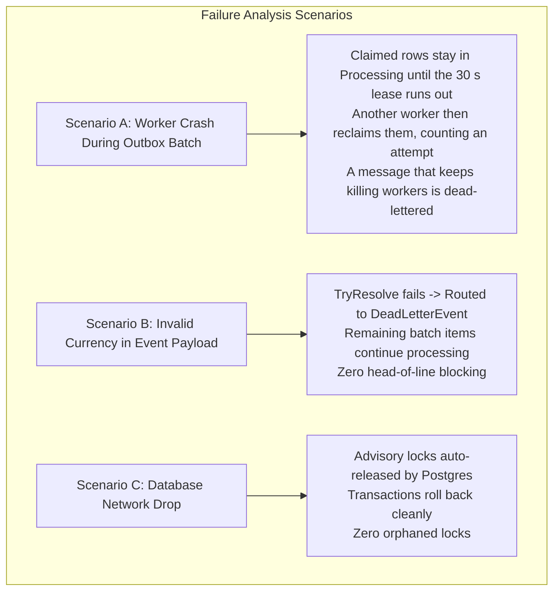

#### Scenario A: Worker Crash Mid-Batch
- **Event**: An API container crashes or is terminated by the host while executing `eventPublisher.PublishAsync()` for message 5 of a 20-message claimed batch.
- **System Defense**: In [`OutboxClaimQuery.cs`](../src/BuildingBlocks/CrowdFunding.BuildingBlocks.Infrastructure/Persistence/OutboxClaimQuery.cs#L41), the claim writes `"LockedUntilUtc"` as the application clock plus the 30-second lock duration, and the same statement also selects `Processing` rows whose lease has already run out.
- **Result**: The remaining unprocessed rows stay in `Processing` until their lease runs out (30 seconds). The next claim by any worker or replica takes them again and counts that as an attempt; after five claims that never finished, the message is written to the dead-letter table instead of being handed out again, so a message that crashes the process cannot loop forever. A handler that runs longer than the lease can be claimed twice, so consumers must stay idempotent (the inbox, 2.3.1). Covered by `OutboxReclaimE2ETests`. `WebhookDeliveryTaskRepository` has its own reclaim for its own table.

#### Scenario B: Poison / Corrupt Event Payload
- **Event**: A serialized JSON payload in the outbox cannot be deserialized, or its CLR type cannot be resolved by `EventTypeRegistry`.
- **System Defense**: In [`ModuleOutboxProcessor.cs`](../src/BuildingBlocks/CrowdFunding.BuildingBlocks.Infrastructure/Outbox/ModuleOutboxProcessor.cs), if `message.TryResolve(...)` returns `false`, the processor writes an audited record to `DeadLetterEvent`, removes the row from the outbox table, logs an alert, and executes `continue`.
- **Result**: **No Head-of-Line Blocking.** The single corrupt message is permanently isolated without blocking the remaining 19 messages in the batch.

#### Scenario C: Database Network Drop During Advisory-Locked Mutation
- **Event**: The application server loses network connectivity to PostgreSQL while holding `pg_advisory_xact_lock` for a campaign.
- **System Defense**: Because the lock was acquired with `pg_advisory_xact_lock` (transaction-scoped) rather than `pg_advisory_lock` (session-scoped), PostgreSQL's connection-health monitor detects the severed socket, terminates the backend server process, automatically rolls back the transaction, and releases the advisory lock immediately.
- **Result**: **Zero orphaned locks.** No manual database administration is required to clear locks.

---

## 4. System Evolution Roadmap

To evolve CrowdFunding Hub predictably as traffic scales, engineering should follow a three-phase transition plan guided by quantitative metrics rather than arbitrary architectural trends.

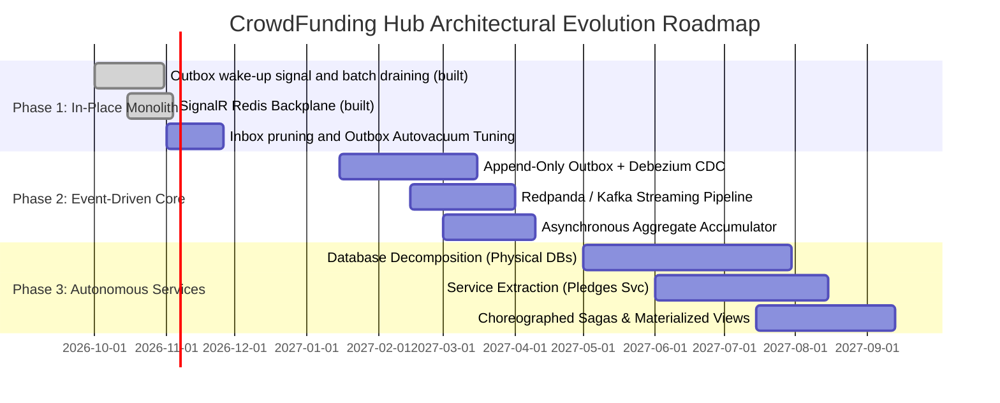

### 4.1 Quantitative & Qualitative Architectural Triggers

Engineering should initiate the transition between architectural phases when the following operational indicators are reached:

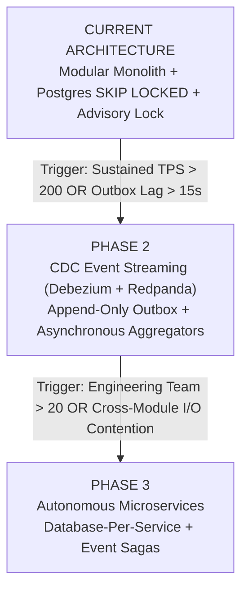

---

### 4.2 Phase 1: In-Place Monolith Hardening (0 – 250 TPS)

*Focus: Maximize single-process throughput, enable horizontal web scaling, and eliminate outbox dispatch latency without adding distributed infrastructure.*

#### 1. Outbox wake-up signal and batch draining (built)
- **Where**: [`ModuleOutboxProcessor.cs`](../src/BuildingBlocks/CrowdFunding.BuildingBlocks.Infrastructure/Outbox/ModuleOutboxProcessor.cs) claims again at once when a batch comes back full, and otherwise waits on `IOutboxSignal` (woken by the commit that wrote the rows) with the 5-second timer as a safety net.
- **Benefit**: Delivery usually starts within milliseconds of the commit, and a burst drains at handler speed instead of one batch per timer tick.

#### 2. Redis backplane for SignalR (built)
- **Where**: `Program.cs` calls `AddStackExchangeRedis` on the SignalR builder when `ConnectionStrings:Redis` is configured.
- **Benefit**: Several API instances behind a load balancer all reach every connected client.

#### 3. Keep the outbox and inbox tables small
- **Outbox**: Delivered rows are deleted on success and dead-lettered rows move to the dead-letter table, so the outbox table holds only pending and in-flight work. Remaining work is tuning autovacuum for the update and delete churn (see the checklist in section 5).
- **Inbox**: Nothing prunes `<module>_inbox_messages` yet. A scheduled job that deletes rows older than the longest redelivery window, or partitioning the table by `ProcessedAtUtc`, would keep it bounded.
- **Benefit**: Keeps table heaps small and the indexes pinned in the PostgreSQL buffer cache.

---

### 4.3 Phase 2: Event-Driven Modernization with CDC & Stream Processing (250 – 1,000 TPS)

*Focus: Eliminate database polling overhead, decouple event consumers, and remove write amplification on PostgreSQL.*

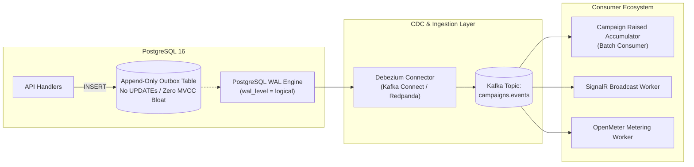

#### 1. Transition to Append-Only Outbox + Debezium CDC
- **Change**: Modify transaction executors to treat the outbox table as strictly **append-only**. Remove `Status`, `Attempts`, `LockedBy`, and `LockedUntilUtc`.
- **Infrastructure**: Provision Debezium connector configured to capture the outbox table using `pgoutput`.
- **Result**:
  - Outbox write amplification drops from two tuple writes per event (insert and claim update, plus a delete) to a single insert.
  - Event dispatch latency becomes a steady $< 50\text{ ms}$, instead of depending on the signal and the 5-second safety-net timer.
  - Polling queries on PostgreSQL drop to zero.

#### 2. Asynchronous Raised Amount Accumulator
- **Change**: Replace per-pledge `pg_advisory_xact_lock` updates on `Campaign.RaisedAmount`. Instead, the pledge handler only appends a confirmed payment event.
- **Processing**: A stream consumer (e.g. using Kafka Streams or Flink) micro-batches pledges over a 500ms sliding window and writes batched increment statements:
  ```sql
  UPDATE campaigns SET raised_amount = raised_amount + @batchTotal WHERE id = @campaignId;
  ```
- **Benefit**: Completely removes the 65 TPS per-campaign bottleneck, allowing individual viral campaigns to accept thousands of pledges per second.

---

### 4.4 Phase 3: Autonomous Service Decomposition (> 1,000 TPS / Multi-Team Organization)

*Focus: Physical fault isolation, independent team deployment cycles, and autonomous database scaling.*

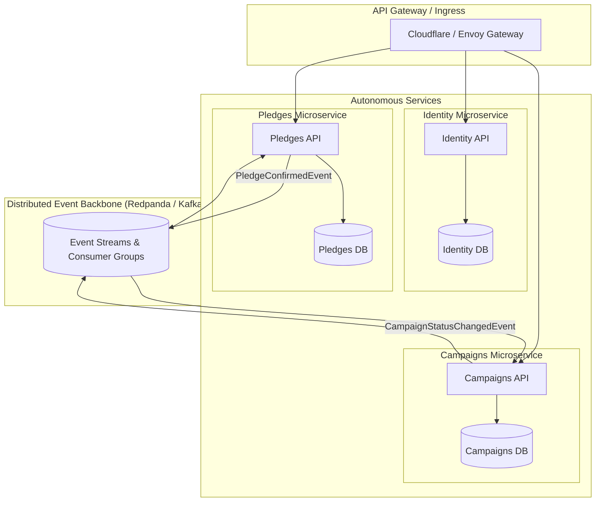

#### 1. Physical Database Extraction
- Migrate `pledges` and `identity` schemas into physically dedicated database instances.
- Configure dedicated connection pools and independent backup/recovery schedules per service.

#### 2. Asynchronous Replicated Read Models
- Already in place inside the monolith: `Pledges` keeps `active_campaigns_cache` in its own database and updates it from `CampaignCreated`, `CampaignPublished`, `CampaignCancelled`, `CampaignSucceeded` and `CampaignFailed` events (section 2.5).
- Remaining step: feed the same handlers from Kafka stream consumers instead of the in-process bus.
- Extend the existing refund handler (`CampaignTerminationRefundHandler`) into a compensation saga for a pledge that slips in during the eventual consistency window of a campaign cancellation. Done: a late confirmation is refused under the campaign lock and refunded through the payment provider.

#### 3. Lock-Free Partitioned Event Sourcing
- Route all events for a given `CampaignId` to the same Kafka partition key.
- By definition, a single Kafka consumer partition processes messages strictly sequentially, achieving guaranteed order and serialization **without requiring any database locks or distributed mutexes**.

---

## 5. Summary Decision Matrix & Operational Checklist

### Architectural Trade-off Summary Matrix

| Decision Area | Selected Pattern | Alternative Pattern | Primary Justification | Key Trade-off / Downside Accepted |
| :--- | :--- | :--- | :--- | :--- |
| **System Boundary** | **Modular Monolith** | Distributed Microservices | Maximize developer velocity; zero network overhead; atomic transactional boundary options. | Single process failure domain; coarse-grained scaling. |
| **Data Persistence** | **Schema per module; one shared database as the fallback, one database per module locally (Patroni pairs in the HA profile)** | Database-per-Service | Schema boundaries and per-schema migration history hold either way; the shared fallback has a single backup target. | Shared fallback: connection pool ceiling and noisy neighbor I/O. Per-module databases: more instances to back up and migrate. |
| **Outbox Dispatch** | **PostgreSQL `SKIP LOCKED` with a wake-up signal** | CDC (Debezium / Kafka) | Zero extra infrastructure; native ACID consistency; simple operational surface. | Polling queries (signal plus a 5-second safety net) and dead tuples from the claim update and the delete. |
| **Aggregate Locking** | **`pg_advisory_xact_lock`** | Distributed Redis Redlock | ACID transaction-bound; automatic rollback on failure; zero risk of orphaned locks. | Ties up active DB connection while waiting; caps single-campaign writes to ~65 TPS. |
| **Cross-Module Reads**| **Replicated Read Model (Event-Carried State Transfer)** | Synchronous In-Process Adapter | No runtime dependency of `Pledges` on `Campaigns`; local sub-millisecond reads. | A short stale window after a cancellation, covered by the refund handler. |
| **Real-time Push** | **SignalR with a Redis backplane when `ConnectionStrings:Redis` is set, in-memory otherwise** | In-Memory only | Zero configuration for local development; several nodes work once Redis is configured. | Without the Redis setting, one node only: messages do not reach clients on other nodes. |

---

### Production Operational Checklist

Prior to promoting CrowdFunding Hub to high-traffic production environments, the operations and engineering teams must complete the following mandatory remediations:

- [ ] **Configure Redis for SignalR**: Set `ConnectionStrings:Redis` before provisioning more than 1 container replica, so `Program.cs` adds the backplane.
- [ ] **Tune PostgreSQL Autovacuum**: Apply aggressive vacuum parameters to all `*_outbox_messages` tables:
  ```sql
  ALTER TABLE campaigns_outbox_messages SET (
      autovacuum_vacuum_scale_factor = 0.05,
      autovacuum_vacuum_cost_limit = 1000
  );
  ```
- [x] **Establish Inbox Purge Job**: `RetentionBackgroundService` runs an `InboxPruneTask` per module hourly and deletes inbox rows older than `Retention:InboxDays` (14 by default); `RetentionE2ETests` covers it.
- [ ] **Set Metric Alarms**:
  - Alert if `Outbox Lag (p95)` exceeds **15 seconds**.
  - Alert if PostgreSQL `Connection Pool Utilization` exceeds **75%**.
  - Alert if `DeadLetterEvent` row count increases by $> 0$.
  - Alert if average duration of `pg_advisory_xact_lock` execution exceeds **50 ms**.

---

### Known Gaps

The detailed lists live in [`TESTS_THAT_TEACH.md`](TESTS_THAT_TEACH.md) ("Gaps") and `educational/03-engineering-spec-and-roadmap/design-to-code-mapping-round1.md` (section 6). In short:

- The ledger lacks an entry kind, a sign check and a trigger.
- Refunds, charges and creator payouts go through a fake payment provider; there is no real provider. Card saving and charge-at-the-deadline exist but are opt-in (`Payments:FundingModel`); charge-now is the default.
- Success and failure emails are not built.
- The campaign scavenger is untested, and the inbox crash window has only a note. Outbox crash recovery is covered by `OutboxReclaimE2ETests`.
