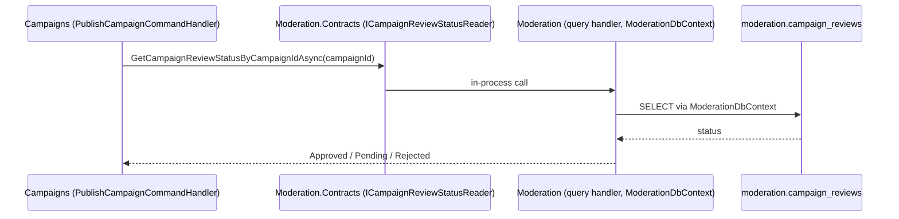

# Data Ownership in a Modular Monolith

> **Audience:** senior engineers, tech leads and architects
> **Rule:** every module owns one PostgreSQL schema. Its tables, its outbox, its inbox, its dead letters and its migration history live there, and no other module maps a table into it.
> **Enforced by:** [`ModuleSchemaOwnershipTests`](../tests/ArchitectureTests/CrowdFunding.ArchitectureTests/ModuleSchemaOwnershipTests.cs) (the model) and [`ModuleSchemaMigrationTests`](../tests/IntegrationTests/CrowdFunding.IntegrationTests/ModuleSchemaMigrationTests.cs) (the upgrade)

---

## 1. The schema map

All modules share one PostgreSQL database. Each module's DbContext declares its schema as a constant (`CampaignsDbContext.Schema`, ...), calls `modelBuilder.HasDefaultSchema(Schema)`, and puts its EF migrations history table in the same schema.

| Schema | Owner (DbContext) | Tables |
| :--- | :--- | :--- |
| `campaigns` | [`CampaignsDbContext`](../src/Modules/Campaigns/CrowdFunding.Modules.Campaigns.Infrastructure/Persistence/DbContexts/CampaignsDbContext.cs) | `campaigns`, `reward_tiers`, `reward_tier_reservations`, `campaign_ledger_entries`, `campaigns_outbox_messages`, `campaigns_dead_letter_events`, `__EFMigrationsHistory`; trigger functions `campaign_ledger_entries_reject_changes()`, `campaigns_raised_amount_matches_ledger()` |
| `contributions` | [`ContributionsDbContext`](../src/Modules/Contributions/CrowdFunding.Modules.Contributions.Infrastructure/Persistence/DbContexts/ContributionsDbContext.cs) | `contributions`, `active_campaigns_cache` (replicated read model), `contributions_outbox_messages`, `contributions_dead_letter_events`, `contributions_processed_events` (inbox), `__EFMigrationsHistory` |
| `identity` | [`IdentityDbContext`](../src/Modules/Identity/CrowdFunding.Modules.Identity.Infrastructure/Persistence/DbContexts/IdentityDbContext.cs) | `users`, `user_roles`, `user_permissions`, `refresh_tokens`, `identity_signing_keys`, `__EFMigrationsHistory` |
| `moderation` | [`ModerationDbContext`](../src/Modules/Moderation/CrowdFunding.Modules.Moderation.Infrastructure/Persistence/DbContexts/ModerationDbContext.cs) | `campaign_reviews`, `moderation_outbox_messages`, `moderation_dead_letter_events`, `__EFMigrationsHistory` |
| `notifications` | [`NotificationsDbContext`](../src/Modules/Notifications/CrowdFunding.Modules.Notifications.Infrastructure/Persistence/DbContexts/NotificationsDbContext.cs) | `notification_preferences`, `campaign_title_cache` (replicated read model), `__EFMigrationsHistory` |
| `campaignupdates` | [`CampaignUpdatesDbContext`](../src/Modules/CampaignUpdates/CrowdFunding.Modules.CampaignUpdates.Infrastructure/Persistence/DbContexts/CampaignUpdatesDbContext.cs) | `webhook_subscriptions`, `webhook_delivery_tasks`, `campaign_owner_cache` (replicated read model), `campaign_updates_processed_events` (inbox), `__EFMigrationsHistory` |
| `system` | [`AuditDbContext`](../src/BuildingBlocks/CrowdFunding.BuildingBlocks.Infrastructure/Audit/AuditDbContext.cs) (building block, not a module) | `audit_records`, `__EFMigrationsHistory` |
| `rosetta` | `RosettaStoneDbContext` (teaching sample, its own host) | `campaign_records`, `__EFMigrationsHistory` |

Nothing lives in `public`.

**Naming.** A module's schema is its name in lower case, which is exactly the schema its migrations history table already used before this change. That is why CampaignUpdates owns `campaignupdates` rather than `campaign_updates`: moving the history table would make EF believe no migration had ever run and replay them all. Table names were kept as they were (including prefixes such as `campaigns_outbox_messages`), so the upgrade is a pure schema move with nothing renamed. Inside a module's schema the prefixes are now redundant, but harmless.

**The audit trail.** `system.audit_records` spans every module: [`AuditLoggingPipelineBehavior`](../src/BuildingBlocks/CrowdFunding.BuildingBlocks.Application/Audit/AuditLoggingPipelineBehavior.cs) records every `[AuditableAction]` command, whatever module handles it. It stays in a shared building-block schema with a single writer: only `AuditDbContext` (through `EfAuditStore`) maps it, it is insert-only (its migration revokes `UPDATE` and `DELETE` from `PUBLIC`, which binds once the application connects as a non-owner role, section 5), it reads its own connection string (`ConnectionStrings:AuditDb`, falling back to `DefaultConnection`), and no module reads it. A shared schema with one owner and no readers does not couple modules to each other. When a module is extracted, the service keeps its own audit table or ships records to a log pipeline; nothing in the monolith has to change.

---

## 2. Why code-only separation is not enough

Before this change the code was already well separated: one DbContext per module, `Contracts`-only references between modules (checked by [`ModuleBoundaryConventionTests`](../tests/ArchitectureTests/CrowdFunding.ArchitectureTests/ModuleBoundaryConventionTests.cs)), no cross-module foreign keys and no cross-module SQL. Only the migrations history was per schema; every table sat in `public`. That is ownership by convention, and conventions leak:

1. **The database cannot see the boundary.** Every module connects with the same role and every table is in the same namespace. A raw SQL report, a `psql` session or a hurried hotfix can join `contributions` to `campaigns`, and nothing complains. The architecture tests inspect assembly references, not SQL strings.
2. **Ownership is invisible outside the code.** A DBA, a backup job, a CDC connector or a data engineer looking at `public` sees 25 tables and has to guess which module owns each from its name.
3. **Name collisions.** Two modules that both want a table called `processed_events` must invent prefixes. Schemas are namespaces; prefixes are a workaround.
4. **Extraction needs an inventory.** Moving a module to its own database meant listing its tables by hand (`pg_dump -t public.campaign_reviews -t public.moderation_outbox_messages ...`) and hoping the list was complete. With a schema per module it is `pg_dump --schema=moderation`.
5. **Permissions need a unit.** PostgreSQL grants privileges per schema (`USAGE`) and per table. Without schemas, per-module database roles (section 5) would need a grant per table, maintained by hand as tables are added.

Schemas do not stop a determined developer by themselves (the application role can still read every schema), but they make ownership a property of the database, give tests something precise to check, and are the prerequisite for the enforcement described in section 5.

---

## 3. How the move was done

### The mapping

```csharp
public sealed class CampaignsDbContext : DbContext
{
    public const string Schema = "campaigns";

    protected override void OnModelCreating(ModelBuilder modelBuilder)
    {
        modelBuilder.HasDefaultSchema(Schema);
        // ... configurations, ConfigureOutbox, ConfigureDeadLetter, ConfigureInbox
    }
}

// Infrastructure DI: the history table follows the same constant.
npgsql.MigrationsHistoryTable("__EFMigrationsHistory", CampaignsDbContext.Schema)
```

`HasDefaultSchema` also covers the shared building-block tables (`ConfigureOutbox`, `ConfigureDeadLetter`, `ConfigureInbox` call `ToTable(name)` without a schema), so each module's outbox, dead letters and inbox land in its own schema with no extra code.

### The migrations

Each module has a `MoveTablesToModuleSchema` migration, generated by EF (`EnsureSchema` plus `RenameTable(..., newSchema:)`), which PostgreSQL executes as `ALTER TABLE public.x SET SCHEMA module`. This is a catalog change, not a copy:

- Rows are not rewritten. Indexes, primary and unique keys, CHECK constraints, foreign keys inside the module, owned sequences and triggers move with their table.
- `xmin` concurrency tokens keep working (they are a system column of every row).
- Each statement takes a brief `ACCESS EXCLUSIVE` lock on the table. Run the upgrade in a deployment window or while the application is idle; it finishes in milliseconds regardless of table size.
- `Down` moves every table back to `public` explicitly.

**What does not move: functions.** A trigger stays attached to its table, and the trigger holds its function by OID, so the ledger triggers keep firing. But a PL/pgSQL body resolves table names through `search_path` every time it runs. `campaigns_raised_amount_matches_ledger()` read `campaign_ledger_entries` unqualified; after the move it would fail with "relation does not exist" on the next update of `raised_amount`. The Campaigns migration therefore moves both trigger functions into `campaigns` (`ALTER FUNCTION ... SET SCHEMA`) and recreates the snapshot check with a schema-qualified `campaigns.campaign_ledger_entries`. The migration test proves the trigger still rejects a drifting snapshot with `check_violation`, not with a missing-relation error.

### Raw SQL

EF-generated SQL follows the model. Hand-written SQL does not, and every unqualified table name in it broke. Two fixes, depending on who owns the statement:

| Statement | Where | Fix |
| :--- | :--- | :--- |
| Outbox claim (`FOR UPDATE SKIP LOCKED`) | [`OutboxClaimQuery`](../src/BuildingBlocks/CrowdFunding.BuildingBlocks.Infrastructure/Persistence/OutboxClaimQuery.cs) | Reads `"schema"."table"` from the EF model through [`QualifiedTableName.Of<OutboxMessage>`](../src/BuildingBlocks/CrowdFunding.BuildingBlocks.Infrastructure/Persistence/QualifiedTableName.cs). The processors no longer pass a hard-coded table name, so the claim cannot drift from the mapping. |
| Inbox claim (`INSERT ... ON CONFLICT DO NOTHING`) | [`EfIdempotentConsumer`](../src/BuildingBlocks/CrowdFunding.BuildingBlocks.Infrastructure/Inbox/EfIdempotentConsumer.cs) | Already read schema and table from the model; now uses the same helper. |
| Ledger append and snapshot recompute | [`CampaignLedger`](../src/Modules/Campaigns/CrowdFunding.Modules.Campaigns.Infrastructure/Persistence/Repositories/CampaignLedger.cs) | `campaigns.campaign_ledger_entries`, `campaigns.campaigns`. |
| Webhook delivery claim | [`WebhookDeliveryTaskRepository`](../src/Modules/CampaignUpdates/CrowdFunding.Modules.CampaignUpdates.Infrastructure/Persistence/Repositories/WebhookDeliveryTaskRepository.cs) | `campaignupdates.webhook_delivery_tasks`. |
| Advisory locks | [`CampaignTransactionExecutor`](../src/Modules/Campaigns/CrowdFunding.Modules.Campaigns.Infrastructure/Transactions/CampaignTransactionExecutor.cs) | Nothing to change: `pg_advisory_xact_lock(key)` names no table. Note that the advisory-lock key space is per database, not per schema; `AdvisoryLockKey` folds the aggregate's GUID into a 64-bit key, so keys from different modules collide only by chance. |

**Why not set `search_path` instead?** Adding every module's schema to the connection's `search_path` would have made the old SQL work unchanged, and it would have hidden the boundary again: an unqualified name would silently resolve into whichever schema comes first. Qualified names say which module's data a statement touches, and they fail loudly if a table moves.

### The guards

- [`ModuleSchemaOwnershipTests`](../tests/ArchitectureTests/CrowdFunding.ArchitectureTests/ModuleSchemaOwnershipTests.cs) builds every module DbContext's model (no database needed) and fails if a module has no default schema or one not named after the module, if two modules share a schema, if any table of a module maps outside the module's schema, or if a module maps a table into another module's schema. Modules are discovered from the compiled `CrowdFunding.Modules.*.Infrastructure` assemblies, so a new module is covered automatically.
- [`ModuleSchemaMigrationTests`](../tests/IntegrationTests/CrowdFunding.IntegrationTests/ModuleSchemaMigrationTests.cs) migrates a fresh database to the state before the move, seeds rows in `public` (a user with a role, a campaign backed by a ledger pledge, a `CampaignCreated` event still pending in the outbox), runs the upgrade and asserts that `public` is empty, that every table sits in its module's schema with the same row count, and that the trigger functions moved. It then starts the application on the upgraded database: the pre-upgrade outbox row is claimed and delivered to Moderation and Notifications, a new pledge credits the ledger, its redelivery is rejected by the moved unique index, and both ledger triggers still fire.

---

## 4. Cross-module reads: Campaigns asks Moderation

Separate schemas settle where data lives. They do not settle how one module learns another module's data. The codebase has one synchronous cross-module read left, and it is the worked example for this lesson.

**The case.** A campaign may be published only after Moderation approved its review. [`PublishCampaignCommandHandler`](../src/Modules/Campaigns/CrowdFunding.Modules.Campaigns.Application/Features/Campaigns/Commands/PublishCampaign/PublishCampaignCommandHandler.cs) asks [`ICampaignReviewStatusReader`](../src/Modules/Moderation/CrowdFunding.Modules.Moderation.Contracts/Queries/GetCampaignReviewStatusByCampaignId/ICampaignReviewStatusReader.cs), an interface in `Moderation.Contracts`, implemented inside Moderation by [`CampaignReviewStatusReader`](../src/Modules/Moderation/CrowdFunding.Modules.Moderation.Infrastructure/Services/CampaignReviewStatusReader.cs).

### Now: a contract query, in process



What this gets right: Campaigns never touches `moderation.campaign_reviews`. The SQL runs through Moderation's DbContext, Moderation's connection string and, once roles exist (section 5), Moderation's role. The contract is a query object and a result, so Moderation can change its tables freely.

What it costs: temporal coupling. Publishing works only while Moderation can answer. In one process that is always true; across a network it is not.

### When Moderation is extracted: two options

| Option | How | Trade-off |
| :--- | :--- | :--- |
| Keep the query, over the network | The same `ICampaignReviewStatusReader` implemented by an HTTP or gRPC client in Campaigns | Least code. Publishing fails or slows whenever Moderation is down or slow; needs timeouts, retries and a circuit breaker. |
| **Event-carried state, local read model** (recommended) | Moderation already publishes `CampaignReviewApprovedApplicationEvent` and `CampaignReviewRejectedApplicationEvent`. Campaigns handles them idempotently (inbox) and stores the decision locally, for example a `campaigns.campaign_review_decisions` table or a status column on the campaign. Publishing checks local state. | Publishing no longer depends on Moderation being up. The price is eventual consistency: a publish attempt right after approval may still see "pending" for the few milliseconds the event takes, and the handler must tolerate redelivery and out-of-order events (keep the latest decision by review timestamp). |

The codebase already uses the second pattern where availability mattered most: Contributions validates pledges against its own `contributions.active_campaigns_cache`, fed by Campaigns' events, instead of querying Campaigns ([`ReplicatedReadModelBoundaryTests`](../tests/ArchitectureTests/CrowdFunding.ArchitectureTests/ReplicatedReadModelBoundaryTests.cs) keeps it that way). Notifications (`campaign_title_cache`) and CampaignUpdates (`campaign_owner_cache`) do the same. Applying it to the review status is item 14 of [`PLATFORM_SHORTCOMINGS.md`](PLATFORM_SHORTCOMINGS.md).

**Rule of thumb.** In a monolith, a contract query is an acceptable, cheap starting point, provided it goes through the owner's code and never through the owner's tables. Before extraction, convert every synchronous read on a write path into a local read model fed by events. Reads that are purely for display can stay queries, or move to a composition layer (a BFF or API gateway).

---

## 5. What the database can enforce (next step, not implemented)

Schemas name ownership; roles enforce it. The next step is one login role per module, with rights on its own schema only:

```sql
-- One owner role runs migrations; one runtime role per module.
CREATE ROLE crowdfunding_migrator LOGIN;                 -- owns every schema, runs `-- migrate`
CREATE ROLE campaigns_app LOGIN PASSWORD '...';

REVOKE ALL ON SCHEMA public FROM PUBLIC;
GRANT USAGE ON SCHEMA campaigns TO campaigns_app;
GRANT SELECT, INSERT, UPDATE, DELETE ON ALL TABLES IN SCHEMA campaigns TO campaigns_app;
ALTER DEFAULT PRIVILEGES FOR ROLE crowdfunding_migrator IN SCHEMA campaigns
    GRANT SELECT, INSERT, UPDATE, DELETE ON TABLES TO campaigns_app;
-- ... the same for contributions_app, identity_app, moderation_app, notifications_app,
--     campaignupdates_app; audit_app gets INSERT and SELECT on system.audit_records only.
```

The application needs no code change to adopt this: every module already reads its own connection string (`ConnectionStrings:CampaignsDb`, ..., `ConnectionStrings:AuditDb`), so each gets its own credentials. A query from Campaigns into `moderation.campaign_reviews` then fails with `permission denied` instead of passing review. Points to plan for:

- **Migrations run as the owner role**, not as the runtime roles, so runtime roles never hold DDL rights. `ALTER DEFAULT PRIVILEGES` keeps grants current as migrations add tables.
- **Triggers run as the invoking role** (they are not `SECURITY DEFINER`), so `campaigns_app` needs rights on `campaigns.campaign_ledger_entries`, which it has. Nothing in a trigger crosses schemas.
- **Pool sizing.** One role per module means one connection pool per module per replica. Size `Max Pool Size` per module rather than globally.
- **Advisory locks stay shared.** They are per database, whatever the role.
- **The audit writer** connects as `audit_app`, so module roles need no rights on `system`.

It is not implemented here because it changes deployment (secrets per module, role provisioning in the migration job), not code; that belongs with the extraction step.

---

## 6. From schema per module to database per service

A schema per module is the monolith-side half of database-per-service. With every table, the outbox, the inbox and the migrations history of a module inside one schema, and no foreign keys across schemas (the architecture test fails on a cross-schema mapping), extracting a module's data is:

```bash
pg_dump -h monolith-db -d crowdfundingdb -F c --schema=moderation -f moderation.dump
pg_restore -h moderation-db -d moderation_db moderation.dump
```

then pointing `ConnectionStrings:ModerationDb` at the new database. The migrations history travels with the schema, so the extracted service's EF migrations continue from where the monolith left off. For a cut-over without downtime, use PostgreSQL logical replication with a publication over the schema's tables instead of a dump.

| Monolith (this branch) | Extracted service |
| :--- | :--- |
| Schema `moderation` in the shared database | Database `moderation_db` (same schema name inside) |
| `ConnectionStrings:ModerationDb` falls back to `DefaultConnection` | `ConnectionStrings:ModerationDb` points at `moderation_db` |
| Contract query `ICampaignReviewStatusReader`, in process | Local read model in Campaigns fed by review events (section 4) |
| Outbox events delivered by `InProcessMessageBus` | Outbox events delivered by a broker; consumers keep the inbox |
| Per-module role (next step, section 5) | The service's own database credentials |

The extraction itself is the upcoming course step:

- [`educational/03-engineering-spec-and-roadmap/deconstruction-walkthrough.md`](../educational/03-engineering-spec-and-roadmap/deconstruction-walkthrough.md): the step-by-step runbook for extracting Moderation.
- [`educational/01-architecture-paradigms/monolith-to-microservices-blueprint.md`](../educational/01-architecture-paradigms/monolith-to-microservices-blueprint.md): the prerequisites for extraction and where this codebase stands on each.
- Branch `future/microservices-extraction`: a working proof of concept (standalone Moderation host, JWKS-validated authentication, Strangler Fig compose topology, extraction boundary tests).
