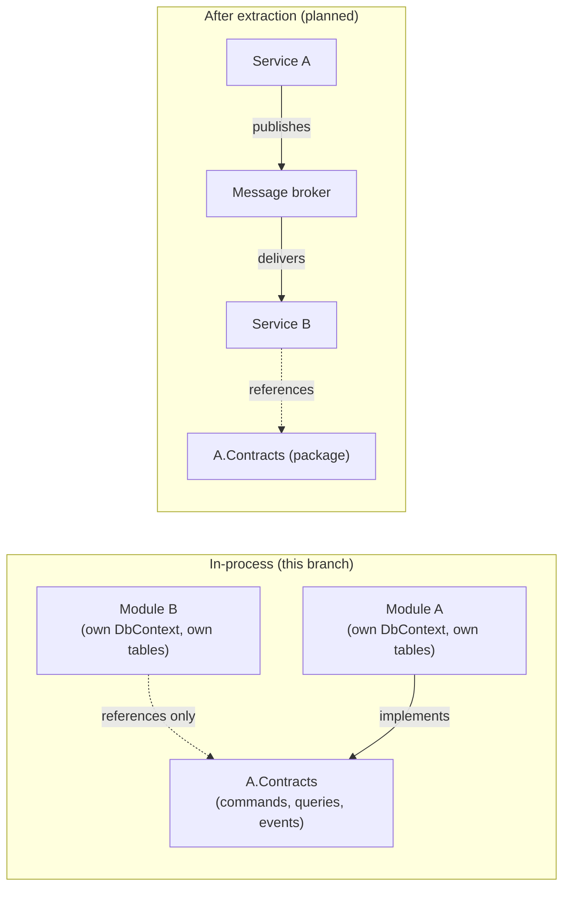
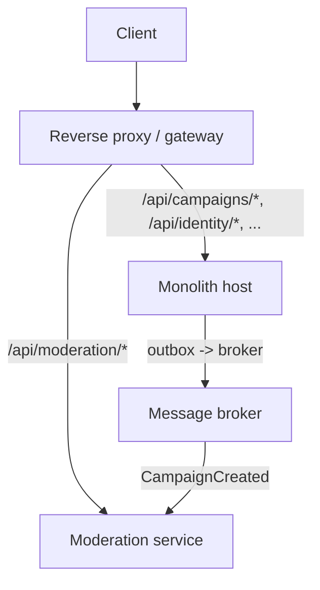

# Blueprint: Designing a Monolith for Later Decomposition

> **Rule of thumb:** if you cannot keep clean boundaries between modules in one process, you will not keep them across a network. Distribution magnifies every boundary flaw.

> **Status on this branch (`feature/clean-arch-course`):** microservice extraction is **not implemented here**. Moderation runs as an in-process module of the monolith. Extraction is the upcoming course step; a working proof of concept (standalone Moderation host, JWKS-validated auth, a Strangler Fig compose topology, extraction boundary tests) is preserved on branch `future/microservices-extraction`. Section 2 describes what this branch already has; section 3 is the plan for the next step.

---

## 1. Monolith first

Splitting into services too early adds distributed transactions (or their absence), network latency and serialization, partial failures, tracing across processes, and coordinated deployments. Building a modular monolith first lets the domain and module boundaries settle while everything is still one process and one debugger session.

The condition is that the monolith follows the constraints a split would need, so a later extraction changes hosting, wiring and data location, and leaves business logic alone.



---

## 2. Six prerequisites, and where this codebase stands

### 2.1 Cross-module access only through Contracts assemblies
- **Rule:** a module never references another module's Domain, Application or Infrastructure assembly.
- **Here:** every module has a Contracts project (for Campaigns: the `AddContributionToCampaign` command, the `CampaignCreated`/`Published`/`Cancelled`/`Succeeded`/`Failed` application events, and a `CampaignStatusContract` enum). Other modules reference only that.
- **Why it matters later:** an extracted module's Contracts project can be packed and consumed as a package reference instead of a project reference. Callers that used in-process commands would still need a transport (HTTP or messaging) behind them; that part is not free.

### 2.2 One DbContext and one set of tables per module
- **Rule:** each module owns its tables and is the only code that touches them.
- **Here:** one DbContext and one PostgreSQL schema per module (`campaigns`, `contributions`, `identity`, `moderation`, `notifications`, `campaignupdates`), holding all of the module's tables, its outbox, inbox and migration history. `ModuleSchemaOwnershipTests` fails the build if a module maps a table outside its schema. Each module resolves its own connection string, `ConnectionStrings:{Module}Db`, falling back to `DefaultConnection` (see `MultiDatabaseConnectionDecouplingTests`).
- **Limitation:** all modules connect with the same database role, so PostgreSQL does not yet refuse a cross-schema query; per-module roles are the next step. Moving a module's data to its own database is `pg_dump --schema=<module>` plus a configuration change. See [`docs/data-ownership.md`](../../docs/data-ownership.md).

### 2.3 No foreign keys across modules
- **Rule:** a table never has a foreign key to another module's table.
- **Here:** [`ContributionConfiguration.cs`](../../src/Modules/Contributions/CrowdFunding.Modules.Contributions.Infrastructure/Persistence/Configurations/ContributionConfiguration.cs) stores `CampaignId` and `ContributorId` as plain required columns, with no relationship to the Campaigns or Identity tables.
  ```csharp
  builder.Property(x => x.CampaignId).IsRequired();
  builder.Property(x => x.ContributorId).IsRequired();
  ```
- **Why it matters later:** a foreign key forces both tables into the same database. Without it, consistency across modules is maintained by events and read models.

### 2.4 Cross-module changes through a transactional outbox
- **Rule:** a module announces state changes by writing events in the same transaction as the change, never by a dual write.
- **Here:** Campaigns, Contributions and Moderation each have an outbox table (for example `contributions_outbox_messages`) written in the same transaction as the aggregate change. `ModuleOutboxProcessor<TDbContext>` claims rows with `FOR UPDATE SKIP LOCKED`, deletes them on success, retries with back-off and dead-letters after five attempts; a post-commit signal wakes it immediately. Consumers that must not apply an event twice use the inbox (`IIdempotentConsumer`). Delivery is at-least-once.
- **Limitation:** the in-process message bus is the working mode. `RabbitMqMessageBus` can publish CloudEvents envelopes, but there is no broker consumer, so cross-process delivery does not exist on this branch.

### 2.5 Asymmetric token signing with JWKS
- **Rule:** do not sign tokens with a shared symmetric secret (HS256) if services will verify them.
- **Here:** Identity signs ES256 (ECDSA P-256) JWTs and publishes the public keys at `/.well-known/jwks.json` ([`JwksEndpoint.cs`](../../src/API/CrowdFunding.API/Security/JwksEndpoint.cs)). Private signing keys are encrypted at rest with AES-256-GCM.
- **Why it matters later:** an extracted service fetches and caches the public keys and verifies tokens locally, without holding any private key. Revocation still needs a shared check; see the security-stamp note in [`key-mental-models-for-students.md`](../04-architect-gold-notes/key-mental-models-for-students.md).

### 2.6 Architecture tests in CI
- **Rule:** boundaries are checked by the build, not by code review.
- **Here:** [`tests/ArchitectureTests/CrowdFunding.ArchitectureTests/`](../../tests/ArchitectureTests/CrowdFunding.ArchitectureTests/README.md) inspects compiled assembly references by reflection (`Assembly.GetReferencedAssemblies()`; no NetArchTest). `ModuleBoundaryConventionTests` checks that every module has the four layers, that cross-module references go only to Contracts, that Domain assemblies reference only `BuildingBlocks.Domain`, and that Contracts reference no module internals. Per-module dependency tests, `ReplicatedReadModelBoundaryTests` and `ApiHostDependencyTests` add more specific rules.
  ```csharp
  var violations = ModuleAssemblies
      .SelectMany(source => ReferencedModuleAssemblies(source.Assembly)
          .Where(target => target.Module != source.Module && target.Layer != "Contracts")
          .Select(target => $"{source.Name} -> {target.Name}"))
      .ToList();

  Assert.Empty(violations);
  ```

---

## 3. The extraction plan (next course step, not implemented on this branch)

The plan uses the Strangler Fig pattern: put a routing layer in front, move one route prefix at a time to the new service, and keep the monolith serving everything else.



1. **Standalone host.** Create a Moderation host that references the existing Moderation Contracts, Application and Infrastructure projects and validates tokens against the monolith's JWKS endpoint.
2. **Own database.** Point `ConnectionStrings:ModerationDb` at a separate database and move the Moderation tables.
3. **Route traffic.** Route `/api/moderation/*` to the new host at the gateway.
4. **Asynchronous delivery.** Deliver `CampaignCreated` and the other events Moderation consumes through a broker. This needs the broker consumer that this branch does not have.
5. **Clean up.** Remove the Moderation module registration from the monolith host.

What the proof of concept on `future/microservices-extraction` demonstrates is that steps 1 to 3 need no changes to Moderation's domain or application code. Steps 4 and 5 involve real work (a broker consumer, the monolith's outbound Moderation events, and deployment), so treat "extraction without rewrites" as applying to business logic, not to the system as a whole. The step-by-step runbook is [`deconstruction-walkthrough.md`](../03-engineering-spec-and-roadmap/deconstruction-walkthrough.md).
