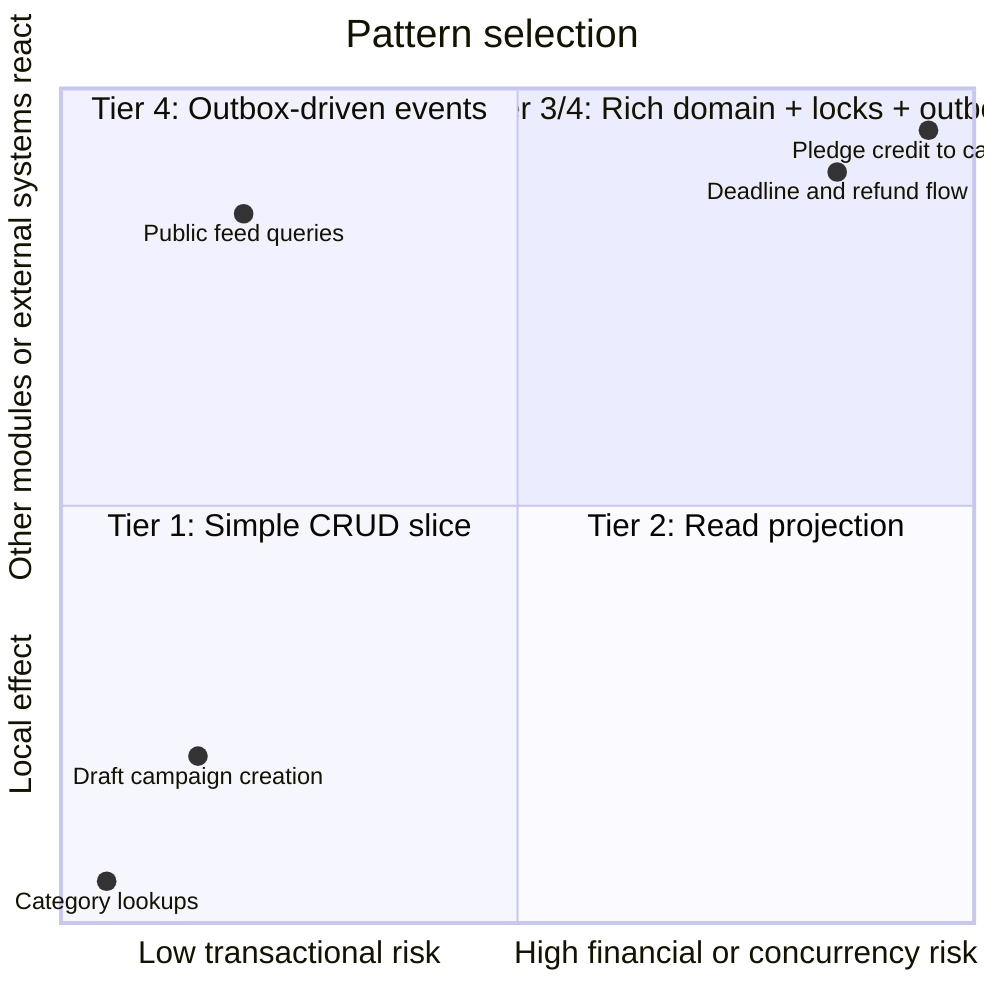

# Poly-Pattern Architecture: Pragmatism vs. Uniformity

> **Maxim:** apply the simplest pattern that safely satisfies each feature's invariants. Uniform architecture across every feature is a policy, not a design.

---

## 1. The problem with one pattern everywhere

Courses often present one pattern (Clean Architecture, CQRS, DDD) and imply every feature must follow it. In practice that produces:
- A trivial lookup that needs a command, a validator, a handler, a repository interface and implementation, DTO mappings and an outbox message.
- Teams maintaining empty abstractions for CRUD, then concluding that "Clean Architecture is slow", when the misuse was the problem.

Most business applications are mixed:
- A large share of the code is low-risk CRUD, lookups and reporting.
- A small core is concurrent and financially sensitive, where lost updates or double credits cost real money.

Giving the low-risk code the ceremony of the core is accidental complexity. Giving the core the simplicity of the CRUD code is negligence.

---

## 2. Four tiers



| Tier | Style | Typical technology | Use for | Cost |
|---|---|---|---|---|
| **1: Simple CRUD slice** | One endpoint, validation, direct `DbContext` | Minimal API + FluentValidation + EF Core | Drafts, profile edits, admin lookups | Low (one file) |
| **2: Read projection** | Query that bypasses the domain model | EF Core `AsNoTracking()` projection, optional Redis cache | Public feeds, listings, search | Low (one or two files) |
| **3: Rich domain model** | Aggregate root, invariants in the domain, explicit transaction | Aggregates, value objects, `pg_advisory_xact_lock`, `xmin` concurrency tokens, database constraints | Pledges, the campaign funding ledger, reward-tier inventory | High |
| **4: Outbox-driven events** | Transactional outbox, idempotent consumers | Outbox table claimed with `FOR UPDATE SKIP LOCKED`, inbox table | Payment confirmed: credit the campaign, send e-mail, fan out webhooks | Highest |

In this codebase Tier 3 and Tier 4 usually appear together: the write that changes an aggregate also writes the outbox rows that other modules consume.

---

## 3. Tier 1 vs. Tier 3 on the same entity

### Tier 1: creating a draft campaign (illustrative)

Creating a draft has no concurrent writers, moves no money, and nothing else reacts to it yet. A single-file endpoint is enough. The sketch below is illustrative; the runnable version is Tier 1 of the Rosetta Stone sample (section 6).

```csharp
public static class CreateDraftCampaignEndpoint
{
    public record Request(string Title, string Story, decimal TargetAmount, string Currency);
    public record Response(Guid Id, string Title);

    public sealed class Validator : AbstractValidator<Request>
    {
        public Validator()
        {
            RuleFor(x => x.Title).NotEmpty().MaximumLength(200);
            RuleFor(x => x.Story).NotEmpty().MinimumLength(20);
            RuleFor(x => x.TargetAmount).GreaterThan(0);
        }
    }

    public static void Map(IEndpointRouteBuilder app) =>
        app.MapPost("/drafts", async (Request req, IValidator<Request> validator, DraftsDbContext db, CancellationToken ct) =>
        {
            var validation = await validator.ValidateAsync(req, ct);
            if (!validation.IsValid)
                return Results.ValidationProblem(validation.ToDictionary());

            var draft = new Draft(Guid.NewGuid(), req.Title, req.Story, req.TargetAmount, req.Currency);
            db.Drafts.Add(draft);
            await db.SaveChangesAsync(ct);
            return Results.Created($"/drafts/{draft.Id}", new Response(draft.Id, draft.Title));
        });
}
```

### Tier 3: crediting a confirmed pledge to a campaign

When a payment is confirmed, several things must hold at once:
1. The campaign's raised amount must equal the sum of its ledger entries.
2. A redelivered event must not credit the same pledge twice.
3. A cancel and a pledge on the same campaign must not interleave.
4. Other modules must learn about the outcome, even if the process crashes right after commit.

The real implementation spreads this across the `Contribution` aggregate (state machine `Pending -> Succeeded/Failed -> Refunded`), `Campaign.RecordPledge` / `RecordRefund`, and `CampaignLedger`, which inserts into the append-only `campaign_ledger_entries` table with `ON CONFLICT DO NOTHING` under a per-campaign `pg_advisory_xact_lock`. PostgreSQL triggers reject any `UPDATE`/`DELETE` of ledger entries and any `raised_amount` that differs from the sum of entries. The outbox rows are written in the same transaction. See [`docs/append-only-ledger.md`](../../docs/append-only-ledger.md) for the full design and its trade-offs.

The extra files are justified here because each one defends a specific failure: lost updates, double credits, and lost downstream events.

---

## 4. Polling outbox vs. Debezium CDC

Students usually ask: *why write events to a table instead of publishing to a broker directly?* Because of the dual-write problem: if you commit and then publish, a crash between the two loses the event; if you publish and then the commit fails, you announced something that never happened. Writing the event into an outbox table in the same transaction makes the state change and the intent to publish commit or roll back together.

Two ways to move outbox rows out:

1. **Polling (implemented).** Each module has a `ModuleOutboxProcessor<TDbContext>` that claims rows with `FOR UPDATE SKIP LOCKED`, reclaims rows whose lease expired, deletes rows on success, retries with exponential back-off, and moves a row to a dead-letter table after five attempts. An `OutboxCommitSignalInterceptor` wakes the processor right after a transaction that wrote outbox rows commits; a 5-second poll is only the fallback sweep.
2. **Log-based CDC with Debezium (considered, not implemented).** Debezium reads the same outbox table from PostgreSQL's write-ahead log through a logical replication slot and streams to a broker, which removes the polling queries. It adds a connector, a broker and replication-slot operations to run.

```mermaid
sequenceDiagram
    autonumber
    participant App as Monolith
    participant DB as PostgreSQL
    participant Proc as Outbox processor (implemented)
    participant Bus as Message bus

    App->>DB: BEGIN; update contribution; INSERT outbox row; COMMIT
    App->>Proc: commit signal (same process)
    Proc->>DB: claim rows FOR UPDATE SKIP LOCKED
    Proc->>Bus: publish (in-process bus by default)
    Proc->>DB: DELETE delivered rows
```

The decision record and the throughput point at which CDC becomes worth it are in [`docs/outbox-architecture.md`](../../docs/outbox-architecture.md).

---

## 5. Rules of thumb

1. Do not use an aggregate if there are no invariants to protect. A plain data record is fine for CRUD.
2. Do not route queries through write repositories. Project reads directly to response DTOs.
3. Write to the outbox only when another module or an external system must react reliably.
4. Enforce boundaries with project references and architecture tests, not with layers of empty classes.

---

## 6. Run it

[`src/Samples/RosettaStone/`](../../src/Samples/RosettaStone/README.md) implements one requirement, *create a campaign with a title, story and target amount*, three ways: Tier 1 (Minimal API CRUD) and Tier 2 (pragmatic CQRS) inside the sample, and Tier 3 as a pointer to the production endpoint `POST /api/campaigns`. The sample is its own runnable host:

```bash
dotnet run --project src/Samples/RosettaStone   # http://localhost:5090/scalar/v1
```

The production API does not reference the sample; an architecture test (`ApiHostDependencyTests`) enforces that. The sample's README has the measured scorecard (files, lines, assemblies) and two questions that decide the tier: *does another module need to react to this write reliably?* and *can concurrent writes corrupt this row?*
