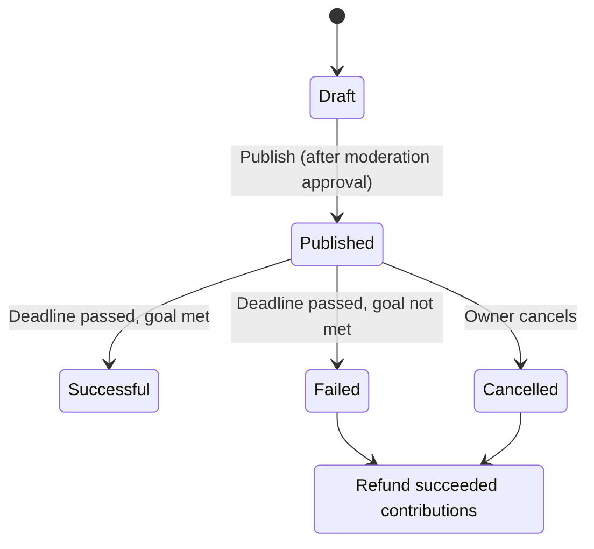

# The Under-Engineering Audit: Where the Design Did Not Go Far Enough

> **Curriculum focus:** hidden coupling and incomplete decoupling
> **Key lesson:** a monolith that looks clean in process can still become a distributed monolith once a network sits between its modules.
> **Status:** revised 2026-09-28. The first audit found four decomposition roadblocks and an incomplete domain lifecycle. Each item below says what the problem was, whether it is resolved, and how. Section 3 lists what is still open.

---

## 1. The four decomposition roadblocks

### Roadblock 1: synchronous cross-module query (resolved)

**The problem.** `MakeContributionCommandHandler` used to call `ICampaignContributionAvailabilityReader`, an interface implemented by the Campaigns module, to check that a campaign was open before accepting a pledge. In process this was a cheap method call. Across a network it would become a synchronous call: if Campaigns were down or restarting, Contributions could not accept pledges.

**How it was resolved.** The reader no longer exists. Contributions keeps a replicated read model, the `active_campaigns_cache` table (entity `ActiveCampaignCache`), which `ReplicatedCampaignEventHandlers` updates from `CampaignCreated`, `CampaignPublished`, `CampaignCancelled`, `CampaignSucceeded` and `CampaignFailed` application events. [`MakeContributionCommandHandler.cs`](../../src/Modules/Contributions/CrowdFunding.Modules.Contributions.Application/Features/Contributions/Commands/MakeContribution/MakeContributionCommandHandler.cs) checks its own table. Notifications (`CampaignTitleCache`) and CampaignUpdates (`CampaignOwnerCache`) use the same technique. `ReplicatedReadModelBoundaryTests` in the architecture tests guard it.

**The trade-off to teach.** The read model is eventually consistent: a pledge can be accepted in the short window after a campaign closes and before the event arrives. The authoritative check stays in Campaigns, which serializes on the campaign's advisory lock and does not credit a pledge to a campaign that is no longer published (`AddContributionToCampaignResult.Credited` is `false`).

### Roadblock 2: outbox poller hard-wired to in-process dispatch (resolved, with one gap)

**The problem.** A single `OutboxProcessorBackgroundService` in the API host read every module's outbox and handed events directly to handlers resolved from the DI container. There was no seam for a broker.

**How it was resolved.** That class no longer exists. Campaigns, Contributions and Moderation each run a `ModuleOutboxProcessor<TDbContext>`, which claims rows with `FOR UPDATE SKIP LOCKED`, reclaims expired leases, retries with exponential back-off and dead-letters after five attempts. Processors publish through `IMessageBus`, chosen by `Messaging:Provider`: `InProcessMessageBus` (default) or `RabbitMqMessageBus`, which publishes a CloudEvents envelope. A commit interceptor wakes the processor as soon as a transaction that wrote outbox rows commits; the 5-second poll is only a fallback. See [outbox-architecture.md](../../docs/outbox-architecture.md).

**What is still missing.** RabbitMQ is publish-only. There is no consumer, so events cannot yet cross a process boundary (section 3).

### Roadblock 3: one connection string for every module (resolved in configuration)

**The problem.** Every `DbContext` was registered with the same connection string, so all modules shared one database and one connection pool. A surge of pledges could starve login and moderation queries.

**How it was resolved.** Each module resolves its connection string with `GetRequiredModuleConnectionString`: it reads `ConnectionStrings:{Module}Db` (for example `ContributionsDb`) and falls back to `DefaultConnection`. Pointing a module at its own database or pool is a configuration change. `MultiDatabaseConnectionDecouplingTests` cover it.

**What to point out.** With the default configuration every module falls back to the same string, and Npgsql pools by connection string, so they still share one pool until an operator sets the module keys.

### Roadblock 4: the shared BuildingBlocks kernel (open by design)

**The problem.** Every module references `BuildingBlocks.Domain`, `BuildingBlocks.Application` and `BuildingBlocks.Infrastructure`. In a multi-team service landscape a shared library forces coordinated rebuilds and releases.

**The current position.** BuildingBlocks holds generic mechanisms (dispatching, validation and audit behaviors, outbox and inbox, error types, value objects such as `Money`), not the concepts of any one bounded context. The lesson is the distinction: generic utilities can ship as versioned packages; domain concepts must not be shared across contexts.

---

## 2. The crowdfunding lifecycle (resolved)

**The problem.** Campaigns stayed published forever unless cancelled, and `ContributionStatus` had no `Refunded` state, so failed or cancelled campaigns never returned money.

**How it was resolved.**

- `CampaignExpirationBackgroundService` (Campaigns.Infrastructure) runs every minute, finds published campaigns past their deadline and dispatches `CompleteCampaignCommand` or `FailCampaignCommand`.
- `CampaignTerminationRefundHandler` (Contributions.Application) handles `CampaignFailedApplicationEvent` and `CampaignCancelledApplicationEvent`, loads `Succeeded` contributions in batches of 100 and calls `Contribution.Refund`, which moves them to `Refunded` and raises `ContributionRefundedApplicationEvent`.
- Campaigns handles that event by appending a compensating refund entry to the append-only campaign ledger, so `RaisedAmount` of a cancelled or failed campaign falls as refunds land. Reward-tier reservations are released by another handler of the same event. See [append-only-ledger.md](../../docs/append-only-ledger.md).

This is choreography: no coordinator, each module reacts to events it subscribes to. What it does not include is an outbound refund call to a payment provider; the refund is recorded as domain state.

---

## 3. What is still open

1. **No broker consumer.** Events are published to RabbitMQ but nothing consumes them. Until a consumer exists (with the inbox for deduplication), extraction cannot run over a broker.
2. **One synchronous cross-module read left.** `PublishCampaignCommandHandler` in Campaigns calls `ICampaignReviewStatusReader` (defined in `Moderation.Contracts`) to check that a campaign was approved before publishing. It is the same pattern Roadblock 1 removed from the pledge path and needs the same fix before Moderation can be extracted: a review-status read model in Campaigns fed by `CampaignReviewApproved` and `CampaignReviewRejected` events.
3. **Shared schema.** Module tables live in the `public` schema, separated by ownership and naming; only the EF migration history table is in a per-module schema. Moving tables into module schemas would make a `pg_dump --schema` split possible.
4. **Per-instance signal and rate limits.** The outbox wake-up signal and the rate limiter live in memory; other replicas fall back to the 5-second sweep, and limits apply per instance.
5. **Side effects outside the inbox.** E-mail and metering depend on provider idempotency keys; a crash between the external call and the commit can repeat them. Outbound webhooks are at-least-once.
6. **Unsigned unsubscribe link.** One-click unsubscribe trusts a bare user id instead of a signed, expiring token.
7. **Key encryption key rotation.** Signing keys are encrypted at rest with a single configured key that cannot yet be rotated.

The platform-wide list is in [PLATFORM_SHORTCOMINGS.md](../../docs/PLATFORM_SHORTCOMINGS.md).
