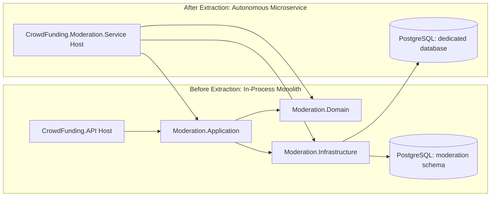

# Deconstruction Walkthrough: Extracting a Microservice in 5 Steps

> **Curriculum Runbook:** Live Extraction Exercise for Principal Engineers & Architects  
> **Objective:** Walk through the physical extraction of the `Moderation` module from the in-process Monolith into an autonomous, containerized microservice (`CrowdFunding.Moderation.Service`) with **zero lines of domain logic rewritten**.

---

## 1. The Starting State vs. Target State



---

## 2. Step 1: Scaffold the Standalone Web Service Host

Create the new web API project in `services/`:
```bash
dotnet new web -n CrowdFunding.Moderation.Service -o services/CrowdFunding.Moderation.Service
```

Add references to the existing module layers:
```xml
<!-- services/CrowdFunding.Moderation.Service/CrowdFunding.Moderation.Service.csproj -->
<ItemGroup>
  <ProjectReference Include="..\..\src\Modules\Moderation\CrowdFunding.Modules.Moderation.Application\CrowdFunding.Modules.Moderation.Application.csproj" />
  <ProjectReference Include="..\..\src\Modules\Moderation\CrowdFunding.Modules.Moderation.Infrastructure\CrowdFunding.Modules.Moderation.Infrastructure.csproj" />
  <ProjectReference Include="..\..\src\Modules\Moderation\CrowdFunding.Modules.Moderation.Contracts\CrowdFunding.Modules.Moderation.Contracts.csproj" />
  <ProjectReference Include="..\..\src\BuildingBlocks\CrowdFunding.BuildingBlocks.Application\CrowdFunding.BuildingBlocks.Application.csproj" />
  <ProjectReference Include="..\..\src\BuildingBlocks\CrowdFunding.BuildingBlocks.Infrastructure\CrowdFunding.BuildingBlocks.Infrastructure.csproj" />
</ItemGroup>
```

---

## 3. Step 2: Configure Dependency Injection & JWT Verification

In `services/CrowdFunding.Moderation.Service/Program.cs`:
Because the system uses **asymmetric ES256 tokens and JWKS**, the new Moderation service does **not** need access to the Identity database! It simply resolves its signing keys from the monolith's JWKS endpoint:

```csharp
var builder = WebApplication.CreateBuilder(args);

var jwtIssuer = builder.Configuration["Authentication:Issuer"]!;

// 1. Register Module Core
builder.Services.AddModerationApplication();
builder.Services.AddModerationInfrastructure(builder.Configuration);
builder.Services.AddCrowdFundingMessaging(builder.Configuration);

// 2. Configure Asymmetric JWT Authentication via the JWKS document
//    Authentication:JwksUri points at the issuer's /.well-known/jwks.json
builder.Services.Configure<JwksOptions>(builder.Configuration.GetSection(JwksOptions.SectionName));
builder.Services.AddHttpClient<JwksSigningKeyResolver>();

builder.Services.AddAuthentication(JwtBearerDefaults.AuthenticationScheme)
    .AddJwtBearer(options =>
    {
        options.TokenValidationParameters = new TokenValidationParameters
        {
            ValidateIssuer = true,
            ValidIssuer = jwtIssuer,
            ValidateAudience = false,
            ValidateIssuerSigningKey = true,
            ValidateLifetime = true,
            ClockSkew = TimeSpan.Zero
        };
    });

// The resolver needs an HttpClient, so it is attached after AddJwtBearer
builder.Services.AddOptions<JwtBearerOptions>(JwtBearerDefaults.AuthenticationScheme)
    .Configure<JwksSigningKeyResolver>((options, resolver) =>
    {
        options.TokenValidationParameters.IssuerSigningKeyResolver = resolver.ResolveSigningKeys;
    });

builder.Services.AddAuthorization();
builder.Services.AddControllers();

var app = builder.Build();

app.UseAuthentication();
app.UseAuthorization();
app.MapControllers();

app.Run();
```

The service does not use an OpenID Connect authority or metadata address: the Identity module publishes only the JWKS document, so `JwksSigningKeyResolver` fetches it from `Authentication:JwksUri` and caches the public keys for ten minutes.

---

## 4. Step 3: Physical Database Splitting (Database-per-Service)

Because the monolith used **schema-per-module** with **zero cross-schema foreign keys**, splitting the database is a pure operational task. Two topologies exist: a single shared database with one schema per module (the dump below targets the `moderation` schema), and the local default in `docker-compose.yml`, where each module already has its own database (`moderation_db`), so the dump is taken from `moderation_db` instead.

1. **Dump the moderation schema from the monolith database:**
   ```bash
   # Shared-database topology
   pg_dump -h localhost -U postgres -d crowdfundingdb --schema=moderation -F c -b -v -f moderation_schema.dump
   # Per-module-database topology (local default)
   pg_dump -h localhost -U postgres -d moderation_db --schema=moderation -F c -b -v -f moderation_schema.dump
   ```
2. **Restore into the dedicated Moderation database server:**
   ```bash
   pg_restore -h moderation-db -U postgres -d moderation_db -v moderation_schema.dump
   ```
3. **Update `appsettings.json` in the new Moderation Service:**
   ```json
   {
     "ConnectionStrings": {
       "ModerationDb": "Host=moderation-db;Port=5432;Database=moderation_db;Username=postgres;Password=postgres;"
     }
   }
   ```

---

## 5. Step 4: Switch Outbox from In-Process to Message Broker (Kafka / RabbitMQ)

In the monolith, `CampaignCreatedApplicationEvent` was polled in-process. In the microservices topology:
1. The **Monolith** (or Campaigns microservice) publishes `CampaignCreated` to a RabbitMQ exchange or Kafka topic `campaigns.events`.
2. The **Moderation Service** (`services/CrowdFunding.Moderation.Service`) reuses the module's existing `IEventHandler<T>` (registered with `AddEventHandlersFromAssemblies`). The RabbitMQ transport in `BuildingBlocks.Infrastructure` (`RabbitMqMessageBus`, built on `RabbitMQ.Client`, no MassTransit) only **publishes**: it writes the event as a CloudEvents message to the exchange. No consumer exists yet, so a subscriber that reads the exchange and calls the handlers below is the piece still to be written:
   ```csharp
   public class CampaignCreatedApplicationEventHandler : IEventHandler<CampaignCreatedApplicationEvent>
   {
       private readonly ICommandDispatcher _commandDispatcher;

       public CampaignCreatedApplicationEventHandler(ICommandDispatcher commandDispatcher)
           => _commandDispatcher = commandDispatcher;

       public async Task Handle(CampaignCreatedApplicationEvent notification, CancellationToken cancellationToken)
       {
           await _commandDispatcher.SendAsync<CreateCampaignReviewResult>(
               new CreateCampaignReviewCommand(notification.CampaignId),
               cancellationToken);
       }
   }
   ```

---

## 6. Step 5: Route Traffic via API Gateway (Strangler Fig)

In the edge reverse proxy (YARP in the API host or Envoy / Kong):
Route all traffic matching `/api/moderation/*` to the new independent container:

```json
// YARP Configuration in Gateway
"ReverseProxy": {
  "Routes": {
    "moderation-route": {
      "ClusterId": "moderation-cluster",
      "Match": {
        "Path": "/api/moderation/{**catch-all}"
      }
    }
  },
  "Clusters": {
    "moderation-cluster": {
      "Destinations": {
        "destination1": {
          "Address": "http://moderation-service:8080"
        }
      }
    }
  }
}
```

---

## 7. The Deconstruction Scorecard

| Extraction metric | Result |
| :--- | :--- |
| Domain logic rewritten | 0 lines |
| Aggregate invariants altered | 0 lines |
| Repository / query SQL altered | 0 lines |
| System downtime required | 0 seconds (Strangler Fig pattern) |
| Token validation rework | 0 (leveraged asymmetric JWKS) |
**Conclusion:** The upfront architectural discipline of schema isolation, `.Contracts` boundaries, and asymmetric cryptography pays off completely at the moment of decomposition.
