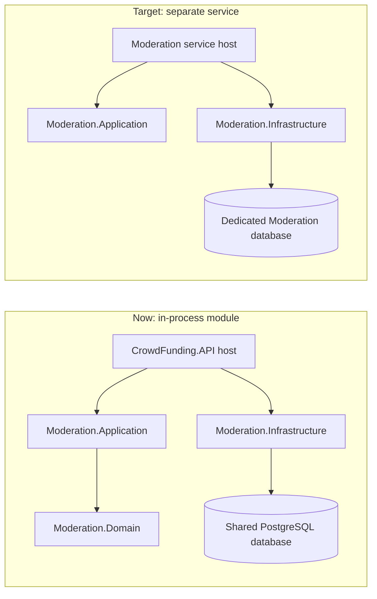

# Deconstruction Walkthrough: Extracting Moderation into a Service

> **Curriculum runbook:** the plan for the course's microservice extraction step
> **Objective:** move the `Moderation` module out of the monolith into its own host and database without rewriting its domain or application code.

> **Status on this branch: not implemented.** Here Moderation is an in-process module of the monolith, served by `ModerationController` (`/api/moderation/reviews`) and fed by in-process events. Extraction is the upcoming course step. A working proof of concept is preserved on the branch `future/microservices-extraction`: a standalone Moderation host (`services/CrowdFunding.Moderation.Service` on that branch), JWKS-validated authentication, a Strangler Fig docker-compose topology (`docker-compose.microservices.yml` on that branch) and extraction boundary tests. That branch predates later changes on this one (Minimal APIs, built-in OpenAPI in place of Swashbuckle, the validation pipeline, the append-only ledger), so expect to port it rather than merge it. Section 8 lists what the proof of concept did not provide.

---

## 1. Starting state and target state



What the monolith already provides for this step:

- Moderation references only BuildingBlocks and the `Contracts` projects of Campaigns and Identity; the architecture tests enforce that.
- Moderation owns its tables (`campaign_reviews`, `moderation_outbox_messages`, `moderation_dead_letter_events`) and has no foreign keys to other modules. Its migration history is in the `moderation` schema.
- `ModerationDbContext` reads `ConnectionStrings:ModerationDb`, falling back to `DefaultConnection`.
- Identity signs ES256 tokens and publishes `/.well-known/jwks.json`, so another process can validate tokens without a shared secret.
- Moderation publishes `CampaignReviewApproved` and `CampaignReviewRejected` through its own outbox and `IMessageBus`, which has a RabbitMQ implementation.

---

## 2. Step 1: create the service host

Create a web project that references the module's own projects:

```bash
dotnet new web -n CrowdFunding.Moderation.Service -o services/CrowdFunding.Moderation.Service
```

```xml
<ItemGroup>
  <ProjectReference Include="..\..\src\Modules\Moderation\CrowdFunding.Modules.Moderation.Application\CrowdFunding.Modules.Moderation.Application.csproj" />
  <ProjectReference Include="..\..\src\Modules\Moderation\CrowdFunding.Modules.Moderation.Infrastructure\CrowdFunding.Modules.Moderation.Infrastructure.csproj" />
  <ProjectReference Include="..\..\src\Modules\Moderation\CrowdFunding.Modules.Moderation.Contracts\CrowdFunding.Modules.Moderation.Contracts.csproj" />
  <ProjectReference Include="..\..\src\BuildingBlocks\CrowdFunding.BuildingBlocks.Application\CrowdFunding.BuildingBlocks.Application.csproj" />
  <ProjectReference Include="..\..\src\BuildingBlocks\CrowdFunding.BuildingBlocks.Infrastructure\CrowdFunding.BuildingBlocks.Infrastructure.csproj" />
</ItemGroup>
```

Add an architecture test that the service references no other module's `Application`, `Domain` or `Infrastructure` project. The proof of concept has one (`ModerationServiceExtractionBoundaryTests`).

---

## 3. Step 2: register the module and validate tokens through JWKS

The service registers the module exactly as the monolith does, plus the dispatchers, the validation behavior, the error handler and messaging. Authentication points at Identity's public key set; the service never touches the Identity database.

```csharp
var builder = WebApplication.CreateBuilder(args);

builder.Services.AddModerationApplication();
builder.Services.AddModerationInfrastructure(builder.Configuration);
builder.Services.AddCrowdFundingMessaging(builder.Configuration);

builder.Services.AddAuthentication(JwtBearerDefaults.AuthenticationScheme)
    .AddJwtBearer(options =>
    {
        options.MapInboundClaims = false;           // identity comes from "sub", as in the monolith
        options.TokenValidationParameters = new TokenValidationParameters
        {
            ValidIssuer = "CrowdFunding.API",
            ValidAudience = "CrowdFunding.Client",
            ValidAlgorithms = [SecurityAlgorithms.EcdsaSha256],
            // Signing keys are resolved from the monolith's /.well-known/jwks.json and cached.
        };
    });

builder.Services.AddAuthorization();
```

Issuer and audience must match the `Jwt` section of the monolith's configuration. Identity publishes a bare JWKS document, not an OpenID Connect discovery document, so `Authority`/`MetadataAddress` discovery does not apply: the proof of concept uses a small resolver (`JwksSigningKeyResolver`) that fetches the key set, caches it for ten minutes and selects the key by `kid`. A production version should also refetch when a token arrives with an unknown `kid`, so a key rotation does not cause up to ten minutes of 401s.

The review endpoints (`GET/POST /api/moderation/reviews...`) move to the service. Write them as Minimal APIs, or copy `ModerationController` if the course wants to keep the comparison.

---

## 4. Step 3: give Moderation its own database

Module tables currently live in the shared `public` schema, so the split copies Moderation's tables by name rather than by schema:

```bash
pg_dump -h monolith-db -U postgres -d crowdfundingdb -F c \
  -t public.campaign_reviews \
  -t public.moderation_outbox_messages \
  -t public.moderation_dead_letter_events \
  -n moderation \
  -f moderation.dump
pg_restore -h moderation-db -U postgres -d moderation_db moderation.dump
```

(`-n moderation` carries the EF migration history table.) Then point the service at the new database:

```json
{
  "ConnectionStrings": {
    "ModerationDb": "Host=moderation-db;Port=5432;Database=moderation_db;Username=postgres;Password=..."
  }
}
```

Moving each module's tables into its own schema first would reduce this step to `pg_dump --schema=moderation`. That move is still open on this branch.

---

## 5. Step 4: deliver events over a broker

In the monolith, the Campaigns outbox processor hands `CampaignCreatedApplicationEvent` to the in-process bus, and `CampaignCreatedApplicationEventHandler` in Moderation opens a review. Across processes:

1. The monolith runs with `Messaging:Provider = RabbitMQ`. `RabbitMqMessageBus` already publishes each outbox event as a CloudEvents envelope whose `id` is the event's `EventId`.
2. The Moderation service runs a **broker consumer** that reads the envelope, resolves the event type, and dispatches it to the existing `IEventHandler<CampaignCreatedApplicationEvent>`. The handler code does not change.
3. The consumer wraps each dispatch in `IIdempotentConsumer.ExecuteOnceAsync(eventId, consumerName, ...)` so a redelivered message has no effect. Moderation needs its own processed-events table for this; today only Contributions and CampaignUpdates have one.
4. The same in reverse: the monolith needs a consumer for `CampaignReviewApproved` and `CampaignReviewRejected` from the service.

None of this consumer side exists yet, on either branch (section 8).

---

## 6. Step 5: route traffic through an edge (Strangler Fig)

Put a reverse proxy in front of both processes and move `/api/moderation/*` to the service while everything else still goes to the monolith. With YARP:

```json
"ReverseProxy": {
  "Routes": {
    "moderation": { "ClusterId": "moderation", "Match": { "Path": "/api/moderation/{**catch-all}" } },
    "monolith":   { "ClusterId": "monolith",   "Match": { "Path": "{**catch-all}" } }
  },
  "Clusters": {
    "moderation": { "Destinations": { "d1": { "Address": "http://moderation-service:8080" } } },
    "monolith":   { "Destinations": { "d1": { "Address": "http://monolith-api:8080" } } }
  }
}
```

Keep the monolith's Moderation module registered until the service has taken all traffic and events, then remove it from the monolith host.

---

## 7. Expected outcome

If the steps above are followed, the extraction changes hosting, configuration and messaging, not Moderation's domain or application code:

```
Moderation domain code rewritten:          none expected
Moderation application handlers rewritten: none expected (new consumer and host code is added)
Token validation:                          JWKS, no shared secret
Downtime:                                  avoidable with the Strangler Fig cut-over
```

The one exception is the synchronous dependency in section 8, which requires a design change in Campaigns.

---

## 8. What extraction still needs

The proof of concept on `future/microservices-extraction` proves the host, the JWKS authentication and the module boundary. It does not provide:

1. **A broker consumer.** `RabbitMqMessageBus` is publish-only. The proof-of-concept service therefore receives no `CampaignCreated` events; the monolith still runs its own Moderation module side by side. A consumer with inbox deduplication (section 5) is required.
2. **An edge gateway.** The proof-of-concept compose file runs the monolith and the service on separate ports against the same PostgreSQL and RabbitMQ; no proxy routes `/api/moderation/*`.
3. **A separate database.** Both processes use the same PostgreSQL cluster. The data split in section 4 has not been exercised.
4. **Removal of the synchronous review-status read.** `PublishCampaignCommandHandler` in Campaigns calls `ICampaignReviewStatusReader` (defined in `Moderation.Contracts`, implemented in `Moderation.Infrastructure`) inside the publish transaction to check that the campaign was approved. Once Moderation runs elsewhere this becomes a network call on the publish path, the same trap the pledge path escaped with a replicated read model. The fix is the same: Campaigns keeps a local review-status table updated from `CampaignReviewApproved` and `CampaignReviewRejected` events.
5. **Porting to the current code.** The proof of concept uses controllers and Swashbuckle and predates the validation pipeline, the error classifier and the ledger changes on this branch.
