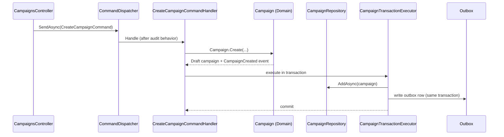
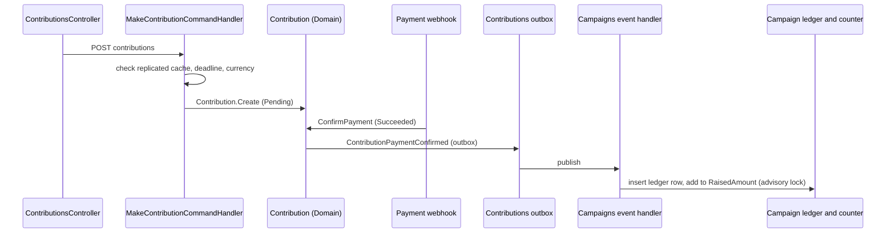
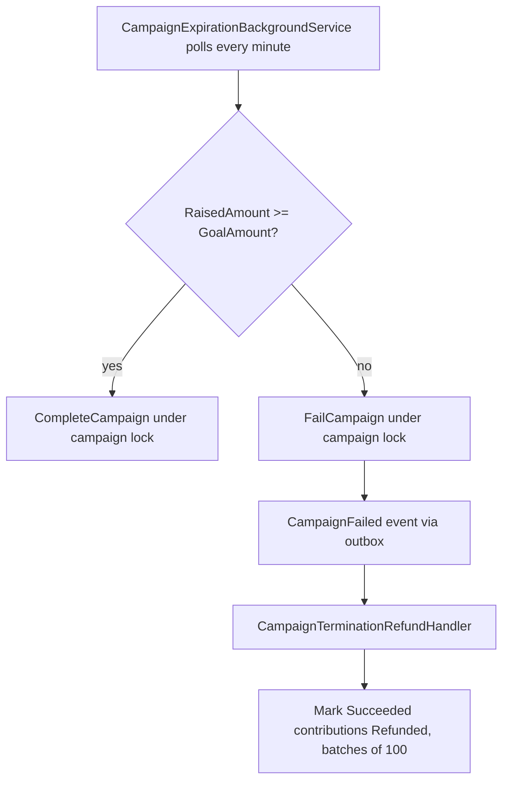

# Design-to-Code Mapping: Round 1 (Crowdfunding Platform)

> **Purpose:** show a learner, step by step, where each Round 1 system-design decision lives in the `CrowdFundingHub` code, which test guards it, and where the code differs from the design.
> **Design source:** `hispeedsystem/system-design-mastery/interview-loops/04-financial-and-transactional/06-crowdfunding-platform.md` (Round 1, steps 1.0 to 1.6, plus "See It Built").
> **Method:** read from code and tests on 2026-10-21. No tests were run. Test names come from the test sources.
> **Status tags:** **MATCHES** (code implements the design), **SIMPLER VARIANT** (a smaller version of the design), **NOT BUILT** (no code).

Paths are relative to the repo root. `CAMP` = `src/Modules/Campaigns/CrowdFunding.Modules.Campaigns`, `CONT` = `src/Modules/Contributions/CrowdFunding.Modules.Contributions`, `NOTIF` = `src/Modules/Notifications/CrowdFunding.Modules.Notifications`, `BB` = `src/BuildingBlocks/CrowdFunding.BuildingBlocks`.

## 1. Summary

| Design step | Module | Status | Guarded by |
|---|---|---|---|
| 1.1 Where the money sits for 30 days | Contributions | NOT BUILT (charge-now state model only, payment gateway is a mock) | `ContributionDomainTests` |
| 1.2 Double-click creates two pledges | Contributions | NOT BUILT | none |
| 1.3 The total on the page vs the pledges | Campaigns | SIMPLER VARIANT (idempotency table plus a locked counter) | `CampaignContributionConcurrencyTests` |
| 1.4 Limited tier oversold | Campaigns | MATCHES (lock, invariant, 15-minute hold); no database CHECK | `RewardTierConcurrencyE2ETests` |
| 1.5 Pledge after the deadline | Contributions, Campaigns | NOT BUILT (no closing fence) | partial |
| 1.6 Settlement at the deadline | Campaigns, Contributions | SIMPLER VARIANT (decision and state-only refunds); charge-once settlement NOT BUILT; webhook inbox MATCHES | `CampaignExpirationE2ETests`, `RefundSagaE2ETests`, webhook tests |
| Outbox, event registry, dead letter | BuildingBlocks | MATCHES | `OutboxTests`, `OutboxLeanTableE2ETests` |
| General consumer inbox | all consumers | NOT BUILT (only `processed_payment_webhooks`) | none |
| "Tell people" | Notifications | SIMPLER VARIANT | `EmailNotificationOutboxE2ETests` |

## 2. The two flows, drawn

### Create a campaign (the light path)

### Make a contribution (the heavy path)

## 3. Step by step

### Step 1.1: where the money sits for 30 days: NOT BUILT

- **Design:** save the card at pledge time, charge at the deadline only if funded.
- **Code:** a pledge is a `Pending` row with a mock payment intent. Confirmation arrives by webhook or a manual endpoint. No payment provider is called anywhere in `src/`.
- **Where:** `CONT.Application/Features/Contributions/Commands/MakeContribution/MakeContributionCommandHandler.cs:37-94` (mock intent at line 86); `CONT.Domain/Aggregates/Contribution.cs` (`Create` 64-97, `ConfirmPayment` 126-144, `Refund` 179-190); `ContributionStatus` is Pending, Succeeded, Failed, Refunded.
- **Tests:** `ContributionDomainTests`, `MakeContributionCommandHandlerTests`, `ContributionAndOutboxE2ETests`.
- **Why it differs:** the code uses the charge-now model the design rejects, a deliberate simpler choice that the design's own "See It Built" section acknowledges.

### Step 1.2: double-click creates two pledges: NOT BUILT

- **Design:** an idempotency key or client-supplied pledge ID makes a retry return the first pledge.
- **Code:** nothing. `Contribution.Create` always generates a new ID, and two POSTs create two Pending contributions. Only a rate limiter (`ContributionsController.cs:103`) slows repeats.
- **Tests:** none.

### Step 1.3: the total vs the pledges: SIMPLER VARIANT

- **Design:** an append-only ledger. The total is derived from it.
- **Code:** a table `campaign_contributions_ledger` with a unique index on `ContributionId` only; insert is `ON CONFLICT DO NOTHING` (`CAMP.Infrastructure/Persistence/Repositories/ContributionLedger.cs:22-42`). The total is a running counter, `Campaign.RaisedAmount`, added to in the same transaction under a per-campaign `pg_advisory_xact_lock` (`CampaignTransactionExecutor.cs:72-82`, `Campaign.cs:182-198`), with an `xmin` token and three retries as a second guard.
- **Not present:** an entry kind, a sign check constraint, an update/delete trigger, negative refund entries, and a total computed as a ledger sum. Append-only is by convention.
- **Tests:** `CampaignContributionConcurrencyTests.ConcurrentPledges_ShouldNotLoseUpdates`, `RedeliveredContribution_ShouldBeAppliedOnlyOnce`; `CampaignDomainTests.ApplyConfirmedContribution_*`.

### Step 1.4: limited tier oversold: MATCHES

- **Design:** serialise the claim of a limited slot, hold it for a short time.
- **Code:** a per-tier advisory lock serialises read-check-increment. The aggregate enforces `claimed + reserved <= capacity` (`CAMP.Domain/Aggregates/RewardTier.cs`, `ReserveSlot` 82-92). A reservation lasts 15 minutes (`RewardTierReservation.cs:63`), becomes a claim when payment confirms, and is released by a failure handler or a scavenger (`RewardTierReservationScavengerBackgroundService.cs`).
- **Gaps:** no database CHECK for the invariant (it lives only in code under the lock), the reservation is not tied to card setup, and nothing checks that a reservation belongs to the same backer and campaign.
- **Tests:** `RewardTierConcurrencyE2ETests.FiftyConcurrentReservations_AgainstFiveRemainingSlots_ShouldYieldExactlyFiveSuccesses`; `RewardTierTests`. The scavenger has no test.

### Step 1.5: pledge after the deadline: NOT BUILT (closing fence)

- **Design:** a closing fence so no pledge is accepted after the deadline and none that was accepted is left out of the funded decision.
- **Code:** the deadline is checked in application code at pledge time (`MakeContributionCommandHandler.cs:50`) against a replicated cache. The confirm path checks only that the campaign is active; the credit path checks only `Status == Published`. There is no database enforcement and no ENDED state.
- **Consequence (from reading the code, untested):** a payment confirmed after the campaign turned Successful or Failed makes `ApplyConfirmedContribution` throw. The message is retried, then dead-lettered, and the money is not refunded.
- **Tests:** `Handle_ShouldThrow_WhenCampaignCannotAcceptContributions`; the webhook-after-cancellation test. No test of the closing race.

### Step 1.6: settlement at the deadline: SIMPLER VARIANT

- **Decider:** compares the stored counter with the goal (`CampaignExpirationBackgroundService.cs:76`). The read happens before the lock; the handlers re-validate under it.
- **Refund saga:** state only. It marks contributions Refunded and never calls a payment provider (`CONT.Application/Features/Contributions/Events/CampaignTerminationRefundHandler.cs`).
- **NOT BUILT:** charging each pledge exactly once at settlement (no settlement jobs, no charge attempts, no payment-provider idempotency keys, no charge states).
- **Webhook inbox: MATCHES.** Signature check, stale-timestamp rejection and dedupe by event ID (`PaymentWebhooksController.cs`, `StripeWebhookSignatureVerifier.cs`, `PaymentWebhookIdempotencyStore.cs`, table `processed_payment_webhooks`). The check and insert are a SELECT then an INSERT in one transaction, with the primary key as the backstop.
- **Tests:** `CampaignExpirationE2ETests`, `RefundSagaE2ETests`, `CampaignTerminationRefundHandlerTests` (idempotent on redelivery, batches), the webhook reconciliation tests.

### Cross-cutting: the outbox: MATCHES

- **Write:** each module's transaction executor maps domain events to outbox rows in the same transaction (`CampaignTransactionExecutor.cs:57-148`, `ContributionTransactionExecutor.cs`).
- **Drain:** `BB.Infrastructure/Outbox/ModuleOutboxProcessor.cs`, one worker per module. Claim query uses `FOR UPDATE SKIP LOCKED` (`OutboxClaimQuery.cs`); batch 20, five attempts, then dead letter.
- **Registry and bus:** `EventTypeRegistry` keyed by event name and version; in-process bus by default, RabbitMQ optional.
- **Gap:** the claim query takes only `Pending` rows, and nothing resets rows stuck in `Processing`, so a worker crash mid-batch can strand them. `docs/TRADE_OFFS_AND_LIMITATIONS.md` says they are reclaimed; the code does not.
- **Tests:** `OutboxTests`, `OutboxLeanTableE2ETests`, `ContributionAndOutboxE2ETests`, `RabbitMqMessageBusTests`.

### Cross-cutting: consumer inbox: NOT BUILT

There is no inbox type and no per-consumer processed-event table. Consumers are idempotent by natural state checks: the ledger unique index, `Contribution.Refund` only from Succeeded, reservation status checks, and upserts in the replicated cache. Handlers run one after another inside one publish, so a failure in a later handler re-runs the earlier ones.

### "Tell people": SIMPLER VARIANT

Receipts and refund or cancellation alerts are built (`NOTIF.Application/Events/NotificationEventHandlers.cs`, idempotency through an `X-Message-Id` header). Handlers for published, cancelled and review events are empty stubs, and no email is sent when a campaign succeeds or fails, so a backer is told about a refund but never that the campaign was funded.

## 4. Where the "See It Built" section overstates the code

The loop's "See It Built" section describes the reference code ahead of the code itself. These claims are not supported by the code as of 2026-10-21 and should be corrected there (or the code brought up to them):

1. "Inboxes that make every consumer idempotent": there is no general inbox.
2. "A unique key on contribution and entry kind": the unique index is on `ContributionId` alone.
3. "A check constraint ties each entry's sign to its kind": not found.
4. "A trigger rejects updates and deletes": not found.
5. "Refunds are negative compensating entries": refunds change contribution status and never touch the ledger or decrement `RaisedAmount`.
6. "Recomputes the raised total as a sum over the ledger": the total is an incremental counter.

## 5. Gaps this mapping exposes

| Gap | Design step | Suggested ticket |
|---|---|---|
| No idempotency on pledge creation | 1.2 | Add an idempotency key or client pledge ID with a unique index |
| No closing fence; late confirmations dead-letter without refund | 1.5 | Add an ENDED state and refund late confirmations |
| Outbox rows stuck in `Processing` are never reclaimed | outbox | Reclaim on lock expiry, or correct the docs |
| Ledger lacks entry kind, sign check, trigger, refund entries | 1.3 | Decide whether to build it or change the design text |
| No settlement charge-once mechanism | 1.6 | Out of scope while charge-now stands; document the choice |
| No success/failure outcome email | "Tell people" | Add handlers or remove the stubs |
| Scavenger and outbox crash recovery untested | 1.4, outbox | Add tests |
