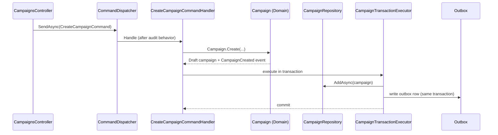
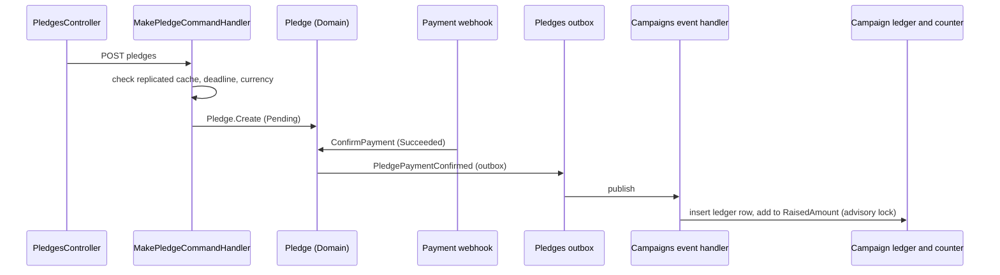
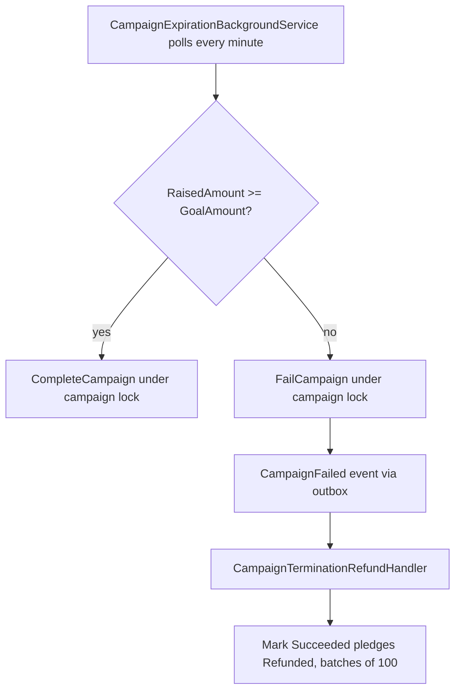
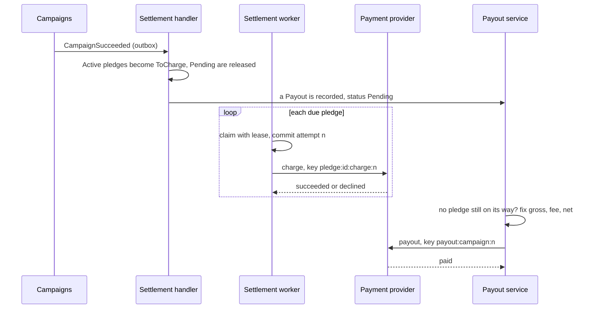
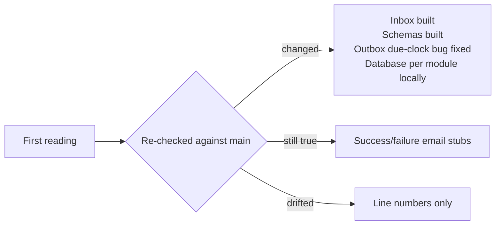

# Design-to-Code Mapping: Round 1 (Crowdfunding Platform)

> **Purpose:** show a learner, step by step, where each Round 1 system-design decision lives in the `CrowdFundingHub` code, which test guards it, and where the code differs from the design.
> **Design source:** `hispeedsystem/system-design-mastery/interview-loops/04-financial-and-transactional/06-crowdfunding-platform.md` (Round 1, steps 1.0 to 1.6, plus "See It Built").
> **Method:** read from the code and tests, then re-checked after the inbox, schema and outbox changes (section 6). Line numbers drift as the code changes, so trust file and symbol names over numbers. Test names come from the test sources.
> **Status tags:** **MATCHES** (code implements the design), **SIMPLER VARIANT** (a smaller version of the design), **PARTLY BUILT** (part of the design exists, part does not), **NOT BUILT** (no code).

Paths are relative to the repo root. `CAMP` = `src/Modules/Campaigns/CrowdFunding.Modules.Campaigns`, `CONT` = `src/Modules/Pledges/CrowdFunding.Modules.Pledges`, `NOTIF` = `src/Modules/Notifications/CrowdFunding.Modules.Notifications`, `BB` = `src/BuildingBlocks/CrowdFunding.BuildingBlocks`.

## 1. Summary

| Design step | Module | Status | Guarded by |
|---|---|---|---|
| 1.1 Where the money sits for 30 days | Pledges | PARTLY BUILT (both models exist; charge-now is the default and save-then-charge is selected in configuration; the card is a reference held by a fake provider, no real provider) | `PledgeDomainTests`, `SaveThenChargeE2ETests`, `PledgeActivationGuardTests` |
| 1.2 Double-click creates two pledges | Pledges | MATCHES (optional `Idempotency-Key` header, unique index per backer and key) | `PledgeIdempotencyTests`, `PledgeIdempotencyE2ETests` |
| 1.3 The total on the page vs the pledges | Campaigns | SIMPLER VARIANT (idempotency table plus a locked counter) | `CampaignPledgeConcurrencyTests` |
| 1.4 Limited tier oversold | Campaigns | MATCHES (lock, invariant, 15-minute hold, and a database CHECK constraint) | `RewardTierConcurrencyE2ETests`, `RewardTierDatabaseGuardTests` |
| 1.5 Pledge after the deadline | Pledges, Campaigns | SIMPLER VARIANT (lock and status check inside Campaigns, plus a refund for a late confirmation; no ENDED state) | `LatePledgeTests`, `LateConfirmationRefundE2ETests` |
| 1.6 Settlement at the deadline | Campaigns, Pledges | PARTLY BUILT (charge-once settlement exists in the save-then-charge model; refunds, charges and creator payouts go through a fake payment provider); webhook inbox MATCHES | `CampaignExpirationE2ETests`, `RefundSagaE2ETests`, `SaveThenChargeE2ETests`, `PayoutE2ETests`, webhook tests |
| Outbox, event registry, dead letter | BuildingBlocks | MATCHES | `EventTypeRegistryTests`, `OutboxMessageTests`, `OutboxLeanTableE2ETests` |
| Consumer inbox | all consumers | MATCHES in part (per-module inbox; written after the handler, so a crash window remains) | `InboxRetryTests` |
| "Tell people" | Notifications | SIMPLER VARIANT | `EmailNotificationOutboxE2ETests` |

## 2. The two flows, drawn

### Create a campaign (the light path)

### Make a pledge (the heavy path)

## 3. Step by step

### Step 1.1: where the money sits for 30 days: PARTLY BUILT

- **Design:** save the card at pledge time, charge at the deadline only if funded.
- **Code:** two funding models, chosen by the setting `Payments:FundingModel`. **Charge-now** (the default): a pledge is `Pending` with a payment intent, and confirmation by webhook or a manual endpoint takes the money. **Save-then-charge**: making a pledge starts a card save at the provider and returns a client secret; `POST .../pledges/{id}/confirm-setup` stores the card reference and the pledge becomes `Active`, which counts toward the campaign but charges nothing. The activation is recorded once per pledge (table `pledge_activations`, unique index `UX_pledge_activations_one_per_pledge`), so two setup confirmations arriving together activate once.
- **Statuses:** `Pending`, `Succeeded`, `Failed`, `Refunded`, and for save-then-charge `Active`, `ToCharge`, `Charging`, `Released`.
- **Where:** `Pledges.Domain/Aggregates/Pledge.cs` and `PledgeActivation.cs`; `Pledges.Application/Features/Pledges/Commands/ConfirmPledgeSetup`; `Pledges.Infrastructure/Payments/FakePaymentProvider.cs` (the card is a reference string, and the reference picks the behaviour: `pm_ok`, `pm_decline`, `pm_decline_once`, `pm_auth_required`, `pm_timeout_once`).
- **Tests:** `PledgeDomainTests`, `SaveThenChargeE2ETests`, `PledgeActivationGuardTests`, `MakePledgeCommandHandlerTests`, `PledgeAndOutboxE2ETests`.
- **Still missing:** a real payment provider, a card entered in a browser against a real provider's script, and a reward-tier reservation tied to the card setup (a reservation still expires on its own timer).
- **Why charge-now stays the default:** it is the simpler model and every existing flow works unchanged; the cost is a refund per backer when a campaign fails, which save-then-charge avoids (it releases the promise and calls the provider for nobody).

### Step 1.2: double-click creates two pledges: MATCHES

- **Design:** an idempotency key or client-supplied pledge ID makes a retry return the first pledge.
- **Code:** `POST /api/campaigns/{id}/pledges` accepts an optional `Idempotency-Key` header (1 to 100 printable ASCII characters). The key is stored on the `Pledge` and a unique index on `(BackerId, IdempotencyKey)` where the key is not null decides races (`PledgeConfiguration.cs`, `PledgeIndexes.IdempotencyKey`). `MakePledgeCommandHandler` looks the key up first, before any campaign check, so a retry after the deadline still gets the first pledge. A retry returns `200` with `Idempotent-Replayed: true`; the same key with a different amount, currency, campaign or reward reservation is a `409`; simultaneous requests are settled by the index and the losers read the winner. `PledgeTransactionExecutor` turns that specific unique violation into `IdempotencyKeyAlreadyUsedException`.
- **One live pledge per backer per campaign (also built):** a partial unique index on `(CampaignId, BackerId)` for `Pending` and `Succeeded` pledges (`UX_pledges_one_live_pledge_per_backer`) and a check in `MakePledgeCommandHandler` refuse a second live pledge with `409`, so a backer with two tabs and two keys still gets one pledge. It ends when the pledge does (`Failed` or `Refunded`). Changing a pledge in place is not built; the message tells the backer to change or cancel the existing one. A migration check fails loudly if existing data already breaks the rule.
- **Differences from the design:** the key is optional, but without one a second request is still refused by the one-live-pledge rule; keys are scoped to the backer, not global; a retention task clears a key after `Retention:IdempotencyKeyDays` (7 by default), so a retry later than that creates a new pledge.
- **Tests:** `PledgeIdempotencyTests` (unit: replay, mismatch, retry after the campaign closed, lost race) and `PledgeIdempotencyE2ETests` (twelve simultaneous requests create one pledge; mismatch is a conflict; two backers may share a key; a malformed key is rejected).

### Step 1.3: the total vs the pledges: MATCHES (with a stored counter beside the ledger)

- **Design:** an append-only ledger. The total is derived from it, a refund is a negative compensating entry, and a decision uses the exact ledger sum, never a snapshot.
- **Code:** a table `campaign_pledges_ledger` with an entry **kind** (`Pledge` or `Refund`). A pledge is stored positive and a refund negative, enforced by a CHECK constraint (`CK_campaign_pledges_ledger_sign_matches_kind`). Each pledge can appear once per kind (unique index on `(PledgeId, Kind)`), so a redelivered event cannot count twice. A trigger (`trg_campaign_pledges_ledger_append_only`) refuses every UPDATE and DELETE, so the only way to undo an entry is another entry. Refunds reach the campaign through `PledgeRefundedApplicationEvent` and `ReversePledgeOnCampaignCommandHandler`, which writes the negative entry and lowers the balance in the same per-campaign lock as crediting and deciding.
- **The exact total decides:** `CompleteCampaignCommandHandler` and `FailCampaignCommandHandler` call `CampaignLedgerReconciliation` first. It sums the ledger, and when the stored `Campaign.RaisedAmount` disagrees it logs an error and uses the ledger total, so a drifted counter cannot fund or fail a campaign wrongly.
- **Order-independent:** a refund can be processed before the credit it reverses. The refund entry is written anyway, the balance is left alone, and the credit that arrives later finds the refund and counts nothing; the two entries cancel in the ledger. A payment refused because the campaign had ended is recorded as a pledge and its matching refund together.
- **Differences from the design:** the stored counter (`Campaign.RaisedAmount`) is kept for fast reads and is healed from the ledger at decision time instead of being removed.
- **Tests:** `CampaignLedgerTests` (unit: refund then credit in either order, double delivery, refund on a failed campaign, a drifted counter), `CampaignLedgerDatabaseGuardTests` (the sign check, the trigger and the uniqueness, with plain SQL against PostgreSQL), `RefundSagaE2ETests` (three pledges and three refunds sum to zero), `CampaignPledgeConcurrencyTests`.

### Step 1.4: limited tier oversold: MATCHES

- **Design:** serialise the claim of a limited slot, hold it for a short time.
- **Code:** a per-tier advisory lock serialises read-check-increment. The aggregate enforces `claimed + reserved <= capacity` (`CAMP.Domain/Aggregates/RewardTier.cs`, `ReserveSlot` 82-92). A reservation lasts 15 minutes (`RewardTierReservation.cs:63`), becomes a claim when payment confirms, and is released by a failure handler or a scavenger (`RewardTierReservationScavengerBackgroundService.cs`).
- **Database guard:** the same invariant is a CHECK constraint, `CK_reward_tiers_never_oversold` (claimed and reserved never negative, and together never above the capacity), so a write path that forgets the lock still cannot oversell. `RewardTierDatabaseGuardTests` writes around the aggregate and watches the database refuse.
- **Gaps:** the reservation is not tied to card setup (a saved card does not extend or confirm it), and nothing checks that a reservation belongs to the same backer and campaign.
- **Tests:** `RewardTierConcurrencyE2ETests.FiftyConcurrentReservations_AgainstFiveRemainingSlots_ShouldYieldExactlyFiveSuccesses`; `RewardTierTests`. The scavenger has no test.

### Step 1.5: pledge after the deadline: SIMPLER VARIANT (closing fence)

- **Design:** a closing fence so no pledge is accepted after the deadline and none that was accepted is left out of the funded decision. In one database that is a row lock on the campaign: every pledge write and the close job update the same row.
- **Code:** Pledges and Campaigns are separate modules with separate databases, so a row lock cannot span them. The fence is split in two. Inside Campaigns, crediting a pledge and the deadline decision take the same per-campaign advisory lock (`CampaignTransactionExecutor`), so a credit either lands before the decision and is counted in it, or arrives after and sees a campaign that is no longer published. A pledge is refused at creation when Pledges' replicated copy of the campaign shows it ended or past its deadline.
- **The gap that was closed:** a payment confirmed after the campaign ended used to throw, retry and dead-letter, and the backer was never refunded. Now `AddPledgeToCampaignCommandHandler` rejects it inside the lock with `Campaign.RejectLatePledge`, which raises `LatePledgeRejected` through the outbox, and `LatePledgeRefundHandler` in Pledges refunds the pledge. Redelivery is harmless because only a `Succeeded` pledge is refunded.
- **Differences from the design:** there is no ENDED state, because the decision happens in one step under the lock (Published to Successful or Failed), so a campaign cannot be stranded between closing and deciding. The refusal of a late pledge is compensation after the fact (an event and a refund) instead of a database error at write time, which is the price of two databases.
- **Tests:** `LatePledgeTests` (unit: rejection, no counting, refund, idempotent redelivery) and `LateConfirmationRefundE2ETests` (a confirmation accepted just as the campaign was cancelled ends refunded, uncounted and with no failed outbox rows).

### Step 1.6: settlement at the deadline: PARTLY BUILT

- **Decider:** compares the stored counter with the goal (`CampaignExpirationBackgroundService.cs:76`). The read happens before the lock; the handlers re-validate under it.
- **Refund saga:** each refund asks the payment provider to return the money (`PledgeRefunder`), then marks the pledge Refunded and keeps the provider's reference. The provider is a fake (`FakePaymentProvider`) that replays the stored answer for a repeated idempotency key. The key is per refund attempt: a retry after a timeout or a crash reuses it, so no refund is issued twice; a new attempt gets a new key only after the provider has answered "no" (a real provider replays a failed answer for a repeated key). The provider call is outside the database transaction. Tests: `PaymentProviderRefundTests`, `RefundThroughProviderE2ETests`, `RefundSagaE2ETests`.
- **Charge-once settlement (built, save-then-charge model only).** When a campaign succeeds, `PledgeSettlementHandler` moves its `Active` pledges to `ToCharge` and releases the `Pending` ones; when it fails or is cancelled, every `Pending` and `Active` pledge is `Released` and nobody is charged or refunded. `SettlementBackgroundService` claims due pledges with a lease and `FOR UPDATE SKIP LOCKED`, and `PledgeChargeService` charges each through the provider as a numbered attempt: the attempt row is committed before the provider is called, the key is `pledge:<id>:charge:<n>`, a timeout or a dead worker resumes the SAME attempt with the SAME key, and a decline starts attempt n + 1 later (three attempts, a day apart, then `Failed`). A partial unique index allows one successful attempt per pledge.
- **Creator payout (built, both models).** When a campaign succeeds, `PayoutCreationHandler` records a `Payout` (one per campaign, unique index `UX_payouts_one_per_campaign`). `PayoutService` waits until no pledge of the campaign is still `Active`, `ToCharge` or `Charging`, sums what was really charged, takes the platform fee of each pledge (`PlatformFee.ForPledge`: `PlatformFeeBps`, 500 by default, rounded to the cent; the same fee the metering handler sends, so the metered fees of a campaign equal the payout fee) and saves gross, fee and net. A check constraint, `CK_payouts_amounts_add_up`, keeps them adding up and refuses a missing amount where the status needs one. One ledger line per charged pledge and per fee goes into `payout_ledger_entries` (append-only, enforced by a trigger), and a `PaidOut` line closes the balance to zero. Only then does it call `IPaymentProvider.PayoutAsync` with the key `payout:<campaign>:<n>`; a refusal is retried an hour later under the next number. A campaign where every charge failed has nothing to pay. When the provider has paid, the payout raises `PayoutPaidApplicationEvent` through the outbox. If a pledge that the payout counted is refunded afterwards (a late payment refunded after the amounts were fixed), `PayoutService.RecordRefundsAfterPayoutAsync` writes a `ChargeRefunded` line and a `FeeReturned` line: the fixed amount is never changed, and the ledger balance goes negative by what the creator owes back. The creator, or a payments manager, reads the payout and its ledger at `GET /api/campaigns/{id}/payout`.

- **Mocked:** the payment provider (`FakePaymentProvider`). **Not built:** collecting back from the creator what the ledger says they owe after a late refund, and a payout statement document.
- **Webhook inbox: MATCHES.** Signature check, stale-timestamp rejection and dedupe by event ID (`PaymentWebhooksController.cs`, `StripeWebhookSignatureVerifier.cs`, `PaymentWebhookIdempotencyStore.cs`, table `processed_payment_webhooks`). The check and insert are a SELECT then an INSERT in one transaction, with the primary key as the backstop. A retention task deletes records older than `Retention:PaymentWebhookDays` (7 days, longer than a provider's 72-hour retries).
- **Tests:** `CampaignExpirationE2ETests`, `RefundSagaE2ETests`, `CampaignTerminationRefundHandlerTests` (idempotent on redelivery, batches), `SaveThenChargeE2ETests` (one charge per saved card, a decline retried as a new attempt, release without any charge), `PayoutE2ETests` (the payout waits for the last charge, the fee comes off, the creator is paid once, a refused payout is retried under a new key), `PayoutDatabaseGuardTests`, the webhook reconciliation tests.

### Cross-cutting: the outbox: MATCHES

- **Write:** each module's transaction executor maps domain events to outbox rows in the same transaction (`CampaignTransactionExecutor.cs:57-148`, `PledgeTransactionExecutor.cs`).
- **Drain:** `BB.Infrastructure/Outbox/ModuleOutboxProcessor.cs`, one worker for each module that has an outbox (Campaigns, Pledges, Moderation). Claim query uses `FOR UPDATE SKIP LOCKED` (`OutboxClaimQuery.cs`); batch 20, five attempts, then dead letter.
- **Registry and bus:** `EventTypeRegistry` keyed by event name and version; in-process bus by default, RabbitMQ optional.
- **Crash recovery:** the claim also takes `Processing` rows whose lease has run out, writes the lease from the application clock, and counts a reclaim as an attempt so a message that keeps killing its worker is dead-lettered (`OutboxReclaimE2ETests`).
- **Tests:** `EventTypeRegistryTests`, `OutboxMessageTests`, `OutboxLeanTableE2ETests`, `PledgeAndOutboxE2ETests`, `RabbitMqMessageBusTests`.

### Cross-cutting: consumer inbox: MATCHES IN PART

> A per-module inbox now exists: table `<module>_inbox_messages`, keyed by message ID and handler, written after the handler succeeds (`InboxRegistration.cs`, `EfInbox.cs`, `ServiceProviderEventPublisher.cs`; test `InboxRetryTests`). It is used on both transports: in process the outbox row id is the message id, and over RabbitMQ it travels as the envelope id and the consumer host sets it. For a handler that is one module transaction and carries the `IRecordsInboxInTransaction` marker, the module's transaction executor writes the row in that same transaction (test `InboxInTransactionTests`: a crash after the commit does not run it again, and two workers racing commit its work once). Every other handler is recorded after it finishes, so a crash between the two re-runs it once. The text below describes the code before that change and still explains why handlers must stay idempotent.

Before the inbox existed, there was no inbox type and no per-consumer processed-event table, and consumers relied on natural state checks, which still back the inbox up: the ledger unique index, `Pledge.Refund` only from Succeeded, reservation status checks, and upserts in the replicated cache. Handlers run one after another inside one publish, so a failure in a later handler re-runs the earlier ones.

### "Tell people": SIMPLER VARIANT

Receipts and refund or cancellation alerts are built (`NOTIF.Application/Events/NotificationEventHandlers.cs`, idempotency through an `X-Message-Id` header). Handlers for published, cancelled and review events are empty stubs, and no email is sent when a campaign succeeds or fails, so a backer is told about a refund but never that the campaign was funded.

## 4. Where the "See It Built" section overstates the code

The loop's "See It Built" section describes the reference code ahead of the code itself. These claims were not supported by the code when this page was first written, and should be corrected there (or the code brought up to them):

1. "Inboxes that make every consumer idempotent": a per-module inbox now exists, but it is written after the handler, covers both transports (the outbox row id is the message id), and a retention task prunes it.
2. "A unique key on pledge and entry kind": the unique index is on `PledgeId` alone.
3. "A check constraint ties each entry's sign to its kind": not found.
4. "A trigger rejects updates and deletes": not found.
5. "Refunds are negative compensating entries": true now. A refund writes a negative ledger entry and lowers the balance.
6. "Recomputes the raised total as a sum over the ledger": the decision recomputes it from the ledger and heals the stored counter; reads use the counter.

## 5. Gaps this mapping exposes

> Note: the schema-per-module row below was found while checking a lesson. It was checked statically (migrations and entity configurations) and has not been confirmed against a live database.

| Gap | Design step | Suggested ticket |
|---|---|---|
| ~~No idempotency on pledge creation~~ **Closed:** `Idempotency-Key` header with a unique index per backer and key | 1.2 | Done |
| ~~No closing fence; late confirmations dead-letter without refund~~ **Closed:** late confirmations are rejected under the campaign lock and refunded; no ENDED state by design | 1.5 | Done |
| ~~Outbox rows stuck in `Processing` are never reclaimed~~ **Closed:** reclaim on lease expiry, lease on the application clock, attempts bounded | outbox | Done |
| ~~Ledger lacks entry kind, sign check, trigger, refund entries~~ **Closed:** kind, sign CHECK, append-only trigger, negative refund entries, decision on the exact sum | 1.3 | Done |
| ~~Module tables are not in per-module schemas~~ **Closed:** every module has `HasDefaultSchema`, a `MoveTablesTo<Module>Schema` migration and its own history table, checked by `ModuleSchemaRulesTests` against a real database. Each module also now gets its own database in the local stack | Cross-cutting (schema per module) | Done |
| ~~No settlement charge-once mechanism, no creator payout~~ **Closed (opt-in):** save-then-charge with numbered, keyed attempts, and a payout net of the platform fee, both against a fake provider; charge-now stays the default | 1.1, 1.6 | Done; a real provider is the next step |
| No success/failure outcome email | "Tell people" | Add handlers or remove the stubs |
| Scavenger untested (outbox crash recovery is covered by `OutboxReclaimE2ETests`) | 1.4 | Add a test |

## 6. What changed since the first reading

- **Outbox stuck rows (new, fixed).** A row left in `Processing` by a crashed worker is now reclaimed once its lease runs out, and the lease is written from the application clock.
- **Outbox due-clock (new, fixed).** The claim query compared an application-set `ScheduledAtUtc` with the database's `now()`; a database clock slightly behind made just-queued rows unclaimable. It now compares against the application clock. 
- **Funding model, charge-once settlement and creator payouts (new, built against a fake provider).** See steps 1.1 and 1.6.
- **Campaign state in Pledges no longer depends on event order (new, fixed).** A "published" event handled before "created" used to be dropped, and the late "created" then stored the campaign as inactive; a redelivered "created" did the same. Now "created" only starts a row inactive and an early lifecycle event leaves a placeholder for it to complete (`CampaignCacheOrderTests`).
- **Pledge idempotency (new, built).** See step 1.2.
- **Closing fence (new, built as a simpler variant).** See step 1.5.
- **Ledger shape (new, built).** See step 1.3.
- **Success/failure email (still true).** Searches for check constraints, triggers and ledger entry kinds found nothing. The notification handlers for published, cancelled and review events are still `Task.CompletedTask`.
- **Webhook subscriptions (new).** A stale background save could re-activate a deleted subscription; fixed with an `xmin` token and covered by `WebhookSubscriptionConcurrencyTests`. It also fixed the tier assignment for that feature (stays Tier 3).
- **Tests added since the first reading:** `InboxRetryTests`, `ModuleSchemaRulesTests`, `NotificationPreferencesTier2Tests`, `WebhookSubscriptionConcurrencyTests`. See `docs/TESTS_THAT_TEACH.md`.
- **Still untested:** the reservation scavenger. Outbox crash recovery is covered by `OutboxReclaimE2ETests`.
