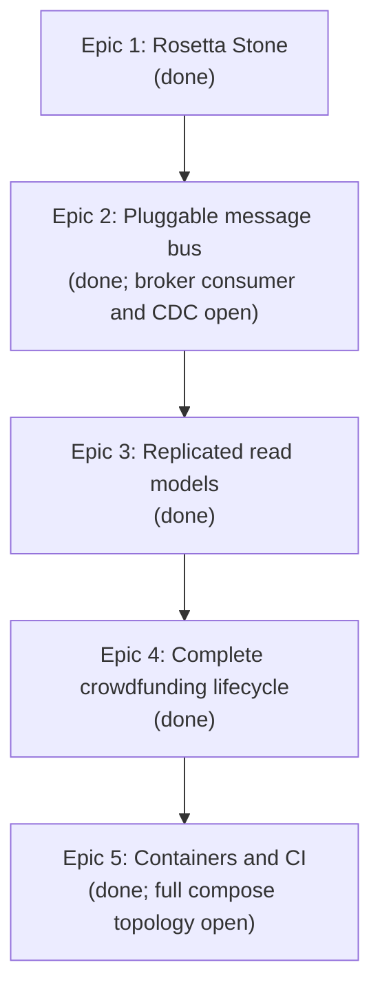

# Engineering Specification: From Monolith to Decomposition-Ready Reference

> **Document type:** roadmap, with status per item
> **Audience:** course authors and engineers extending the codebase
> **Status:** revised 2026-09-28 against the code. Epics 1, 3 and 4 are done. Epics 2 and 5 are done except for the items marked open. Each item names the code that implements it, which sometimes differs from the names first proposed here.

---

## 1. Overview



| Epic | Status | Open items |
|---|---|---|
| 1. Rosetta Stone | Done | None |
| 2. Pluggable message bus | Done in part | Broker consumer; Debezium CDC relay; Kafka provider |
| 3. Replicated read models | Done | None |
| 4. Crowdfunding lifecycle | Done | Outbound refund call to a payment provider |
| 5. Containers and CI | Done in part | API, RabbitMQ and CDC services in `docker-compose.yml` |

---

## 2. Epic 1: Rosetta Stone (done)

**Problem.** Learners could not see why the layered design costs what it costs, because the codebase had no simpler baseline.

**What was built.** `src/Samples/RosettaStone` implements "create a campaign" at three levels of ceremony:

```
src/Samples/RosettaStone/
├── 01-MinimalApiCrud/
│   └── CreateCampaignMinimalEndpoint.cs    direct DbContext write, one file
├── 02-PragmaticCqrs/
│   ├── CreateCampaignEndpoint.cs
│   ├── CreateCampaignCommand.cs            command and validator
│   └── CreateCampaignCommandHandler.cs     direct DbContext write, three files
└── 03-RichDomainModel/
    └── README.md                           points to the real POST /api/campaigns pipeline
```

The sample is its own runnable host (`dotnet run --project src/Samples/RosettaStone`, Scalar UI at `http://localhost:5090/scalar/v1`) with an isolated `rosetta` schema. The API does not reference it; `ApiHostDependencyTests` check that. Parity is covered by `RosettaStoneParityTests` (integration) and `RosettaStoneTests` (unit). See the [sample README](../../src/Samples/RosettaStone/README.md).

---

## 3. Epic 2: Pluggable message bus (done in part)

**Problem.** The outbox poller dispatched in memory only, so there was no seam for a broker.

**What was built.**

1. `IMessageBus` in `BuildingBlocks.Application/Messaging`:
   ```csharp
   public interface IMessageBus
   {
       Task PublishAsync(object applicationEvent, CancellationToken cancellationToken = default);
   }
   ```
2. Two implementations in `BuildingBlocks.Infrastructure/Messaging`: `InProcessMessageBus` (default) and `RabbitMqMessageBus`, which uses `RabbitMQ.Client` directly (not MassTransit) and publishes a CloudEvents envelope. `BaseApplicationEvent.EventId` is the outbox row id and the CloudEvents `id`.
3. Selection by configuration:
   ```json
   "Messaging": {
     "Provider": "InProcess",
     "RabbitMq": { ... }
   }
   ```
4. One `ModuleOutboxProcessor<TDbContext>` per publishing module (Campaigns, Contributions, Moderation), replacing the central poller. It claims with `FOR UPDATE SKIP LOCKED`, reclaims expired leases, backs off exponentially and dead-letters after five attempts. A commit interceptor signals it as soon as a transaction that wrote outbox rows commits; the 5-second poll is the fallback. See [outbox-architecture.md](../../docs/outbox-architecture.md).
5. An idempotent inbox (`IIdempotentConsumer`) with per-module processed-event tables, used where a consumer must run once.

**Open.**

- **Broker consumer.** RabbitMQ is publish-only. A consumer that reads the CloudEvents envelope, deduplicates through the inbox and dispatches to the existing `IEventHandler<T>` implementations is required before any module can run in its own process.
- **Debezium CDC relay.** Considered as an alternative to the polling processor (tailing the outbox tables from the PostgreSQL WAL); not implemented.
- **Kafka provider.** Not implemented; only `InProcess` and `RabbitMQ` exist.

---

## 4. Epic 3: Replicated read models (done)

**Problem.** `MakeContributionCommandHandler` called `ICampaignContributionAvailabilityReader`, implemented by Campaigns, synchronously on every pledge.

**What was built.**

1. A Contributions-owned table `active_campaigns_cache` (entity `ActiveCampaignCache`: campaign id, owner id, title, currency, `IsActive`, deadline, updated-at). Like all module tables it lives in the `public` schema; the owning module and the name separate it.
2. `ReplicatedCampaignEventHandlers` in Contributions handles `CampaignCreated`, `CampaignPublished`, `CampaignCancelled`, `CampaignSucceeded` and `CampaignFailed` application events and keeps the table current.
3. [`MakeContributionCommandHandler.cs`](../../src/Modules/Contributions/CrowdFunding.Modules.Contributions.Application/Features/Contributions/Commands/MakeContribution/MakeContributionCommandHandler.cs) reads the local table through `IActiveCampaignCacheRepository`. `ICampaignContributionAvailabilityReader` has been deleted.
4. The same pattern serves Notifications (`CampaignTitleCache`) and CampaignUpdates (`CampaignOwnerCache`). `ReplicatedReadModelBoundaryTests` guard it.

The pledge path makes no synchronous call into another module. Campaigns remains the authority on crediting: it re-checks status under the campaign's advisory lock and does not credit a campaign that has closed.

---

## 5. Epic 4: Complete crowdfunding lifecycle (done)

**Problem.** Campaigns never completed or failed, and pledges could not be refunded.

**What was built.**

1. **Deadline worker.** `CampaignExpirationBackgroundService` in `Campaigns.Infrastructure/BackgroundServices` runs every minute. It asks `ICampaignRepository.GetExpiredPublishedCampaignIdsAsync` for published campaigns past their deadline, reloads each one and dispatches:
   - `CompleteCampaignCommand` when `RaisedAmount >= GoalAmount` (`Campaign.CompleteSuccessfully`, status `Successful`, `CampaignSucceededDomainEvent`);
   - `FailCampaignCommand` otherwise (`Campaign.MarkFailed`, status `Failed`, `CampaignFailedDomainEvent`).
   The domain events become `CampaignSucceededApplicationEvent` and `CampaignFailedApplicationEvent` in the Campaigns outbox.
2. **Refunds.** `ContributionStatus.Refunded` exists. `CampaignTerminationRefundHandler` handles `CampaignFailedApplicationEvent` and `CampaignCancelledApplicationEvent`, loads `Succeeded` contributions in batches of 100 and calls `Contribution.Refund`, which raises `ContributionRefundedDomainEvent` and, through the outbox, `ContributionRefundedApplicationEvent`.
3. **Ledger compensation.** Campaigns handles `ContributionRefundedApplicationEvent` by appending a refund entry to the append-only `campaign_ledger_entries` table; `raised_amount` is recomputed as the sum of entries. See [append-only-ledger.md](../../docs/append-only-ledger.md).

**Open.** The refund is recorded as domain state. There is no outbound refund call to a payment provider.

---

## 6. Epic 5: Containers and CI (done in part)

**What was built.**

1. **API image.** [`src/API/CrowdFunding.API/Dockerfile`](../../src/API/CrowdFunding.API/Dockerfile) is a two-stage build (`mcr.microsoft.com/dotnet/sdk:10.0` to `mcr.microsoft.com/dotnet/aspnet:10.0`) exposing port 8080.
2. **Local dependencies.** `docker-compose.yml` runs PostgreSQL 16, Redis 7 and the .NET Aspire dashboard (UI on `http://localhost:18888`, OTLP on port 4317). The API runs with `dotnet run` (`http://localhost:5076`) and applies migrations automatically in Development.
3. **CI.** [`.github/workflows/ci.yml`](../../.github/workflows/ci.yml) runs on pushes and pull requests to `main`: restore, `dotnet format --verify-no-changes`, Release build with `/warnaserror`, then architecture, unit and Testcontainers integration tests, with test reports published.

**Open.**

- `docker-compose.yml` does not run the API, RabbitMQ or a CDC connector, so "clone and `docker compose up`" does not yet start the whole system.
- A multi-service topology belongs to the extraction step. A proof of concept exists on the branch `future/microservices-extraction`; see [deconstruction-walkthrough.md](deconstruction-walkthrough.md).
