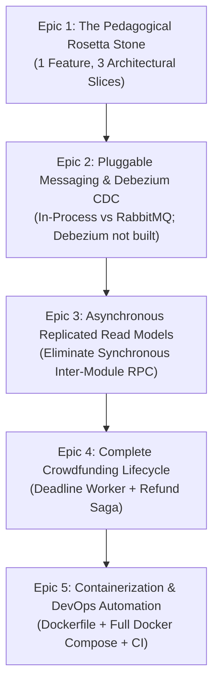

# Engineering Specification: Transforming the Monolith into a Benchmark Educational Reference

> **Document Status:** Ready for Sprint Planning & Implementation  
> **Target Audience:** Core Engineering Team, Principal Architects  
> **Objective:** Concrete technical specifications to transform `CrowdFundingHub` into the industry-gold-standard reference for **Monoliths Built for Frictionless Microservices Decomposition**.

> **Ticket references.** The `TICKET-0xx` names in this document identify the work items behind each change. The ticket text itself is not kept in this repository.

---

## 1. Specification Overview & Epics



---

## 2. Epic 1: The Pedagogical Rosetta Stone (Status: ✅ Completed via `TICKET-028`)

### Problem Statement:
Learners cannot intuitively understand *why* Clean Architecture or DDD is necessary because there is no baseline comparison in the codebase.

### Technical Specification:
Create a dedicated educational namespace: `src/Samples/RosettaStone/` implementing the **same exact feature** (`CreateCampaign`) in **three distinct architectural styles**:

The folder layout:

- `src/Samples/RosettaStone/`
  - `01-MinimalApiCrud/`
    - `CreateCampaignMinimalEndpoint.cs`: direct `DbContext` write, 1 file, 49 lines
  - `02-PragmaticCqrs/`
    - `CreateCampaignEndpoint.cs`: route endpoint
    - `CreateCampaignCommand.cs`: CQRS command and validator
    - `CreateCampaignCommandHandler.cs`: direct `DbContext` write, 3 files, 92 lines in total
  - `03-RichDomainModel/`
    - `README.md`: pointer to the full production 14-file DDD pipeline

> [!NOTE]
> Fully implemented in [`src/Samples/RosettaStone/`](../../src/Samples/RosettaStone/README.md) with isolated `rosetta` schema, parity integration tests, and Swagger tag `RosettaStone`.

---

## 3. Epic 2: Pluggable Message Bus & Debezium CDC Specification (Status: ✅ Message bus completed, Debezium CDC not built; TICKET-024 & TICKET-025)

### Problem Statement:
The transactional outbox poller is hardcoded to in-memory dispatching (`ServiceProviderEventPublisher`), preventing students from seeing how events stream to external microservices.

### Technical Specification:
1. Define a unified `IMessageBus` interface in `BuildingBlocks.Application`:
   ```csharp
   public interface IMessageBus
   {
       Task PublishAsync<TEvent>(TEvent @event, CancellationToken cancellationToken = default) 
           where TEvent : IApplicationEvent;
   }
   ```
2. Provide two interchangeable implementations:
   - `InProcessMessageBus`: Dispatches via `IServiceProvider` (default for local development).
   - `RabbitMqMessageBus`: serializes CloudEvents v1.0 to RabbitMQ using `RabbitMQ.Client` (no MassTransit, and no Kafka implementation exists).
3. Configure `appsettings.json` toggle:
   ```json
   "Messaging": {
     "Provider": "InProcess", // Options implemented: "InProcess", "RabbitMQ" ("DebeziumCDC" was specified but not built)
     "RabbitMqHost": "rabbitmq://localhost"
   }
   ```
4. **Debezium CDC Mode:** Add an `unlogged` or append-only mode where the outbox background service is disabled entirely, and a Debezium connector configuration JSON is provided in `docker/debezium/`. **Not built:** `docker/debezium/` does not exist and `Messaging:Provider` accepts only `InProcess` and `RabbitMQ`.

---

## 4. Epic 3: Asynchronous Replicated Read Models (Status: ✅ Completed via `TICKET-023`)

### Problem Statement:
[`MakeContributionCommandHandler.cs`](../../src/Modules/Contributions/CrowdFunding.Modules.Contributions.Application/Features/Contributions/Commands/MakeContribution/MakeContributionCommandHandler.cs) called a synchronous availability reader (`ICampaignContributionAvailabilityReader`, since removed), creating a distributed monolith failure cascade.

### Technical Specification:
1. In `contributions` schema, create a new table:
   ```sql
   CREATE TABLE contributions.active_campaigns_cache (
       campaign_id UUID PRIMARY KEY,
       owner_id UUID NOT NULL,
       title VARCHAR(200) NOT NULL,
       currency VARCHAR(3) NOT NULL,
       is_active BOOLEAN NOT NULL,
       deadline_utc TIMESTAMP WITH TIME ZONE NOT NULL,
       updated_at_utc TIMESTAMP WITH TIME ZONE NOT NULL
   );
   ```
2. In `Contributions.Application`, add event consumers for:
   - `CampaignPublishedApplicationEvent` $\rightarrow$ Inserts/updates `active_campaigns_cache`.
   - `CampaignCancelledApplicationEvent` $\rightarrow$ Marks `is_active = false`.
3. In `MakeContributionCommandHandler`, query `active_campaigns_cache` locally in the `ContributionsDbContext`.
4. **Outcome:** Zero synchronous cross-module RPC calls during pledge processing!

> [!NOTE]
> Fully implemented in the `Contributions` module (`ReplicatedCampaignEventHandlers` keeps the table current). The synchronous query reader `ICampaignContributionAvailabilityReader` has been removed.

---

## 5. Epic 4: Complete Crowdfunding Lifecycle (Deadlines & Refunds) (Status: ✅ Completed via `TICKET-027`)

### Problem Statement:
Campaigns never complete or fail, and backer pledges cannot be refunded, leaving the core crowdfunding domain half-finished.

### Technical Specification:

#### 1. Background Worker: `CampaignExpirationBackgroundService`
- Runs in `src/Modules/Campaigns/CrowdFunding.Modules.Campaigns.Infrastructure/BackgroundServices/CampaignExpirationBackgroundService.cs`.
- Executes every 60 seconds (configurable).
- Queries:
  ```csharp
  var expiredCampaigns = await db.Campaigns
      .Where(c => c.Status == CampaignStatus.Published && c.DeadlineUtc <= DateTime.UtcNow)
      .ToListAsync(ct);
  ```
- For each expired campaign:
  - If `CurrentBalance >= GoalAmount`: Dispatches `CompleteCampaignCommand` $\rightarrow$ transitions to `Successful` $\rightarrow$ emits `CampaignSucceededApplicationEvent`.
  - If `CurrentBalance < GoalAmount`: Dispatches `FailCampaignCommand` $\rightarrow$ transitions to `Failed` $\rightarrow$ emits `CampaignFailedApplicationEvent`.

#### 2. Refund Workflow in Contributions:
- Add `Refunded` to `ContributionStatus` enum.
- Add `ContributionRefundedDomainEvent`.
- When `CampaignFailedApplicationEvent` or `CampaignCancelledApplicationEvent` arrives:
  - Contributions module loads all `Succeeded` contributions for the campaign.
  - Iterates and executes refund commands.
  - Updates contribution status to `Refunded`.
  - Publishes `ContributionRefundedApplicationEvent`.

> [!NOTE]
> Fully implemented with `CampaignExpirationBackgroundService`, `CampaignCompletedSuccessfulDomainEvent`, `CampaignExpiredFailedDomainEvent`, and `RefundContributionCommandHandler`.
>
> Limits: the payment provider is a fake, so no real money moves, and there is no card saving or creator payout.

---

## 6. Epic 5: Containerization & DevOps Automation (Status: 🔄 In Progress - Tracked via `TICKET-029` & `TICKET-040`)

### Problem Statement:
The repository requires manual local SDK setup and lacks containerized deployment artifacts and CI/CD pipelines.

### Technical Specification:
1. **Multi-Stage API Dockerfile (`src/API/CrowdFunding.API/Dockerfile`)**:
   - Stage 1: `mcr.microsoft.com/dotnet/sdk:10.0-alpine` (Restore & Build with caching).
   - Stage 2: `mcr.microsoft.com/dotnet/aspnet:10.0-alpine` (Lightweight non-root runtime container).
2. **Comprehensive `docker-compose.yml`**:
   - `api`: The CrowdFunding API host (ports 8080/8081).
   - `postgres`: PostgreSQL 16 with logical decoding enabled (`wal_level = logical`).
   - `redis`: Redis 7 Alpine cache.
   - `rabbitmq`: RabbitMQ 3.13 Management console (port 15672).
   - `debezium`: Debezium Connect container tailing Postgres WAL.
3. **GitHub Actions Workflow (`.github/workflows/ci.yml`)**:
   - Runs on push to `main` and all Pull Requests.
   - Steps: `dotnet restore` $\rightarrow$ `dotnet build --no-restore` $\rightarrow$ `dotnet test --collect:"XPlat Code Coverage"` $\rightarrow$ Assert 0 warnings and 0 errors.
