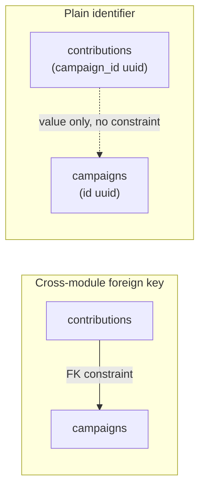
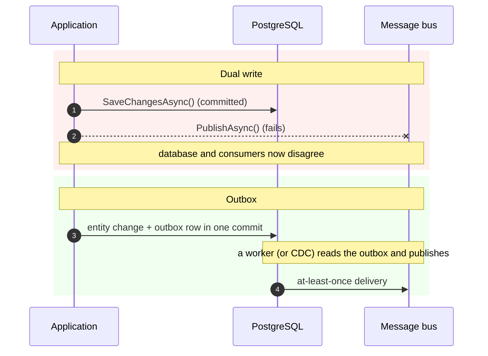
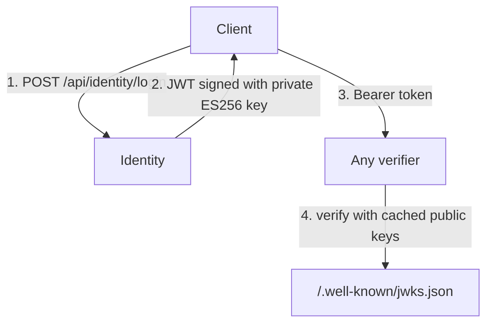
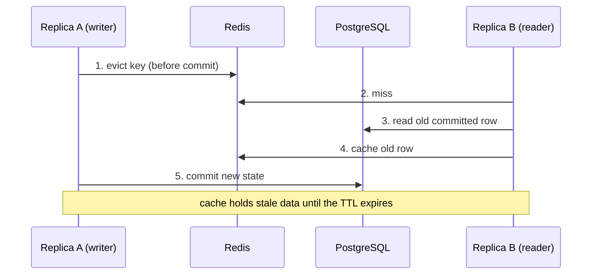

# Architect's Notes: Mental Models for Students and Tech Leads

> **Audience:** senior engineers, tech leads, architects
> **Purpose:** short, reusable mental models, each tied to where this codebase applies it

---

## 1. Coupling is the enemy, not the monolith

Splitting a tangled monolith across a network does not produce microservices. It produces a distributed monolith: the coupling stays, and network failures are added to it.

```
Tangled in-process monolith
          |
  [split across the network without fixing boundaries]
          v
Distributed monolith
(cascading timeouts, partial failures, coordinated deploys)
```

Low coupling and high cohesion can be achieved inside one executable. Here, module boundaries are enforced by project references and architecture tests while everything runs in one process.

---

## 2. Foreign keys across modules are chains

The instinct in a relational design is to link everything: `contributions.campaign_id -> campaigns.id`.



A foreign key requires both tables to live in the same database, which blocks moving one module's data elsewhere. Store the other module's id as a plain value (`Guid CampaignId`) and keep consistency with events and local read models. This codebase has no cross-module foreign keys.

---

## 3. Dual writes fail; the outbox does not

```csharp
await dbContext.SaveChangesAsync();       // 1. write to the database
await broker.PublishAsync(@event);        // 2. publish to the broker
```

This fails in three ways:
1. Step 1 commits and the broker call fails: the world never hears about the change.
2. The process dies between steps 1 and 2: same result.
3. The order is reversed and the commit then fails: the world hears about a change that never happened.



> You cannot make two independent storage systems change atomically without two-phase commit. The outbox makes the database the single source of truth and publishes afterwards, at least once.

Here: a per-module outbox table, a polling processor woken by a post-commit signal, and an inbox table for consumers that must not apply an event twice. Debezium CDC was considered and not implemented; see [`docs/outbox-architecture.md`](../../docs/outbox-architecture.md).

---

## 4. Uniform architecture is an illusion

```
+---------------------------------------------------------------------------+
| Low-risk CRUD and queries           | High-risk transactional core        |
| - drafts, profiles, lookups         | - pledges, ledger, refunds          |
| - Minimal API, direct projections   | - aggregates, locks, DB constraints |
| - optimize for speed of change      | - optimize for correct invariants   |
+---------------------------------------------------------------------------+
```

Forcing a full domain pipeline onto a lookup table is as much a mistake as a hand-written read-modify-write on a concurrent balance. The Rosetta Stone sample ([`src/Samples/RosettaStone/README.md`](../../src/Samples/RosettaStone/README.md)) shows one requirement at three tiers.

---

## 5. Sign centrally, verify locally



> With HS256 every verifier holds the signing secret and can forge tokens. With ES256 the private key stays with Identity (here encrypted at rest with AES-256-GCM), and verifiers need only the public keys from the JWKS endpoint.

---

## 6. Replicated state vs. synchronous queries

When module B needs module A's data:

| Approach | Mechanics | Coupling | Availability |
|---|---|---|---|
| Synchronous query (in-process call, HTTP, gRPC) | B asks A on every request | Temporal: B needs A to be up | If A is down, B fails too |
| Event-carried state transfer | A publishes events; B keeps a local read model | B depends on A's events, not on A being up | B keeps serving from possibly stale local data |

Here, Contributions validates pledges against its own `active_campaigns_cache`, fed by Campaigns' created/published/cancelled/succeeded/failed events, instead of calling into Campaigns. The price is eventual consistency: a pledge can be checked against a slightly stale copy, which is why the Campaigns ledger re-checks the campaign's state when it credits the pledge.

---

## 7. Databases are not queues: MVCC and outbox tables

A common outbox implementation updates each row `Pending -> Processing -> Processed` and keeps it.

In PostgreSQL an `UPDATE` writes a new row version and leaves the old one dead until vacuum removes it. Each status change is a dead tuple, and a table that keeps every processed row grows without bound. Under sustained load, autovacuum falls behind and table and index bloat follow.

```
Status-flag outbox: insert -> update (Processing) -> update (Processed), row kept forever
Lean outbox:        insert -> claim (one update) -> DELETE on success
```

> Delete outbox rows once they are delivered. Move repeated failures to a dead-letter table. Keep only pending work in the table the worker scans.

Here, `ModuleOutboxProcessor<TDbContext>` claims rows (one update, with a lease), deletes them on success, and moves a row to a dead-letter table after five attempts.

---

## 8. Stateless tokens cannot be revoked on their own

Offline JWT verification is fast because it needs no lookup, which also means a token stays valid until it expires, even after logout or compromise.

```
Pure stateless JWT:  no lookup per request, no revocation before expiry
Server sessions:     instant revocation, a store lookup per request
```

The middle ground used here:
1. Short-lived access tokens (15 minutes by default).
2. Refresh token rotation: each refresh revokes the presented token; presenting a revoked one is treated as reuse and revokes all of the user's sessions.
3. A security-stamp revocation list in Redis. Every token carries a security-stamp claim, and on each authenticated request the API checks that stamp against Redis (a key lookup, not a database read). Entries live only as long as an access token can.

The trade-off is explicit: every request now depends on Redis. An extracted service verifying tokens from JWKS alone would lose immediate revocation unless it performs the same check.

---

## 9. Cross-cutting concerns belong in the pipeline

Injecting an audit repository, a validator and a logger into every handler duplicates code and guarantees that a new handler will forget one of them.

> Put cross-cutting behavior in the command dispatcher pipeline (a decorator around every handler). Keep handlers about business logic.

Here, `ValidationPipelineBehavior` runs every FluentValidation validator for a command before its handler (endpoints never validate by hand), and `AuditLoggingPipelineBehavior` records commands marked `[AuditableAction]` in `system.audit_records`. Domain code signals rule violations with its own exceptions (`BusinessRuleViolationException`, `DomainConflictException`), and one `ExceptionClassifier` maps exceptions to HTTP status codes in a single place.

---

## 10. Evict caches after commit, not before

Production runs several replicas. If a writer evicts a cache key before its transaction commits, a reader on another replica can miss the cache, read the old committed row, and repopulate the cache with stale data.



> Evict after the transaction commits. If replicas also keep in-process caches, broadcast the invalidation.

Here, Campaigns repositories call `EnqueueCacheInvalidation` during the transaction and `CampaignTransactionExecutor` removes those keys from the shared Redis cache only after the commit succeeds (`CampaignCachePostCommitInvalidationTests`). For per-replica in-memory state, such as the cached signing keys, Redis Pub/Sub broadcasts invalidations (`SigningKeyMultiReplicaInvalidationE2ETests`), with a periodic refresh bounding staleness if a message is missed.

---

## 11. Ten rules for a decomposition-ready monolith

1. Do not reference another module's Domain, Application or Infrastructure assembly.
2. Cross module boundaries only through Contracts: commands, queries and application events.
3. Give each module its own DbContext, its own tables and its own connection string. (Separate schemas for the tables go further; this codebase does not do that yet.)
4. Never declare a foreign key across module boundaries.
5. Never dual-write to a database and a broker; use an outbox.
6. Sign tokens asymmetrically and publish public keys through JWKS.
7. Do not route queries through write repositories; project directly to DTOs.
8. Size each feature to its risk: keep CRUD simple, reserve rich domain models for real invariants.
9. Enforce boundaries in CI with architecture tests.
10. Aim for extraction that does not rewrite business logic, and verify that claim with a real extraction (the next course step) rather than assuming it.
