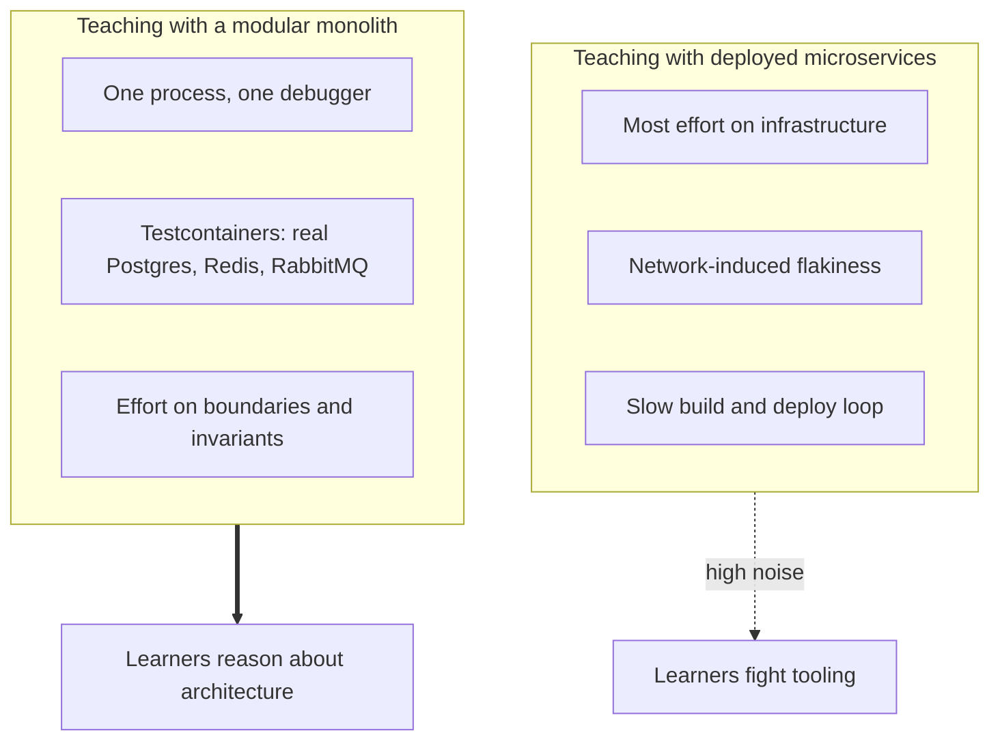

# Learning Matrix: What the Modular Monolith Teaches

> **Audience:** senior engineers, tech leads, architects, instructors
> **Reference system:** CrowdFunding Hub (.NET 10, C# 14, PostgreSQL 16)
> **How to use this page:** each lesson names the trap, what the codebase does about it, and the code and tests to read.

---

## 1. Why learn distributed-systems problems in a modular monolith

Teaching distributed systems only with deployed microservices spends most of the learner's attention on containers, networking, configuration and cloud cost. Teaching with a plain CRUD monolith avoids that, but also avoids the real problems: replication and eventual consistency, dual writes, token verification across services, idempotent consumers.

A modular monolith sits between the two. The problems are present (module boundaries, outbox and inbox, replicated read models, asymmetric tokens), but everything runs in one process, one debugger session and one test run. Integration tests use Testcontainers (PostgreSQL, Redis, RabbitMQ), so they run against real infrastructure without a cloud account.

The limit is equally important to teach: in-process modules never experience real network partitions. The extraction step (next in the course; proof of concept on branch `future/microservices-extraction`) is where those appear.

---

## 2. Lessons

### Lesson 1: Choosing a pattern per feature

- **Trap:** either every insert gets the full pipeline (endpoint, command, validator, handler, repository interface and implementation, aggregate, event, configuration, outbox), or no abstractions at all.
- **In this codebase:** the Rosetta Stone sample implements one requirement three ways: Tier 1 (Minimal API CRUD), Tier 2 (pragmatic CQRS), and Tier 3 (the production `POST /api/campaigns`). Its README has the measured file and line counts for each tier.
- **Read:** [`src/Samples/RosettaStone/README.md`](../../src/Samples/RosettaStone/README.md), [`tests/IntegrationTests/CrowdFunding.IntegrationTests/RosettaStoneParityTests.cs`](../../tests/IntegrationTests/CrowdFunding.IntegrationTests/RosettaStoneParityTests.cs), [`poly-pattern-architecture.md`](../01-architecture-paradigms/poly-pattern-architecture.md).
- **Takeaway:** decide the tier by two questions: must another module react reliably, and can concurrent writes corrupt the data?

### Lesson 2: Storage-engine mechanics behind the outbox

- **Trap:** an outbox that flips each row `Pending -> Processing -> Processed` and keeps it. In PostgreSQL every update leaves a dead tuple, and a table that never shrinks bloats and slows the claim query.
- **In this codebase:** `ModuleOutboxProcessor<TDbContext>` claims with `FOR UPDATE SKIP LOCKED`, reclaims rows whose lease expired, deletes rows on success, backs off exponentially, and moves a row to a dead-letter table after five attempts. A post-commit signal wakes the processor; the 5-second poll is only a fallback.
- **Read:** [`ModuleOutboxProcessor.cs`](../../src/BuildingBlocks/CrowdFunding.BuildingBlocks.Infrastructure/Outbox/ModuleOutboxProcessor.cs), [`OutboxCommitSignalInterceptor.cs`](../../src/BuildingBlocks/CrowdFunding.BuildingBlocks.Infrastructure/Outbox/OutboxCommitSignalInterceptor.cs), [`OutboxLeanTableE2ETests.cs`](../../tests/IntegrationTests/CrowdFunding.IntegrationTests/OutboxLeanTableE2ETests.cs), [`OutboxSignalE2ETests.cs`](../../tests/IntegrationTests/CrowdFunding.IntegrationTests/OutboxSignalE2ETests.cs), [`docs/outbox-architecture.md`](../../docs/outbox-architecture.md).
- **Takeaway:** a pattern's cost depends on the storage engine underneath it.

### Lesson 3: Revoking stateless tokens

- **Trap:** adopting JWKS-verified JWTs and discovering that a logged-out or compromised token stays valid until it expires.
- **In this codebase:** 15-minute ES256 access tokens; refresh token rotation where reuse of a rotated token revokes all of the user's sessions; a Redis security-stamp revocation list checked on every authenticated request.
- **Read:** [`RefreshAccessTokenCommandHandler.cs`](../../src/Modules/Identity/CrowdFunding.Modules.Identity.Application/Features/Users/Commands/RefreshAccessToken/RefreshAccessTokenCommandHandler.cs), [`RedisSecurityStampRevocationStore.cs`](../../src/Modules/Identity/CrowdFunding.Modules.Identity.Infrastructure/Services/RedisSecurityStampRevocationStore.cs), [`RefreshTokenRotationE2ETests.cs`](../../tests/IntegrationTests/CrowdFunding.IntegrationTests/RefreshTokenRotationE2ETests.cs).
- **Takeaway:** immediate revocation costs a shared lookup per request; decide explicitly where you pay it.

### Lesson 4: Multiple replicas and cache eviction

- **Trap:** treating the monolith as one server. With several replicas, evicting a cache key before commit lets another replica re-cache the old value.
- **In this codebase:** Campaigns enqueues cache keys during the transaction and `CampaignTransactionExecutor` removes them from Redis only after commit. Per-replica in-memory state (cached signing keys) is invalidated across replicas with Redis Pub/Sub. SignalR uses a Redis backplane.
- **Read:** [`CampaignTransactionExecutor.cs`](../../src/Modules/Campaigns/CrowdFunding.Modules.Campaigns.Infrastructure/Transactions/CampaignTransactionExecutor.cs), [`CampaignCachePostCommitInvalidationTests.cs`](../../tests/IntegrationTests/CrowdFunding.IntegrationTests/CampaignCachePostCommitInvalidationTests.cs), [`SigningKeyMultiReplicaInvalidationE2ETests.cs`](../../tests/IntegrationTests/CrowdFunding.IntegrationTests/SigningKeyMultiReplicaInvalidationE2ETests.cs), [`SignalRRedisBackplaneE2ETests.cs`](../../tests/IntegrationTests/CrowdFunding.IntegrationTests/SignalRRedisBackplaneE2ETests.cs).
- **Takeaway:** a monolith must be safe to run as several replicas before it is worth splitting. (Rate limiting and the outbox wake-up signal are still per instance; see [`docs/PLATFORM_SHORTCOMINGS.md`](../../docs/PLATFORM_SHORTCOMINGS.md).)

### Lesson 5: Replicated read models instead of synchronous queries

- **Trap:** replacing in-process calls with synchronous HTTP calls between services, so one service's outage takes down the others.
- **In this codebase:** Contributions keeps its own `active_campaigns_cache`, fed by Campaigns' created, published, cancelled, succeeded and failed events, and validates pledges against it. Notifications and CampaignUpdates keep similar local caches (`campaign_title_cache`, `campaign_owner_cache`). An architecture test checks that these read models stay inside their modules.
- **Read:** [`ReplicatedCampaignEventHandlers.cs`](../../src/Modules/Contributions/CrowdFunding.Modules.Contributions.Application/Features/ActiveCampaigns/Events/ReplicatedCampaignEventHandlers.cs), [`ReplicatedReadModelResilienceTests.cs`](../../tests/IntegrationTests/CrowdFunding.IntegrationTests/ReplicatedReadModelResilienceTests.cs), [`ReplicatedReadModelBoundaryTests.cs`](../../tests/ArchitectureTests/CrowdFunding.ArchitectureTests/ReplicatedReadModelBoundaryTests.cs).
- **Takeaway:** autonomy comes from local copies of data, paid for with eventual consistency.

### Lesson 6: Strangler Fig extraction (next course step)

- **Trap:** a big-bang rewrite that freezes feature work for months.
- **Status:** not implemented on this branch; Moderation is an in-process module. The proof of concept on branch `future/microservices-extraction` adds a standalone Moderation host that references the existing Moderation projects, validates tokens against the monolith's JWKS, runs behind a Strangler Fig routing topology, and is guarded by extraction boundary tests.
- **Read:** [`monolith-to-microservices-blueprint.md`](../01-architecture-paradigms/monolith-to-microservices-blueprint.md), [`deconstruction-walkthrough.md`](../03-engineering-spec-and-roadmap/deconstruction-walkthrough.md).
- **Takeaway:** a well-bounded module can be moved to its own host without changing its domain and application code. The surrounding work (a broker consumer, data migration, routing, deployment) is still real work.

### Lesson 7: Cross-cutting behavior in the command pipeline

- **Trap:** validation, auditing and logging copied into each handler, and forgotten in the next one.
- **In this codebase:** `ValidationPipelineBehavior` runs all FluentValidation validators for a command before its handler (outermost behavior; endpoints never validate by hand; queries are not validated by the pipeline). `AuditLoggingPipelineBehavior` records commands marked `[AuditableAction]` in `system.audit_records`. Domain code throws its own exceptions (`BusinessRuleViolationException` for 400, `DomainConflictException` for 409), and `ExceptionClassifier` maps all exceptions to RFC 9457 problem responses in one place.
- **Read:** [`ValidationPipelineBehavior.cs`](../../src/BuildingBlocks/CrowdFunding.BuildingBlocks.Application/Validation/ValidationPipelineBehavior.cs), [`AuditLoggingPipelineBehavior.cs`](../../src/BuildingBlocks/CrowdFunding.BuildingBlocks.Application/Audit/AuditLoggingPipelineBehavior.cs), [`ExceptionClassifier.cs`](../../src/BuildingBlocks/CrowdFunding.BuildingBlocks.Infrastructure/ErrorHandling/ExceptionClassifier.cs), [`AuditLoggingE2ETests.cs`](../../tests/IntegrationTests/CrowdFunding.IntegrationTests/AuditLoggingE2ETests.cs).
- **Takeaway:** governance that must apply to every command belongs in the pipeline, not in each handler.

### Lesson 8: Architecture tests as fitness functions

- **Trap:** a clean boundary diagram that erodes under deadline pressure.
- **In this codebase:** architecture tests inspect compiled assembly references by reflection (no NetArchTest): every module has four layers, cross-module references go only to Contracts, Domain assemblies reference only `BuildingBlocks.Domain`, Contracts reference no internals, and the API host references no sample code and has exactly one controller. They run in CI before unit and integration tests.
- **Read:** [`ModuleBoundaryConventionTests.cs`](../../tests/ArchitectureTests/CrowdFunding.ArchitectureTests/ModuleBoundaryConventionTests.cs), [`ApiHostDependencyTests.cs`](../../tests/ArchitectureTests/CrowdFunding.ArchitectureTests/ApiHostDependencyTests.cs), [`tests/ArchitectureTests/CrowdFunding.ArchitectureTests/README.md`](../../tests/ArchitectureTests/CrowdFunding.ArchitectureTests/README.md).
- **Takeaway:** boundaries that are not tested are suggestions.

### Lesson 9: When the outbox is justified

- **Trap:** adding an outbox to writes that only touch internal tables, or leaving it out of writes that call external systems.
- **In this codebase:** the outbox, inbox and task tables sit where a side effect leaves the database: e-mail, payment webhook reconciliation, media-analysis callbacks, reward-tier inventory, outbound creator webhooks.
- **Read:** [`justifying-the-outbox-and-complex-crud.md`](../01-architecture-paradigms/justifying-the-outbox-and-complex-crud.md), [`EmailNotificationOutboxE2ETests.cs`](../../tests/IntegrationTests/CrowdFunding.IntegrationTests/EmailNotificationOutboxE2ETests.cs), [`PaymentGatewayWebhookReconciliationE2ETests.cs`](../../tests/IntegrationTests/CrowdFunding.IntegrationTests/PaymentGatewayWebhookReconciliationE2ETests.cs), [`InboxIdempotencyE2ETests.cs`](../../tests/IntegrationTests/CrowdFunding.IntegrationTests/InboxIdempotencyE2ETests.cs), [`MediaAnalysisWebhookE2ETests.cs`](../../tests/IntegrationTests/CrowdFunding.IntegrationTests/MediaAnalysisWebhookE2ETests.cs), [`RewardTierConcurrencyE2ETests.cs`](../../tests/IntegrationTests/CrowdFunding.IntegrationTests/RewardTierConcurrencyE2ETests.cs), [`WebhookSubscriptionE2ETests.cs`](../../tests/IntegrationTests/CrowdFunding.IntegrationTests/WebhookSubscriptionE2ETests.cs).
- **Takeaway:** the outbox bridges a database transaction and an effect outside it; inside one transaction it is overhead.

### Lesson 10: Per-module connection strings

- **Trap:** one hard-coded connection string for the whole application, discovered only when someone tries to move a module's data.
- **In this codebase:** each module resolves `ConnectionStrings:{Module}Db` (for example `CampaignsDb`) and falls back to `DefaultConnection`. All modules can share one PostgreSQL instance today, and a module can be pointed at another database by configuration alone. Moving its existing data is a separate migration, and because module tables share the `public` schema, that means moving named tables rather than dumping a schema.
- **Read:** [`ConfigurationExtensions.cs`](../../src/BuildingBlocks/CrowdFunding.BuildingBlocks.Infrastructure/Configuration/ConfigurationExtensions.cs), [`MultiDatabaseConnectionDecouplingTests.cs`](../../tests/IntegrationTests/CrowdFunding.IntegrationTests/MultiDatabaseConnectionDecouplingTests.cs).
- **Takeaway:** decouple deployment topology from code through configuration, and be honest about the data migration that remains.

### Lesson 11: Invariants enforced by the database

- **Trap:** a mutable running total (`raised_amount`) guarded only by application code, where any missed code path or retry can double-count.
- **In this codebase:** each pledge and refund appends a row to `campaign_ledger_entries`. A unique key on (contribution, kind) makes credits idempotent; triggers reject any `UPDATE` or `DELETE` of entries and any `raised_amount` that is not the sum of the entries. A per-campaign advisory lock still serializes cancel against pledge.
- **Read:** [`docs/append-only-ledger.md`](../../docs/append-only-ledger.md), [`CampaignLedger.cs`](../../src/Modules/Campaigns/CrowdFunding.Modules.Campaigns.Infrastructure/Persistence/Repositories/CampaignLedger.cs), [`CampaignLedgerTests.cs`](../../tests/IntegrationTests/CrowdFunding.IntegrationTests/CampaignLedgerTests.cs), [`ContributionConcurrencyTests.cs`](../../tests/IntegrationTests/CrowdFunding.IntegrationTests/ContributionConcurrencyTests.cs).
- **Takeaway:** when a rule protects money, have the database enforce it, so a bug in code produces an error instead of wrong data.

---

## 3. What each role should take away

| Role | Takeaways |
| :--- | :--- |
| **Senior engineers** | Choosing a tier per feature (Rosetta Stone). Dual writes and how the outbox and inbox remove them. Integration tests against real PostgreSQL and Redis with Testcontainers. Minimal APIs next to one controller for comparison ([`docs/minimal-apis-vs-controllers.md`](../../docs/minimal-apis-vs-controllers.md)). |
| **Tech leads** | Enforcing boundaries with architecture tests. Validation and error mapping in one place. Replicated read models and their consistency cost. |
| **Staff and principal engineers** | PostgreSQL MVCC and outbox table design. Token revocation trade-offs. Post-commit cache eviction and per-instance state across replicas. Database-enforced invariants for money. |
| **Architects** | What a modular monolith must have before extraction, what extraction still costs (broker consumer, data migration, routing), and the remaining limitations listed in [`docs/PLATFORM_SHORTCOMINGS.md`](../../docs/PLATFORM_SHORTCOMINGS.md) and [`docs/TRADE_OFFS_AND_LIMITATIONS.md`](../../docs/TRADE_OFFS_AND_LIMITATIONS.md). |

---

## 4. Summary

> Build the monolith first, with module-owned data, contract-only references, an outbox for effects that leave the database, and asymmetric tokens. You keep the fast feedback of one process now, and a later extraction becomes a matter of hosting, messaging and data movement rather than rewriting business logic. The next course step tests that claim on the Moderation module.
