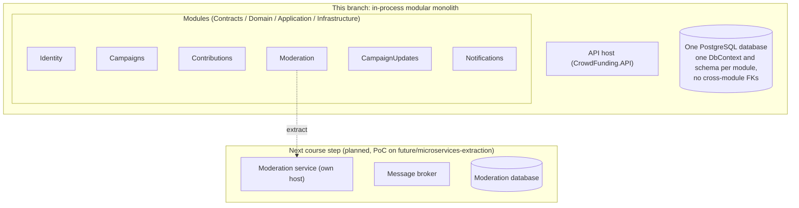

# Educational Material: Designing a Modular Monolith for Later Decomposition

> **Audience:** senior engineers, tech leads, architects
> **Reference implementation:** CrowdFunding Hub (.NET 10, C# 14, PostgreSQL 16)
> **Thesis:** build a monolith first, but give it the module boundaries, data ownership, messaging and token verification that a later microservice extraction needs, so the extraction is mostly packaging and wiring rather than a rewrite of business logic.

---

## 1. What this folder is

Most failed microservice migrations fail because the monolith was never built to be split. The usual obstacles are:

1. **Shared tables and cross-module joins or foreign keys**, so data cannot be moved without breaking queries.
2. **Synchronous in-process calls between modules**, which become cascading timeouts once they cross a network.
3. **Dual writes** (commit to the database, then publish to a broker), which lose or invent events on a crash.
4. **Symmetric token signing (HS256)**, which forces every extracted service to hold the signing secret.

This folder explains how the reference codebase addresses each of these while still running as one process, and where it deliberately stops.

### Where the codebase stands today (branch `feature/clean-arch-course`)

- Six in-process modules: Identity, Campaigns, Contributions, Moderation, CampaignUpdates, Notifications. Each has exactly four projects (Contracts, Domain, Application, Infrastructure), and other modules may reference only its Contracts project.
- One DbContext and one PostgreSQL schema per module (all its tables, outbox, inbox and migration history), no cross-module foreign keys, and a per-module connection string (`ConnectionStrings:{Module}Db`, falling back to `DefaultConnection`). Each module connects as its own database role, so PostgreSQL refuses cross-module queries; see [`docs/data-ownership.md`](../docs/data-ownership.md).
- Transactional outbox per module (Campaigns, Contributions, Moderation) with a post-commit wake-up signal, plus an inbox (`IIdempotentConsumer`) for idempotent consumers. The in-process message bus is the working mode; a RabbitMQ bus can publish but there is no broker consumer.
- ES256 JWTs with a JWKS endpoint, so a future service could verify tokens without the private key.
- Architecture tests that inspect compiled assembly references by reflection and fail the build on boundary violations.

**Microservice extraction is not implemented on this branch.** Moderation runs as an in-process module of the monolith. Extracting it is the upcoming course step. A working proof of concept (standalone Moderation host, JWKS-validated auth, a Strangler Fig compose topology, extraction boundary tests) is preserved on branch `future/microservices-extraction`.

---

## 2. Index

### [01. Architecture Paradigms](./01-architecture-paradigms/)
- [`poly-pattern-architecture.md`](./01-architecture-paradigms/poly-pattern-architecture.md): why one pattern for every feature is a mistake; four tiers (simple CRUD, read projection, rich domain model with locks, outbox-driven events) and how to pick one. Points to the runnable Rosetta Stone sample.
- [`monolith-to-microservices-blueprint.md`](./01-architecture-paradigms/monolith-to-microservices-blueprint.md): the six prerequisites for extracting a module later, what this codebase already has for each, and the extraction plan for the next course step.
- [`justifying-the-outbox-and-complex-crud.md`](./01-architecture-paradigms/justifying-the-outbox-and-complex-crud.md): when the outbox and a rich aggregate are worth their cost (external side effects such as e-mail, payment webhooks, media-analysis callbacks, reward inventory, outbound webhooks) and when they are not.

### [02. Gap Analysis and Trade-offs](./02-gap-analysis-and-tradeoffs/)
- [`over-engineering-audit.md`](./02-gap-analysis-and-tradeoffs/over-engineering-audit.md): where the codebase carries more structure than the problem needs.
- [`under-engineering-audit.md`](./02-gap-analysis-and-tradeoffs/under-engineering-audit.md): where the boundaries are still weaker than a decomposition would require.

### [03. Engineering Spec and Roadmap](./03-engineering-spec-and-roadmap/)
- [`transformation-spec.md`](./03-engineering-spec-and-roadmap/transformation-spec.md): the specification used to evolve the codebase into this teaching reference.
- [`deconstruction-walkthrough.md`](./03-engineering-spec-and-roadmap/deconstruction-walkthrough.md): the step-by-step runbook for extracting the Moderation module (the upcoming course step).

### [04. Architect's Notes](./04-architect-gold-notes/)
- [`key-mental-models-for-students.md`](./04-architect-gold-notes/key-mental-models-for-students.md): short mental models (coupling vs. deployment unit, foreign keys across modules, dual writes, MVCC and outbox tables, token revocation, pipeline behaviors, post-commit cache eviction).
- [`pedagogical-benefits-and-learning-matrix.md`](./04-architect-gold-notes/pedagogical-benefits-and-learning-matrix.md): eleven lessons the codebase teaches, each linked to the code and tests that embody it, and what each role should take away.

### Related documents outside this folder
- [`docs/data-ownership.md`](../docs/data-ownership.md): schema per module, why code-only separation is not enough, per-module database roles (what the database enforces, the owner role, pool math), the Campaigns to Moderation review-status read as the cross-module worked example, and how it maps to database per service.
- [`docs/minimal-apis-vs-controllers.md`](../docs/minimal-apis-vs-controllers.md): the API uses Minimal APIs, with one controller (`ModerationController`) kept for comparison.
- [`docs/append-only-ledger.md`](../docs/append-only-ledger.md): the campaign funding ledger and its database-enforced invariants.
- [`docs/outbox-architecture.md`](../docs/outbox-architecture.md): the outbox claim query, signal, retries and dead-lettering.
- [`src/Samples/RosettaStone/README.md`](../src/Samples/RosettaStone/README.md): one use case implemented three ways, as its own runnable host.

---

## 3. Three tenets

1. **Pragmatism over uniformity.** Size each feature by its transactional risk and its consumers. Simple CRUD stays simple; the money path gets aggregates, locks and database constraints.
2. **Boundaries before processes.** Enforce module boundaries in one process first (contract assemblies, one DbContext per module, no cross-module foreign keys, architecture tests) before paying for a network hop.
3. **Replicated state over synchronous queries.** A module that needs another module's data keeps a local read model fed by events (for example, Contributions' active-campaign cache), so it does not depend on the other module being available.
