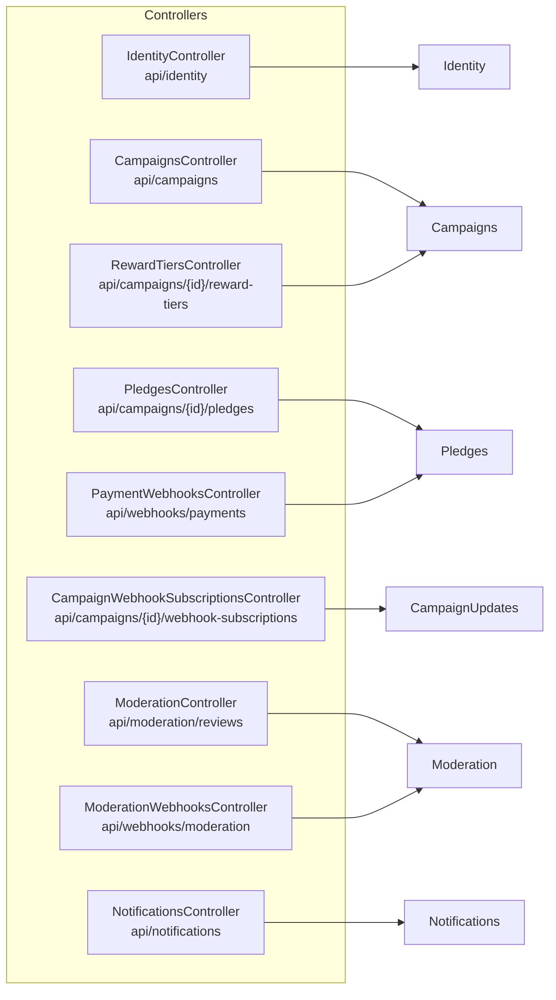
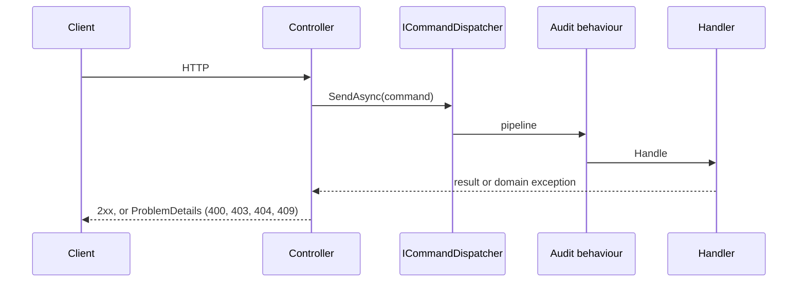

# API Controllers

## Purpose
Thin REST controllers. Each one validates the request, maps it to a command or query, sends it to the dispatcher of the owning module, and maps the result back. Business rules live in the modules, not here.

## Routes

| Controller | Routes |
|---|---|
| `IdentityController` | `POST register`, `login`, `refresh`, `logout`; `GET me`; `POST users/{userId}/roles`, `users/{userId}/permissions`, `users/{userId}/deactivate` |
| `CampaignsController` | `GET /api/campaigns` (paged, filtered), `POST /api/campaigns`, `GET {id}`, `POST {id}/publish`, `POST {id}/cancel` (owner or admin) |
| `RewardTiersController` | `POST`, `GET`, `GET {rewardTierId}`, `POST {rewardTierId}/reserve` under a campaign |
| `PledgesController` | `GET` and `GET {pledgeId}` need a token and are scoped by who is asking (a backer sees their own pledges, the campaign's owner sees the campaign's pledges without payment references, a payments manager sees all; another backer gets 404 or an empty list), `POST` (optional `Idempotency-Key` header: a retry returns the first pledge with `200` and `Idempotent-Replayed: true`, a different request under the same key is `409`, and so is a second live pledge by the same backer on the same campaign), `GET {pledgeId}`, `POST {pledgeId}/confirm-payment`, `POST {pledgeId}/fail-payment` under a campaign |
| `CampaignWebhookSubscriptionsController` | `POST`, `GET`, `GET {subscriptionId}`, `DELETE {subscriptionId}` under a campaign |
| `ModerationController` | `GET` reviews, `GET {campaignId}`, `POST {campaignId}/approve`, `POST {campaignId}/reject` |
| `NotificationsController` | `GET preferences`, `PUT preferences`, `POST unsubscribe` (Tier 2 handlers) |
| `PaymentWebhooksController` | `POST /api/webhooks/payments/stripe` (signature and timestamp checked, event id deduplicated) |
| `ModerationWebhooksController` | `POST /api/webhooks/moderation/media-analysis` (cloud-function result, signature checked) |

## Request path

Authorisation uses permission policies such as `CampaignsCreate` and `CampaignsPublish`. Known gap: deleting a webhook subscription in a race with the dispatcher returns 500 instead of 409.
