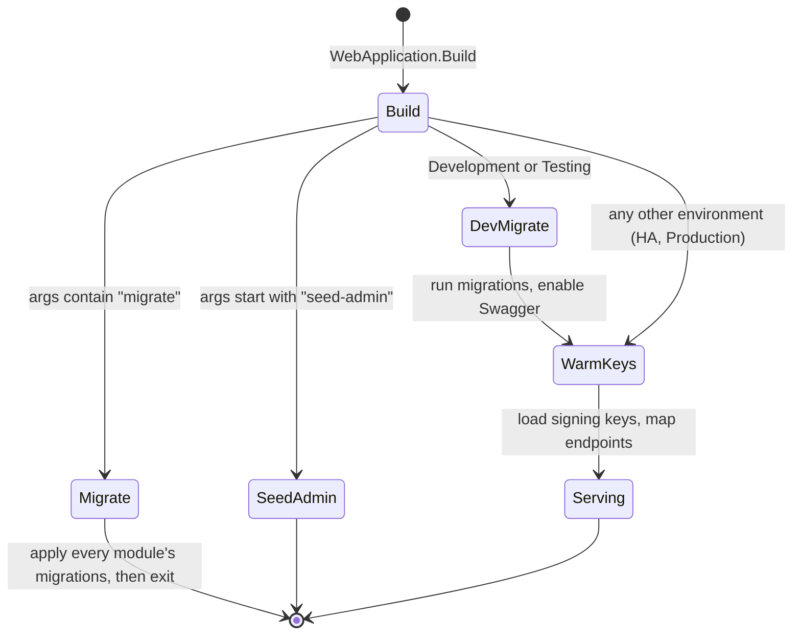
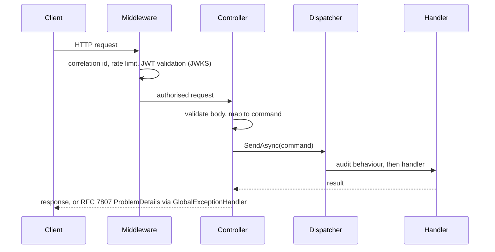

# CrowdFunding API Host

## Purpose
The primary entry-point ASP.NET Core Web API host for the modular monolith. It orchestrates cross-module dependency injection, HTTP transport routing, authentication and authorization, rate limiting, distributed correlation tracing, OpenAPI documentation, SignalR real-time hubs, and database migration lifecycles.

## Architecture & Responsibilities
Following the repository's architectural principles in `DEV_GUIDELINES.md`:
- **Thin Transport Layer**: Controllers and minimal endpoints only accept HTTP requests, validate request bodies, delegate execution to command/query dispatchers, and map responses to API contracts.
- **Decoupled Modules**: Direct module-to-domain references are forbidden; communication across boundaries occurs exclusively via contract packages (`Contracts`) and in-process application events.
- **Asymmetric Authentication (ES256)**: Validates incoming JWT tokens using ECDSA public keys published via the standard `/.well-known/jwks.json` endpoint.
- **Centralized Exception Handling**: Unhandled exceptions are converted to RFC 7807 `ProblemDetails` via `GlobalExceptionHandler`.
- **Health Probes & Metrics**: Provides `/health/live` and `/health/ready` endpoints querying EF Core `DbContext` connectivity.

## Files
- `Program.cs`: Bootstraps configuration, Serilog logging, authentication policies, modular service registration, pipeline middleware, SignalR hub mapping, health checks, and CLI command arguments.
- `appsettings.json`: Base configuration containing connection strings, JWT validation parameters, and rate limiting options.
- `appsettings.Development.json`: Per-module connection strings (`IdentityDb`, `CampaignsDb`, ... one database each) for the light local stack. Development also enables Swagger and migrates at startup.
- `appsettings.HA.json`: Multi-host connection strings (`Target Session Attributes=primary`) for the replicated stack.
- `CrowdFunding.API.http`: HTTP scratchpad for exercising API routes with VS Code / Visual Studio REST client tools.

## Subdirectories
- `Contracts`: Contains strongly typed request and response DTOs exposed over HTTP, organized by module (`Campaigns`, `Pledges`, `Identity`, `Moderation`, `Notifications`, `Common`).
- `Controllers`: Houses REST controllers for `Campaigns`, `Pledges`, `Identity`, `Moderation`, and `Notifications`.
- `Mapping`: Mapster configuration profiles mapping HTTP contracts to application commands and DTOs.
- `Middleware`: Pipeline middleware definitions and extension points.
- `Migrations`: Database migration execution (`MigrationRunner`) and out-of-band operator admin account seeding (`AdminSeeder`).
- `Observability`: Structured logging (`LoggingConfiguration`), correlation ID propagation (`CorrelationIdMiddleware`), health check writers (`HealthCheckResponseWriter`), and RFC 7807 error handling (`GlobalExceptionHandler`).
- `Properties`: Local environment launch settings (`launchSettings.json`; the API listens on `http://localhost:5076`).
- `Validation`, `Documentation`: request validation filters and OpenAPI/Swagger setup.

Outbox and webhook workers are not in the host: each module registers its own background services, for example `CampaignsOutboxBackgroundService`, `PledgesOutboxBackgroundService` and `WebhookDispatcherBackgroundService`; the shared base class is `ModuleOutboxProcessor` in `BuildingBlocks.Infrastructure`.
- `RateLimiting`: IP- and user-partitioned rate limiting policies protecting authentication and pledge endpoints (`RateLimitingConfiguration`).
- `RealTime`: SignalR hub (`CampaignHub`) and real-time push notification service (`SignalRCampaignRealtimeNotifier`).
- `Security`: Bridges HTTP authentication tokens into the domain/application `ICurrentUser` abstraction and exposes public JWKS endpoints (`JwksEndpoint`).

## Running & Operating
- **Run the API**:
  ```bash
  dotnet run --project src/API/CrowdFunding.API
  ```
- **Apply Database Migrations (CLI)**:
  ```bash
  dotnet run --project src/API/CrowdFunding.API -- migrate
  ```
- **Seed System Administrator (CLI)**:
  ```bash
  dotnet run --project src/API/CrowdFunding.API -- seed-admin admin@crowdfunding.local "Password123!" "System Administrator"
  ```

## Environments and startup



In a production-like environment such as `HA`, the API does **not** migrate itself, because several replicas racing DDL is unsafe. Run `dotnet run -- migrate` once first. If you skip it, the API fails at the signing-key warm-up with `relation "identity.identity_signing_keys" does not exist`.

| Environment | Connection strings | Migrates at startup | Start with |
|---|---|---|---|
| `Development` | `appsettings.Development.json`, one database per module on `localhost:5432` | yes | `docker compose up -d` then `dotnet run` |
| `HA` | `appsettings.HA.json`, two nodes per module on ports 6000 and up | no, run `-- migrate` | `docker compose -f docker-compose.ha.yml up -d`, then `ASPNETCORE_ENVIRONMENT=HA dotnet run -- migrate`, then `dotnet run` |

## One request through the host


