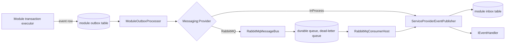

# Building Blocks: Infrastructure Layer

## Purpose
Provides shared technical implementations for persistence, transactional outbox management, domain event dispatching, and usage metering services.

## Subdirectories
- `Outbox`: `ModuleOutboxProcessor<TDbContext>` is the polling worker every module subclasses; `IOutboxDispatcher` is its contract.
- `Messaging`: `InProcessMessageBus` (default, calls the event publisher directly), `RabbitMqMessageBus` and `RabbitMqConsumerHost` (optional, `Messaging:Provider = RabbitMQ`: the host consumes a durable queue, acknowledges after the handlers finish, retries, then dead-letters to `<queue>.dead`), `CloudEventEnvelope`, `RabbitMqOptions`, `MessagingDependencyInjection`.
- `Caching`: Redis publish/subscribe for cross-replica cache invalidation.
- `Audit`: `AuditDbContext`, `EfAuditStore`, and the pipeline behaviour that records every command (its own `audit_db` in the local stack).
- `Configuration`: `GetRequiredModuleConnectionString` reads `ConnectionStrings:<Module>Db` and falls back to `DefaultConnection`.
- `Events`:
  - `InboxRegistration.cs`: `AddInbox<TDbContext>(assembly)` finds each module's handlers and binds them to that module's inbox table.
  - `ServiceProviderEventPublisher.cs`: Implements `IEventPublisher` by discovering and invoking all registered `IEventHandler<TNotification>` implementations from the ASP.NET Core `IServiceProvider`.
- `Metering`:
  - `OpenMeterClient.cs`: Implements `IUsageMeteringClient` over resilient HTTP (`Microsoft.Extensions.Http.Resilience`) targeting OpenMeter Cloud.
  - `OpenMeterOptions.cs`: Binds to configuration settings for OpenMeter endpoints and tokens.
  - `MeteringDependencyInjection.cs`: Extension methods wiring OpenMeter clients and resilient HTTP pipelines.
- `Persistence`:
  - `OutboxMessage.cs`: Persistence model representing outbox records, storing serialized JSON payloads, event discriminator, occurrence time, processed time, and error trace.
  - `OutboxClaimQuery.cs`: claims a batch with `FOR UPDATE SKIP LOCKED`; "due" is judged on the application clock, because comparing it with the database `now()` made just-queued rows unclaimable when the database clock lagged.
  - `InboxMessage.cs`, `EfInbox.cs`: per-module inbox keyed by (message id, handler).
  - `ModelBuilderExtensions.cs`: Fluent EF Core configuration extensions (`ConfigureOutbox`, `ConfigureDeadLetter`, `ConfigureInbox`) for mapping outbox and DLQ tables uniformly across modular DbContexts.
  - `DomainEventAccessor.cs`: Utility for extracting and clearing uncommitted `BaseEvent` instances from tracked aggregate roots in EF Core `ChangeTracker`.

## Message flow through this layer

