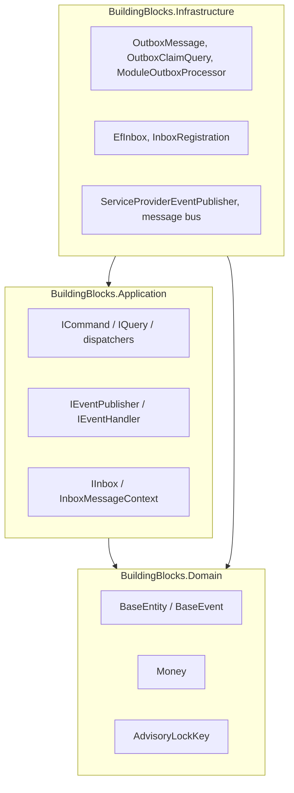
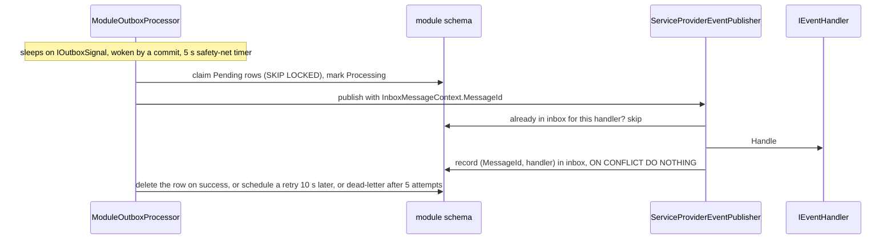

# Building Blocks Layer

## Purpose
Contains foundational, shared, cross-cutting primitives, abstractions, value objects, and infrastructure patterns utilized across all functional modules in the modular monolith.

## Architecture & Boundaries
To maintain strict clean architecture and domain isolation:
- **Zero Module Dependencies**: Building block libraries never reference any business module (`Campaigns`, `Contributions`, `Identity`, etc.).
- **Strict Inward Dependency Flow**:
  - `CrowdFunding.BuildingBlocks.Domain` has zero external dependencies.
  - `CrowdFunding.BuildingBlocks.Application` references only `BuildingBlocks.Domain`.
  - `CrowdFunding.BuildingBlocks.Infrastructure` implements application and domain contracts using concrete frameworks (EF Core, Npgsql, OpenMeter, etc.).

## Projects
- `CrowdFunding.BuildingBlocks.Domain`: Core entity bases (`BaseEntity`), domain events (`BaseEvent`), common value objects (`Money`), and concurrency locking primitives (`AdvisoryLockKey`).
- `CrowdFunding.BuildingBlocks.Application`: In-process CQRS messaging (`ICommand`, `IQuery`, `ICommandHandler`, `IQueryHandler`), event bus abstractions (`IEventPublisher`, `IEventHandler`), CloudEvents usage metering interfaces (`IUsageMeteringClient`), pagination contracts (`PageRequest`, `PagedResult`), technology-agnostic exceptions (`ConcurrencyConflictException`), and security context contracts (`ICurrentUser`).
- `CrowdFunding.BuildingBlocks.Infrastructure`: Transactional outbox persistence (`OutboxMessage`, `ModelBuilderExtensions`), domain event dispatchers (`ServiceProviderEventPublisher`), and OpenMeter HTTP metering integrations (`OpenMeterClient`).

## How the pieces fit

## Outbox to inbox, in one picture

How the worker is woken, and the alternatives (LISTEN/NOTIFY, change data capture), are compared in [`docs/EVENT_DELIVERY_APPROACHES.md`](../../docs/EVENT_DELIVERY_APPROACHES.md).

Known limits: the inbox record is written after the handler, so a crash in between runs the handler once more; the RabbitMQ path does not set a message id, so it skips the inbox; inbox rows are never pruned; an outbox row left in `Processing` by a crashed worker is reclaimed after its 30-second lease and dead-lettered after five unfinished claims.
