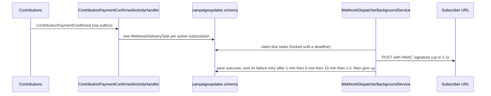
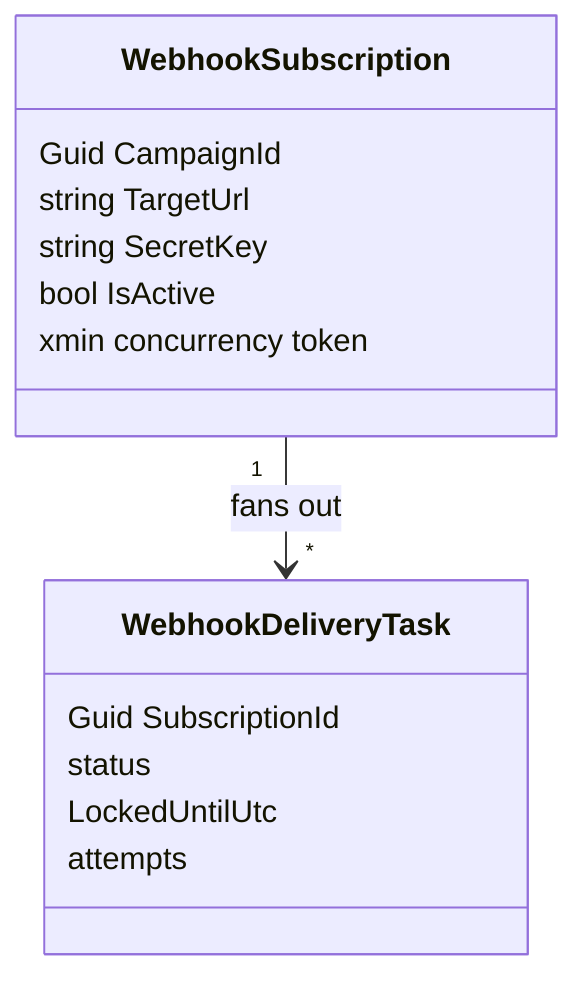

# Campaign Updates Module

## Purpose
The Campaign Updates module is the outbound webhook engine: campaign owners register a URL, and every confirmed pledge on their campaign is delivered to it, signed and retried.

## Delivery flow

## Why subscriptions are Tier 3
They looked like plain CRUD, but the dispatcher reads a subscription, makes an HTTP call, then saves it back. A stale save once re-activated a subscription the owner had just deleted. The `xmin` token fixes it and `WebhookSubscriptionConcurrencyTests` proves it. Known gap: the owner's delete request now gets an unhandled concurrency exception (HTTP 500) instead of a clean 409 in that race.

## Capabilities
- **Commands:** `RegisterWebhookSubscription`, `DeleteWebhookSubscription`.
- **Queries:** `GetWebhookSubscriptionById`, `ListWebhookSubscriptionsByCampaign`.
- **Event handlers** (`CampaignActivityEventHandlers`): the pledge handler fans out delivery tasks; the created handler upserts campaign ownership; published, cancelled and review handlers are empty stubs.

## Data and messaging

| | |
|---|---|
| Database (local stack) | `campaignupdates_db` |
| PostgreSQL schema | `campaignupdates`, with its own `__EFMigrationsHistory` |
| Poly-pattern tier | 3 (xmin on subscriptions) (see `docs/POLY_PATTERN_TIER_ASSIGNMENT.md`) |
| Outbox | none (raises no events) |
| Inbox | `campaignupdates_inbox_messages` |

## Projects & Layers
- `Domain`: `WebhookSubscription`, `WebhookDeliveryTask`.
- `Application`: command, query and event handlers.
- `Infrastructure`: `CampaignUpdatesDbContext`, repositories, HMAC signing (`Security`), `WebhookDispatcherBackgroundService`.
