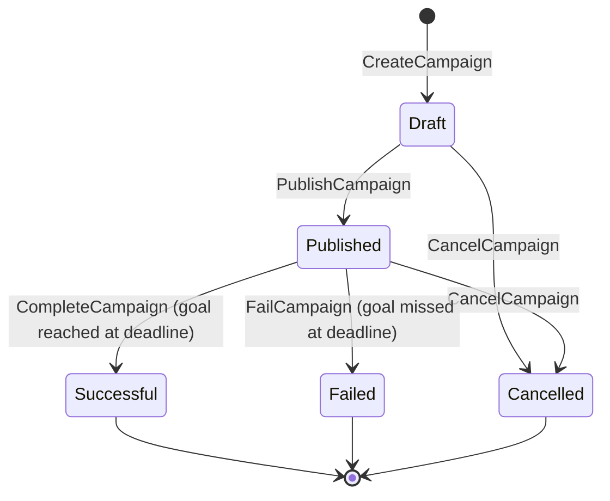
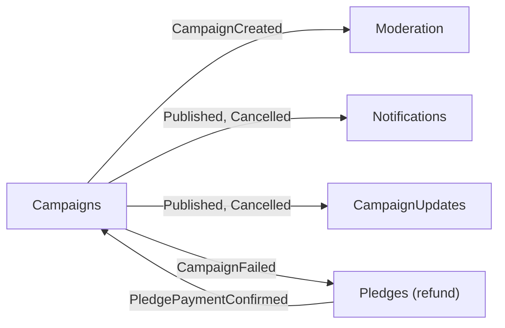

# Campaigns Module

## Purpose
The Campaigns module manages the campaign lifecycle: draft creation, publication, cancellation, reward tiers, funding totals, and the decision at the deadline.

## Lifecycle

`CampaignExpirationBackgroundService` polls for expired campaigns and sends `CompleteCampaignCommand` or `FailCampaignCommand`; both re-validate under the campaign's advisory lock.

## Who talks to whom

## Capabilities
- **Commands:** `CreateCampaign`, `PublishCampaign`, `CancelCampaign`, `CompleteCampaign`, `FailCampaign`, `CreateRewardTier`, `ReserveRewardTierSlot`, `ReleaseExpiredRewardTierReservation`.
- **Queries:** `GetCampaignById`, `ListCampaigns`, `GetRewardTierById`, `ListRewardTiersByCampaign`.
- **Event handler:** `PledgePaymentConfirmedApplicationEventHandler` credits the pledge to the campaign through a ledger with a unique key on `PledgeId` (`INSERT ... ON CONFLICT DO NOTHING`), then adds to `RaisedAmount` under a per-campaign `pg_advisory_xact_lock`, with an `xmin` token as a second guard.
- **Ledger:** `campaign_pledges_ledger` is append-only (a trigger refuses update and delete). Each entry has a kind: a pledge is positive, a refund is a negative compensating entry, enforced by a CHECK constraint, and each pledge appears once per kind. Refunds reach the campaign through `PledgeRefundedApplicationEvent`; the deadline decision uses the exact ledger sum and logs an error if the stored `RaisedAmount` has drifted from it.
- **Reward tiers:** a per-tier advisory lock serialises the read-check-increment, and a reservation lasts 15 minutes unless payment confirms; `RewardTierReservationScavengerBackgroundService` releases expired ones.
- **Caching:** `CachedCampaignReadService` with invalidation after commit.

## Data and messaging

| | |
|---|---|
| Database (local stack) | `campaigns_db` |
| PostgreSQL schema | `campaigns`, with its own `__EFMigrationsHistory` |
| Poly-pattern tier | 3 (advisory lock, xmin, ledger, events) (see `docs/POLY_PATTERN_TIER_ASSIGNMENT.md`) |
| Outbox | `campaigns` outbox, drained by `CampaignsOutboxBackgroundService` |
| Inbox | `campaigns_inbox_messages` |

## Projects & Layers
- `Domain`: `Campaign` aggregate root, `RewardTier`, `RewardTierReservation`, `PledgeLedgerEntry`, `CampaignStatus`, domain events.
- `Application`: command, query and event handlers.
- `Infrastructure`: `CampaignsDbContext`, repositories, transaction executor, caching decorators, outbox worker, background services.
- `Contracts`: commands, queries and application events shared with other modules.
