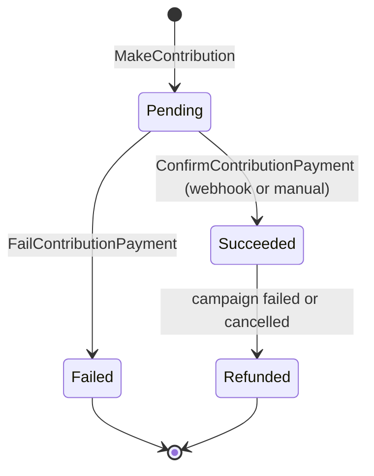
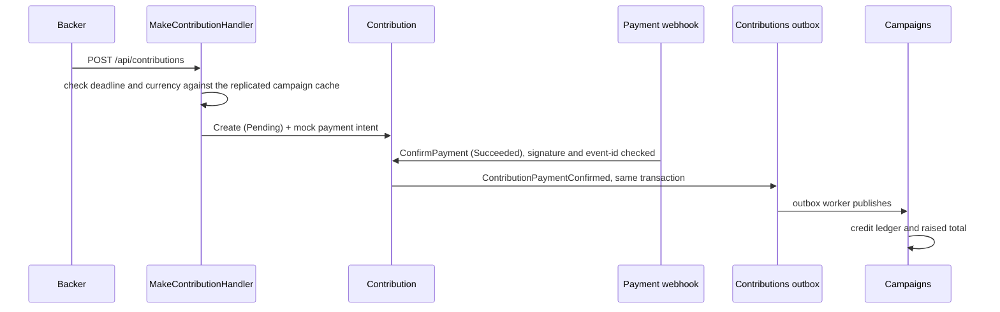

# Contributions Module

## Purpose
The Contributions module manages backer pledges, payment confirmation, refunds when a campaign fails, and usage metering. The payment gateway is a mock; no real provider is called.

## Pledge lifecycle

## A pledge, end to end

## Capabilities
- **Commands:** `MakeContribution`, `ConfirmContributionPayment`, `FailContributionPayment`, `ReconcilePaymentWebhook`.
- **Queries:** `GetContributionById`, `ListContributionsByCampaign`.
- **Event handlers:** `PledgeConfirmedMeteringEventHandler` (platform fee and CloudEvent to OpenMeter), `CampaignTerminationRefundHandler` (marks `Succeeded` pledges `Refunded` in batches of 100; state only, no gateway call), and replicated campaign read-model handlers.
- **Webhook guard:** signature check, stale-timestamp rejection and dedupe by event id in `processed_payment_webhooks`.
- **Concurrency:** `xmin` token on `Contribution` plus advisory locks.

**Not built:** an idempotency key on pledge creation, a closing fence at the deadline, and charge-once settlement. See `educational/03-engineering-spec-and-roadmap/design-to-code-mapping-round1.md`.

## Data and messaging

| | |
|---|---|
| Database (local stack) | `contributions_db` |
| PostgreSQL schema | `contributions`, with its own `__EFMigrationsHistory` |
| Poly-pattern tier | 3 (money, xmin, unique-key webhook guard, events) (see `docs/POLY_PATTERN_TIER_ASSIGNMENT.md`) |
| Outbox | `contributions` outbox, drained by `ContributionsOutboxBackgroundService` |
| Inbox | `contributions_inbox_messages` |

## Projects & Layers
- `Domain`: `Contribution` aggregate root, `ContributionStatus`, domain events.
- `Application`: command, query and event handlers.
- `Infrastructure`: `ContributionsDbContext`, repositories, transaction executor, webhook idempotency store, outbox worker.
- `Contracts`: `ContributionPaymentConfirmedApplicationEvent` and related contracts.
