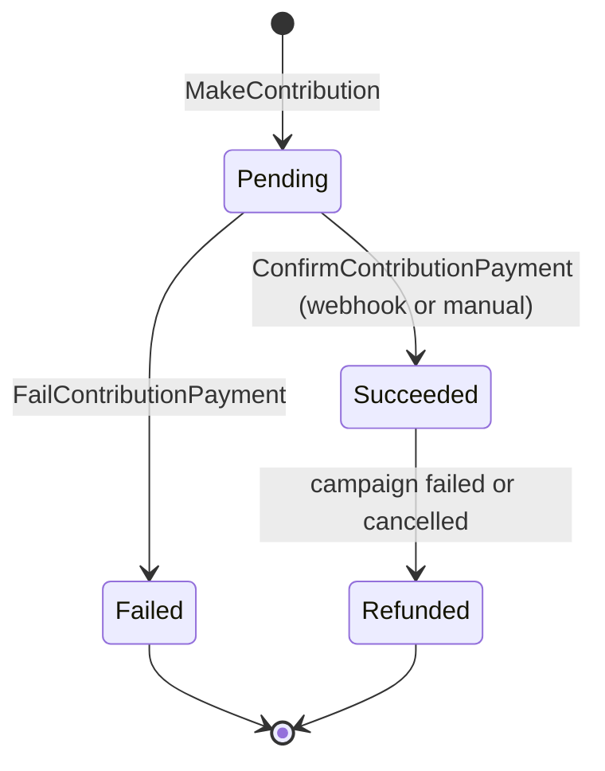
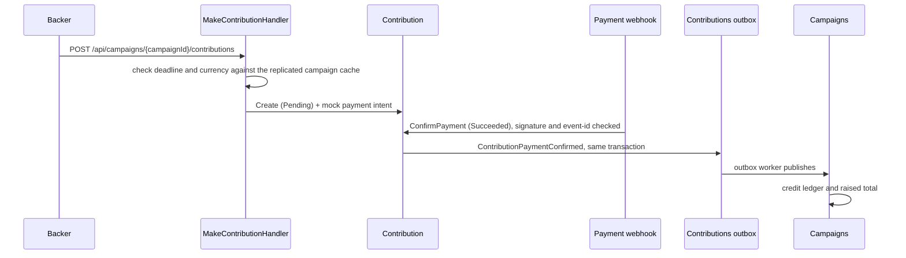
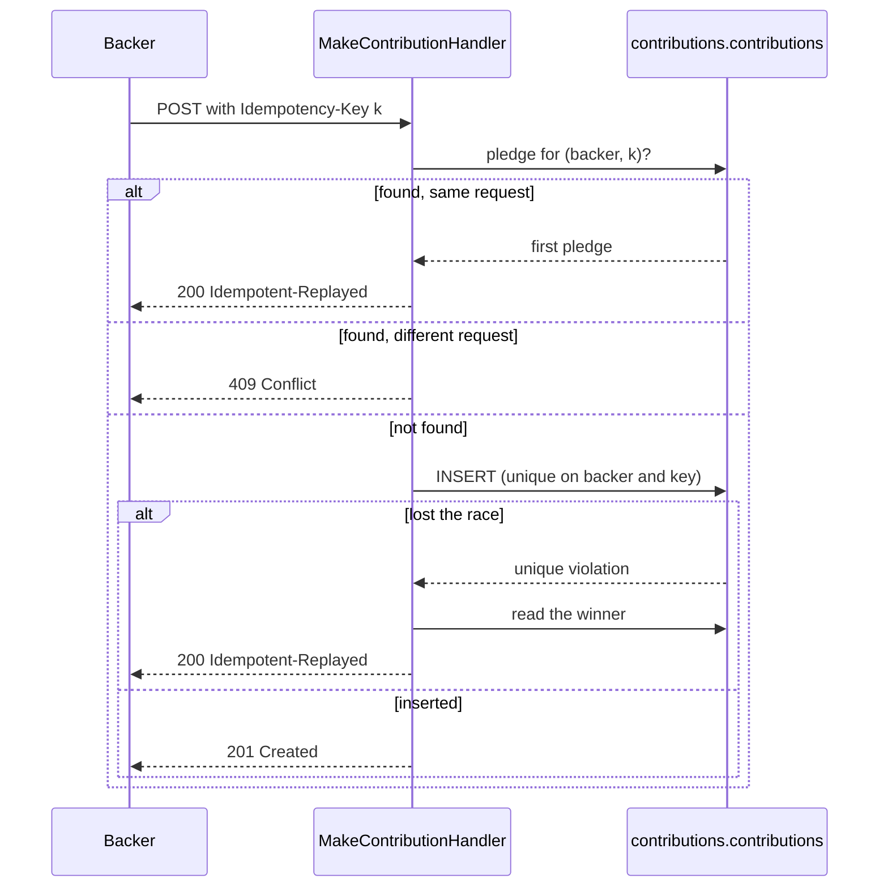

# Contributions Module

## Purpose
The Contributions module manages backer pledges, payment confirmation, refunds when a campaign fails, and usage metering. The payment gateway is a mock; no real provider is called.

## Pledge lifecycle

## A pledge, end to end

## Capabilities
- **Commands:** `MakeContribution`, `ConfirmContributionPayment`, `FailContributionPayment`, `ReconcilePaymentWebhook`.
- **Queries:** `GetContributionById`, `ListContributionsByCampaign`.
- **Event handlers:** `PledgeConfirmedMeteringEventHandler` (platform fee and CloudEvent to OpenMeter), `CampaignTerminationRefundHandler` (marks `Succeeded` pledges `Refunded` in batches of 100; state only, no gateway call), and replicated campaign read-model handlers.
- **Webhook guard:** signature check, stale-timestamp rejection and dedupe by event id in `processed_payment_webhooks`.
- **Concurrency:** `xmin` token on `Contribution`, plus a unique key on `(ContributorId, IdempotencyKey)` for retried pledges. The advisory lock that serialises crediting a campaign sits in Campaigns.

## Who can read a pledge

A pledge shows who backed what and its payment references, so the read endpoints need a token and are scoped by role.

| Caller | List pledges of a campaign | One pledge |
|---|---|---|
| No token | 401 | 401 |
| The backer | only their own | their own, in full |
| Another backer | empty list | 404 (the same answer as for an id that does not exist) |
| The campaign's owner | all, without payment references | without payment references or payment intent |
| A payments manager | all, in full | in full |

The campaign's owner comes from Contributions' own replicated copy of the campaign, so the check needs no call into Campaigns. The rules live in the query handlers (`ContributionVisibility`), so they hold whichever host serves the module.

## Safe retries

`POST /api/campaigns/{id}/contributions` accepts an optional `Idempotency-Key` header. A retry with the same key returns the first pledge (`200`, `Idempotent-Replayed: true`); the same key with a different request is a `409`; a unique index on (backer, key) decides simultaneous requests.

A retention task clears a pledge's idempotency key after `Retention:IdempotencyKeyDays` (7 by default), so the key only protects a genuine retry window and the unique index does not carry keys for ever; the pledge itself is untouched.

**Not built:** a closing fence at the deadline, and charge-once settlement. See `educational/03-engineering-spec-and-roadmap/design-to-code-mapping-round1.md`.

## Data and messaging

| | |
|---|---|
| Database (local stack) | `contributions_db` |
| PostgreSQL schema | `contributions`, with its own `__EFMigrationsHistory` |
| Poly-pattern tier | 3 (money, xmin, unique-key webhook guard, events) (see `docs/POLY_PATTERN_TIER_ASSIGNMENT.md`) |
| Outbox | `contributions` outbox, drained by `ContributionsOutboxBackgroundService` |
| Inbox | `contributions_inbox_messages` |

## Projects & Layers
- `Domain`: `Contribution` aggregate root, `ContributionStatus`, domain events.
- `Application`: command, query and event handlers.
- `Infrastructure`: `ContributionsDbContext`, repositories, transaction executor, webhook idempotency store, outbox worker.
- `Contracts`: `ContributionPaymentConfirmedApplicationEvent` and related contracts.
