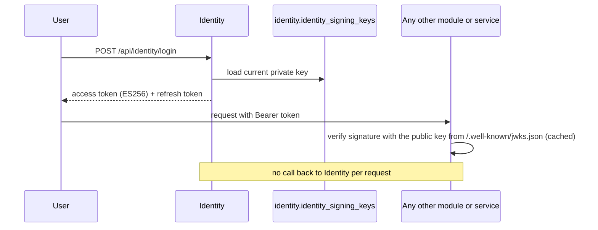

# Identity Module

## Purpose
The Identity module handles registration, password hashing, login, asymmetric ES256 JWT issuance with a public JWKS endpoint, signing-key rotation, and role and permission checks.

## Sign-in and offline verification

## Capabilities
- **Commands:** `RegisterUser`, `LoginUser`, `RefreshAccessToken` (rotation guarded by an `xmin` token on `RefreshToken`), `Logout`, `AssignRoleToUser`, `GrantPermissionToUser`, `DeactivateUser`, `SeedAdmin` (run out of band: `dotnet run -- seed-admin`).
- **Queries:** `GetCurrentUser`.
- **Roles:** `Admin`, `Moderator`, `User`, mapped to permissions such as `Campaigns.Create` by `RolePermissionCatalog`.
- **Signing keys:** stored in the module's own schema; `SigningKeyRefreshBackgroundService` keeps replicas in step.

## Data and messaging

| | |
|---|---|
| Database (local stack) | `identity_db` |
| PostgreSQL schema | `identity`, with its own `__EFMigrationsHistory` |
| Poly-pattern tier | 3 for refresh tokens (xmin); the rest need review (see `docs/POLY_PATTERN_TIER_ASSIGNMENT.md`) |
| Outbox | none (Identity raises no cross-module events today) |
| Inbox | none |

## Projects & Layers
- `Domain`: `User` aggregate root, `UserRole`.
- `Application`: login, registration and user handlers.
- `Infrastructure`: `IdentityDbContext`, password hasher, `DatabaseSigningKeyStore`, token generators.
- `Contracts`: `RoleConstants`, `PermissionConstants`, `CustomClaimTypes`.
