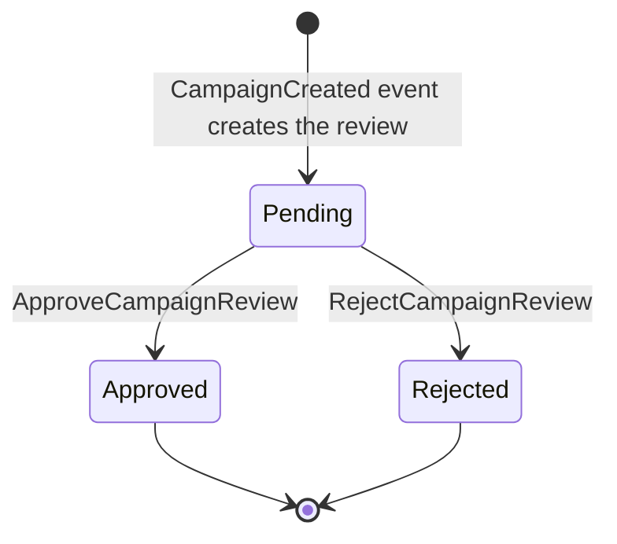
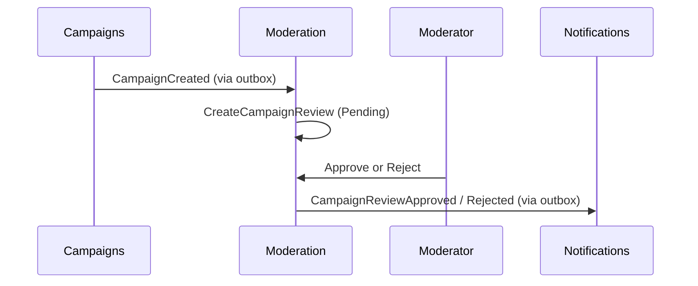

# Moderation Module

## Purpose
The Moderation module reviews newly created campaigns so that only approved ones are published, and records automated media-safety results.

## Review lifecycle

## Capabilities
- **Commands:** `CreateCampaignReview`, `ApproveCampaignReview`, `RejectCampaignReview`, `RecordMediaAnalysis` (result of the cloud-function media check, received by webhook).
- **Queries:** `GetCampaignReviewByCampaignId`, `ListCampaignReviews`.
- **Event handler:** `CampaignCreatedApplicationEventHandler`.
- **Extraction:** this module is the one demonstrated as a standalone service in `services/CrowdFunding.Moderation.Service`.

## Data and messaging

| | |
|---|---|
| Database (local stack) | `moderation_db` |
| PostgreSQL schema | `moderation`, with its own `__EFMigrationsHistory` |
| Poly-pattern tier | 3 (`CampaignReview` raises events); `RecordMediaAnalysis` is a Tier 2 candidate, not yet confirmed (see `docs/POLY_PATTERN_TIER_ASSIGNMENT.md`) |
| Outbox | `moderation` outbox, drained by `ModerationOutboxBackgroundService` |
| Inbox | `moderation_inbox_messages` |

## Projects & Layers
- `Domain`: `CampaignReview` aggregate root, `CampaignReviewStatus`, domain events.
- `Application`: command, query and event handlers.
- `Infrastructure`: `ModerationDbContext`, repositories, transaction executor, outbox worker.
- `Contracts`: review events and query contracts.
