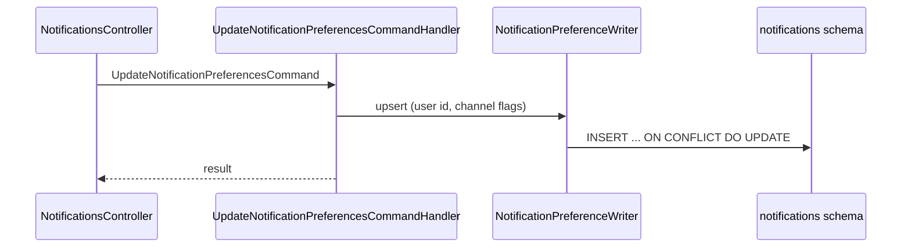

# Crowd Funding Modules Notifications Infrastructure

## Purpose
Contains infrastructure implementations for the Notifications module, including EF Core persistence, services, and transaction executors.

## Files
- `CrowdFunding.Modules.Notifications.Infrastructure.csproj`: Project file that defines dependencies, target framework, and assembly references for this area.

## Child Folders
- `DependencyInjection`: Registers notifications infrastructure services, HttpClient handlers, and repositories.
- `Persistence`: Contains `NotificationsDbContext`, EF Core entity configurations (`NotificationPreferenceConfiguration`), migrations, and repositories (`NotificationPreferenceRepository`, `CampaignTitleCacheRepository`).
- `Services`: Implements `HttpEmailNotificationService` (with RFC 8058 `List-Unsubscribe` headers, idempotency keys, and preference enforcement), `LoggingEmailNotificationService`, and `NotificationsDateTimeProvider`.

## Tier 2 preferences

`Features/Preferences` holds the handlers for `GetNotificationPreferences`, `UpdateNotificationPreferences` and `Unsubscribe`. They use `NotificationsDbContext` directly (one `INSERT ... ON CONFLICT` write through `NotificationPreferenceWriter`), with no aggregate and no repository. `NotificationsModuleDependencyTests` fails the build if they depend on anything else than the module's `DbContext` and clock.

The module also owns `notifications_inbox_messages` (migration `AddInboxMessages`) and moved its tables into the `notifications` schema (`MoveTablesToNotificationsSchema`).
