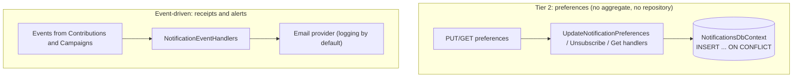

# Notifications Module

## Purpose
The Notifications module sends receipts and refund or cancellation alerts, and stores each user's notification preferences. It is the reference example of a **Tier 2** feature.

## Two shapes in one module

## Event subscriptions
- `ContributionPaymentConfirmedApplicationEvent`: sends the pledge receipt (idempotency through an `X-Message-Id` header).
- `ContributionRefundedApplicationEvent`: sends the refund alert.
- `CampaignPublishedApplicationEvent`, `CampaignCancelledApplicationEvent`, `CampaignReviewApprovedApplicationEvent`, `CampaignReviewRejectedApplicationEvent`: handlers exist but are **empty stubs** today. No email is sent when a campaign succeeds or fails.
- `ReplicatedCampaignTitleEventHandler` keeps a local copy of campaign titles so the module needs no call to Campaigns.

## Data and messaging

| | |
|---|---|
| Database (local stack) | `notifications_db` |
| PostgreSQL schema | `notifications`, with its own `__EFMigrationsHistory` |
| Poly-pattern tier | Preferences: 2 (done, `NotificationsModuleDependencyTests` enforces it); event handlers: 3 shape (see `docs/POLY_PATTERN_TIER_ASSIGNMENT.md`) |
| Outbox | none (raises no events) |
| Inbox | `notifications_inbox_messages` |

## Projects & Layers
- `Domain`: notification rules and event models.
- `Application`: event handlers and channel dispatchers.
- `Infrastructure`: `NotificationsDbContext`, the Tier 2 preference handlers (`Features/Preferences`), email transport.
