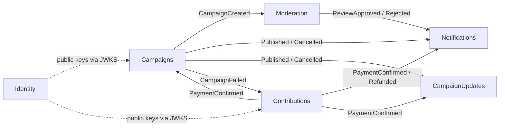
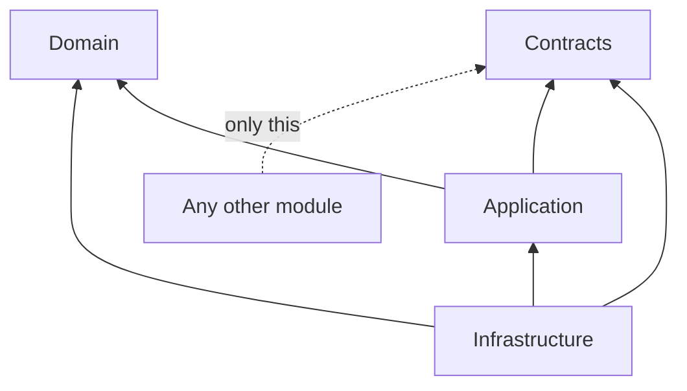

# Functional Business Modules

## Architecture Overview
The platform is organized as a **modular monolith** divided into six distinct bounded contexts. Each module maintains strict encapsulation, owning its own domain models, business logic, application orchestration, and persistence schema.

### Core Architectural Invariants
1. **Module Autonomy**: Each module owns its own database schema, tables, migrations, and Entity Framework Core `DbContext`.
2. **Decoupled Cross-Module Communication**:
   - Synchronous module-to-module queries or command invocations occur strictly via contract interfaces defined in `Contracts` assemblies. Direct references between module domain or infrastructure assemblies are prohibited and guarded by automated architecture tests.
   - Asynchronous state transitions and domain notifications are communicated via in-process application events dispatched through the transactional outbox pattern.
3. **Clean Architecture Structure**:
   - `Domain`: Enterprise invariants, aggregate roots, domain events, and value objects.
   - `Application`: CQRS command/query handlers, validation rules, current-user access checks, and service interfaces.
   - `Infrastructure`: EF Core contexts, entity configurations, repositories, caching, and external service adapters.
   - `Contracts`: Integration DTOs, cross-module commands/queries, and application events consumed by peer modules.

## Modules at a glance

| Module | Owns | Database / schema | Tier | Outbox | Inbox |
|---|---|---|---|---|---|
| Identity | users, roles, refresh tokens, signing keys | `identity_db` / `identity` | 3 | no | no |
| Campaigns | campaigns, reward tiers, contribution ledger | `campaigns_db` / `campaigns` | 3 | yes | yes |
| Contributions | pledges, payment webhooks, metering | `contributions_db` / `contributions` | 3 | yes | yes |
| Moderation | campaign reviews, media analysis | `moderation_db` / `moderation` | 3 | yes | yes |
| Notifications | preferences, receipts, alerts | `notifications_db` / `notifications` | 2 for preferences | no | yes |
| CampaignUpdates | webhook subscriptions and delivery | `campaignupdates_db` / `campaignupdates` | 3 | no | yes |

Each module has its own README with a lifecycle diagram, its message flows and its tier.

## Who reacts to whom

Solid arrows are events through the outbox and inbox; dotted arrows are token verification with no call back to Identity.

## Layering rule inside every module

`Domain` depends on nothing. `Application` depends on `Domain`. `Infrastructure` depends on both. Another module may reference only this module's `Contracts`. The architecture tests fail the build if that is broken.
