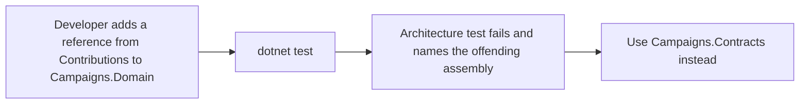

# CrowdFunding Architecture Tests

## Purpose
Executable architecture tests (plain xUnit, inspecting `Assembly.GetReferencedAssemblies()`; the NetArchTest library is not used) to enforce dependency boundaries, clean architecture invariants, and prevent layer coupling or improper cross-module references.

## Test Suites & Boundary Rules
- `CampaignsModuleDependencyTests.cs`:
  - Enforces that `API` does not directly reference `Campaigns.Domain`.
  - Asserts that `Campaigns.Domain` has no dependencies on `Campaigns.Infrastructure` or `API`.
  - Asserts that external modules only consume `Campaigns.Contracts`.
- `ContributionsModuleDependencyTests.cs`:
  - Enforces that `API` does not directly reference `Contributions.Domain`.
  - Asserts that `Contributions.Domain` has no dependencies on `Contributions.Infrastructure` or other modules.
  - Asserts that external modules interact exclusively through `Contributions.Contracts`.
- `IdentityModuleDependencyTests.cs`:
  - Enforces that `API` does not directly reference `Identity.Domain`.
  - Guarantees `Identity.Domain` contains no external framework dependencies.
  - Ensures other business modules interact solely via `Identity.Contracts`.
- `ModerationModuleDependencyTests.cs`:
  - Enforces that `API` does not directly reference `Moderation.Domain`.
  - Verifies module boundary isolation between `Moderation` and peer business modules.

- `NotificationsModuleDependencyTests.cs`: Notifications' Tier 2 handlers depend only on `NotificationsDbContext` and the module's clock, and its Infrastructure references no other module's internals.
- `CampaignUpdatesModuleDependencyTests.cs`: CampaignUpdates references no other module's Application or Infrastructure and no other module's internals.
- `ReplicatedReadModelBoundaryTests.cs`: Contributions exposes no synchronous cross-module read service for campaign availability and does not depend on Campaigns' query contract types; it uses its replicated read model instead.
- `ModerationServiceExtractionBoundaryTests.cs`: Moderation references nothing of the monolith or other modules' Application, Domain or Infrastructure, only its own module and Campaigns Contracts, so it stays extractable as a standalone service.

## What a failure looks like

Known gap: no rule yet stops a Tier 1 or Tier 2 feature from reading another module's tables with raw SQL.

## Significance in CI/CD
These tests run on every pull request to detect accidental architectural drift or shortcut references before code can be merged.
