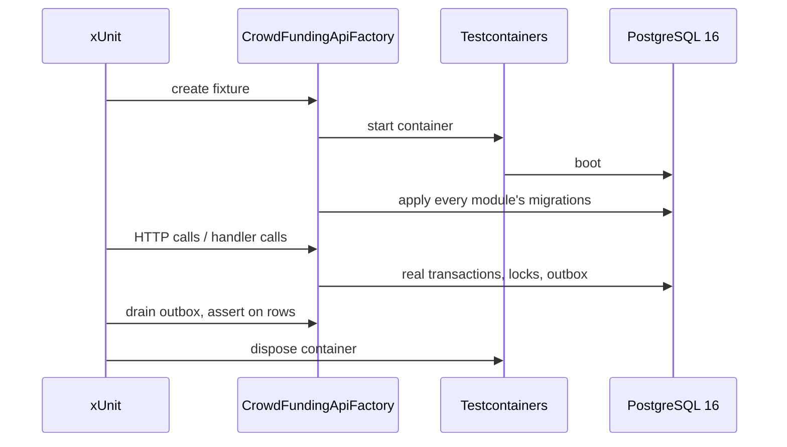

# CrowdFunding Integration Tests

## Purpose
Database-backed integration test suite executing against containerized PostgreSQL instances (`Testcontainers`), validating high-concurrency race conditions, advisory locking, optimistic concurrency tokens, and outbox event persistence.

## Test Suites & Fixtures
- `CampaignContributionConcurrencyTests.cs`:
  - `ConcurrentPledges_ShouldNotLoseUpdates`: Fires concurrent pledge confirmations in parallel against a live campaign to verify that total raised balance and contribution count never suffer lost updates.
  - `RedeliveredContribution_ShouldBeAppliedOnlyOnce`: Simulates at-least-once outbox message redelivery, verifying that duplicate event processing is discarded idempotently via the contribution ledger.
- `ContributionConcurrencyTests.cs`:
  - `ConfirmAndFail_ShouldNotBothSucceed_WhenRacingOnTheSamePendingContribution`: Fires simultaneous confirmation and failure commands against the same pending contribution to prove PostgreSQL `xmin` concurrency tokens and transaction advisory locks prevent conflicting terminal state transitions.
- `CampaignsPostgresFixture.cs`:
  - Manages a lifecycle-bound `PostgreSqlContainer` running PostgreSQL 16.
  - Automatically runs `CampaignsDbContext` EF Core migrations upon test startup.
  - Provides isolated `CampaignsDbContext` factory instances for test assertions.
- `ContributionsPostgresFixture.cs`:
  - Manages a dedicated `PostgreSqlContainer` running PostgreSQL 16.
  - Automatically runs `ContributionsDbContext` EF Core migrations upon test startup.
  - Provides isolated `ContributionsDbContext` factory instances for test assertions.

- `InboxRetryTests.cs`: a failing handler is retried; a handler that succeeded is not run twice for the same message.
- `ModuleSchemaRulesTests.cs`: each module's tables live in its own schema with its own migration history, and no foreign key crosses a schema.
- `NotificationPreferencesTier2Tests.cs`: a Tier 2 feature works end to end with no aggregate or repository.
- `WebhookSubscriptionConcurrencyTests.cs`: a stale dispatcher save cannot re-activate a deleted subscription.
- `OutboxLeanTableE2ETests.cs`, `ContributionAndOutboxE2ETests.cs`, `RefundSagaE2ETests.cs`, `PaymentGatewayWebhookReconciliationE2ETests.cs`: the outbox and the multi-module flows built on it.
- `CrowdFundingApiFactory.cs`: starts the whole API against a Testcontainers PostgreSQL for the end-to-end tests.

## How an integration test runs

## Prerequisites
Integration tests require a running Docker-compatible daemon (Docker Desktop or Colima) to spin up `testcontainers/postgresql`. See `tests/README.md` for the Colima settings.
