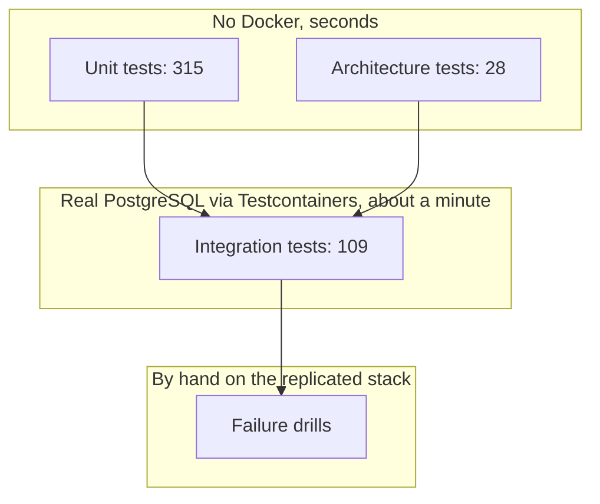

# Automated Test Suite

## Purpose
Contains automated test suites designed to safeguard software correctness, enforce architectural boundaries, verify high-concurrency invariants, and prevent regressions across the codebase.

## The layers



Which tests teach the most, which to skip, and the drill results are in [`docs/TESTS_THAT_TEACH.md`](../docs/TESTS_THAT_TEACH.md).

## Test Strategy & Categories
1. **Architecture Tests (`tests/ArchitectureTests`)**:
   - Uses plain xUnit tests that inspect referenced assemblies (reflection) to enforce architectural constraints. The NetArchTest library is not used.
   - Verifies that `API` does not bypass application boundaries to reference domain models directly.
   - Asserts that modules only communicate via `Contracts` and cannot depend on each other's internal domain or infrastructure implementations.
2. **Unit Tests (`tests/UnitTests`)**:
   - Isolated, in-memory tests running in milliseconds.
   - Uses lightweight fakes (`FakeTransactionExecutors`, `TestCurrentUser`, `TestDispatchers`) instead of database connections or network sockets.
   - Tests business rules, aggregate state transitions, command validators, CQRS handlers, outbox serialization, and OpenMeter CloudEvent mapping.
3. **Integration Tests (`tests/IntegrationTests`)**:
   - Database-backed integration tests utilizing real PostgreSQL instances via `Testcontainers`.
   - Exercises end-to-end database migrations, advisory lock concurrency, race conditions during parallel contributions, and outbox idempotency, the per-module inbox, schema isolation, and webhook concurrency.

## Running Tests
- **Run all tests**:
  ```bash
  dotnet test CrowdFunding.slnx
  ```
- **Run fast unit tests only**:
  ```bash
  dotnet test tests/UnitTests/CrowdFunding.UnitTests
  ```
- **Run architecture tests**:
  ```bash
  dotnet test tests/ArchitectureTests/CrowdFunding.ArchitectureTests
  ```
- **Run integration tests (requires a Docker-compatible runtime; with Colima export `DOCKER_HOST=unix://$HOME/.colima/default/docker.sock` and `TESTCONTAINERS_DOCKER_SOCKET_OVERRIDE=/var/run/docker.sock`)**:
  ```bash
  dotnet test tests/IntegrationTests/CrowdFunding.IntegrationTests
  ```
